# ADK Workflow Patterns: Complete Reference

> **Date:** April 11, 2026  
> **Source:** Google ADK Python framework + official ADK samples  
> **Purpose:** Every ADK workflow pattern, its architecture (Mermaid diagrams), and a working code example.

---

## Table of Contents

### Core Composition Patterns
1. [Sequential Workflow](#1-sequential-workflow)
2. [Parallel Execution (Fan-out / Fan-in)](#2-parallel-execution-fan-out--fan-in)
3. [Loop Workflow](#3-loop-workflow)
4. [Loop with Early Exit (`allow_early_exit`)](#4-loop-with-early-exit)

### Nested Patterns
5. [Sequential Inside Parallel](#5-sequential-inside-parallel)
6. [Parallel Inside Sequential](#6-parallel-inside-sequential)
7. [Parallel Inside Loop Inside Sequential](#7-parallel-inside-loop-inside-sequential)
8. [Sequential Inside Loop](#8-sequential-inside-loop)

### WorkflowAgent Patterns
9. [WorkflowAgent with Function Nodes](#9-workflowagent-with-function-nodes)
10. [WorkflowAgent with Conditional Routing](#10-workflowagent-with-conditional-routing)
11. [ParallelWorker (Fan-out Across Inputs)](#11-parallelworker-fan-out-across-inputs)
12. [Human-in-the-Loop (HITL) with RequestInput](#12-human-in-the-loop-hitl-with-requestinput)
13. [rerun_on_resume](#13-rerun_on_resume)

### Orchestration Patterns
14. [Coordinator / Orchestrator (AgentTool)](#14-coordinator--orchestrator-agenttool)
15. [Validation / Checker Pattern](#15-validation--checker-pattern)
16. [EscalationChecker (Custom Loop Exit)](#16-escalationchecker-custom-loop-exit)
17. [Pipeline Gated Stopping](#17-pipeline-gated-stopping)

### State Management Patterns
18. [output_key (Named State Injection)](#18-output_key-named-state-injection)
19. [Optional State Injection `{variable?}`](#19-optional-state-injection-variable)
20. [State Accumulation Across Iterations](#20-state-accumulation-across-iterations)
21. [State Fan-out (One Key Read by Many)](#21-state-fan-out-one-key-read-by-many)
22. [Non-Adjacent State Reading](#22-non-adjacent-state-reading)
23. [Implicit State via Conversation History](#23-implicit-state-via-conversation-history)
24. [Output Schema (Structured Output)](#24-output-schema-structured-output)

### Advanced Patterns
25. [Callbacks (before/after agent/model/tool)](#25-callbacks-beforeafter-agentmodeltool)
26. [Agent Isolation (`disallow_transfer_to_parent` / `disallow_transfer_to_peers`)](#26-agent-isolation)
27. [Context Control (`include_contents="none"`)](#27-context-control-include_contentsnone)
28. [MCP Tool Integration](#28-mcp-tool-integration)
29. [Multi-Agent Server (Go MultiLoader)](#29-multi-agent-server-go-multiloader)
30. [Timed / Scheduled Trigger](#30-timed--scheduled-trigger)

---

## 1. Sequential Workflow

### What it does
Agents execute in strict linear order. Each agent runs to completion before the next one starts. Sub-agents share the same session state, so any agent can read state written by a prior agent.

### Architecture

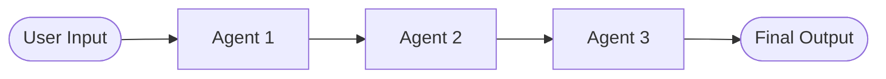

### How it works internally
`SequentialAgent` iterates through `self.sub_agents` in order. It tracks `current_sub_agent` in `SequentialAgentState` for resumability. If a sub-agent pauses (long-running tool), the SequentialAgent pauses too. On resume, `_get_start_index()` finds the correct sub-agent by name.

```python
# SequentialAgent._run_async_impl (simplified)
for i in range(start_index, len(self.sub_agents)):
    sub_agent = self.sub_agents[i]
    async for event in sub_agent.run_async(ctx):
        yield event
        if ctx.should_pause_invocation(event):
            return
```

### Example: City Time Report

Source: `.READ/adk-samples/python/agents/workflows-sequential/agent.py`

```python
from datetime import datetime
from zoneinfo import ZoneInfo
from google.adk.agents.llm_agent import LlmAgent
from google.adk.agents.sequential_agent import SequentialAgent

city_generator_agent = LlmAgent(
    name="city_generator_agent",
    model="gemini-2.5-flash",
    instruction="""Return the name of a random city in 'Continent/City' format.
    Return only the name, strictly in this format: 'America/New_York'.""",
    output_key="city",
)


def lookup_time_function(city: str):
    """Yield the current time in the specified city."""
    time_str = datetime.now(ZoneInfo(city)).strftime("%H:%M:%S")
    new_city = city.split("/")[1]
    from google.adk.agents.workflow.events.event import Event
    yield Event(data={"time_info": time_str, "city": new_city})


city_report_agent = LlmAgent(
    name="city_report_agent",
    model="gemini-2.5-flash",
    instruction="Return a sentence: It is {time_info} in {city} right now.",
)

root_agent = SequentialAgent(
    name="root_agent",
    sub_agents=[city_generator_agent, lookup_time_function, city_report_agent],
)
```

### State flow

| Step | Agent | Writes to state | Reads from state |
|------|-------|----------------|------------------|
| 1 | `city_generator_agent` | `city` = "America/New_York" | — |
| 2 | `lookup_time_function` | (via Event data) `time_info`, `city` | `city` from parameter |
| 3 | `city_report_agent` | — | `{time_info}`, `{city}` |

---

## 2. Parallel Execution (Fan-out / Fan-in)

### What it does
Multiple sub-agents execute concurrently. Each gets its own isolated branch context. Results are merged into a single event stream.

### Architecture

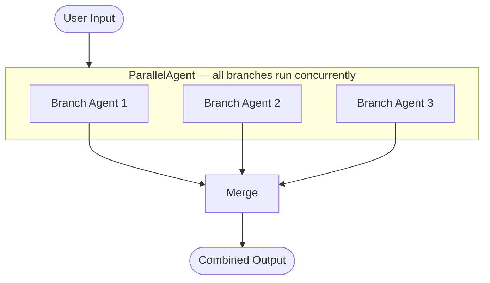

### How it works internally
`ParallelAgent` creates an isolated branch context for each sub-agent using `_create_branch_ctx_for_sub_agent`. Each branch gets a suffix like `agent_1.agent_2.sub_agent_name`. It uses `asyncio.TaskGroup` (Python 3.11+) to run all branches concurrently and merges events via a shared queue with backpressure signals.

```python
# ParallelAgent._run_async_impl (simplified)
agent_runs = []
for sub_agent in self.sub_agents:
    sub_agent_ctx = _create_branch_ctx_for_sub_agent(self, sub_agent, ctx)
    agent_runs.append(sub_agent.run_async(sub_agent_ctx))

async for event in _merge_agent_run(agent_runs):
    yield event
```

### Example: Parallel Chapter Writers

Source: `.READ/adk-samples/python/agents/story_teller/story_teller_agent/agent.py`

```python
from google.adk.agents.llm_agent import LlmAgent
from google.adk.agents.parallel_agent import ParallelAgent

creative_writer = LlmAgent(
    name="creative_writer",
    model="gemini-2.5-flash",
    instruction="Write the NEXT chapter. Prioritise unexpected plot twists and vivid imagery.\n\nPremise: {enhanced_prompt?}\nStory so far: {current_story?}",
    output_key="creative_chapter_candidate",
)

focused_writer = LlmAgent(
    name="focused_writer",
    model="gemini-2.5-flash",
    instruction="Write the NEXT chapter. Prioritise logical consistency and narrative flow.\n\nPremise: {enhanced_prompt?}\nStory so far: {current_story?}",
    output_key="focused_chapter_candidate",
)

parallel_writers = ParallelAgent(
    name="ParallelChapterGenerators",
    sub_agents=[creative_writer, focused_writer],
)
```

### Key properties
- Branches share the same **session state** but have isolated **conversation contexts**
- Events from all branches are interleaved as they arrive (no ordering guarantee)
- If a branch fails, other branches continue

---

## 3. Loop Workflow

### What it does
Repeats its sub-agents in order for exactly `max_iterations` times. No early exit — the loop always runs the full count.

### Architecture

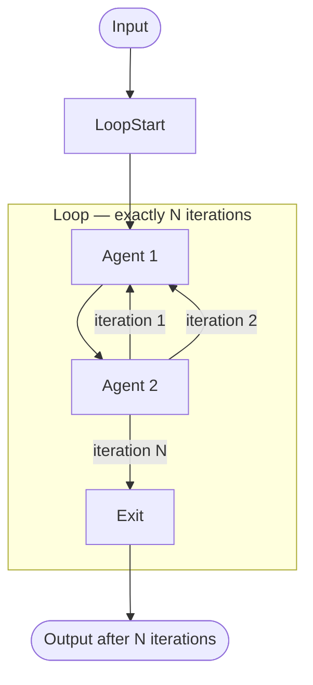

### How it works internally
`LoopAgent` tracks `times_looped` and `current_sub_agent` in `LoopAgentState`. On each loop restart, it calls `ctx.reset_sub_agent_states()` to clear all sub-agent state.

```python
# LoopAgent._run_async_impl (simplified)
while not self.max_iterations or times_looped < self.max_iterations:
    for sub_agent in self.sub_agents:
        async for event in sub_agent.run_async(ctx):
            yield event
            if event.actions.escalate:
                should_exit = True
            if ctx.should_pause_invocation(event):
                return
        if should_exit:
            break
    times_looped += 1
    ctx.reset_sub_agent_states(self.name)
```

### Example: Story Chapter Generation

Source: `.READ/adk-samples/python/agents/story_teller/story_teller_agent/agent.py`

```python
from google.adk.agents.loop_agent import LoopAgent
from google.adk.agents.sequential_agent import SequentialAgent
from google.adk.agents.parallel_agent import ParallelAgent

# Inside a SequentialAgent:
story_building_loop = LoopAgent(
    name="story_building_loop",
    max_iterations=3,
    sub_agents=[
        ParallelAgent(
            name="chapter_writers",
            sub_agents=[creative_writer, focused_writer],
        ),
        critique_agent,
    ],
)
```

Each iteration:
1. Both writers produce a chapter draft in parallel
2. CritiqueAgent picks the best and appends to `current_story`
3. After 3 iterations, the story has 3 chapters

---

## 4. Loop with Early Exit

### What it does
Like Loop, but the **last agent** in the loop body receives an `exit_loop` tool. Calling it with `EventActions(escalate=True)` stops the loop before `max_iterations` is reached.

### Architecture

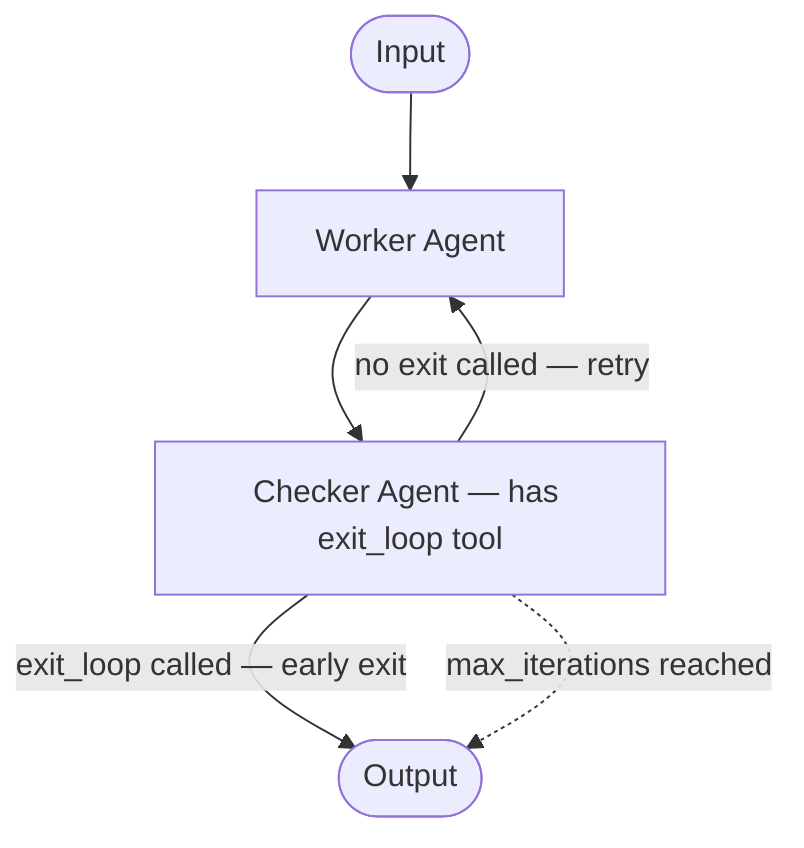

### How it works
The last agent in the loop body yields `Event(actions=EventActions(escalate=True))`. The LoopAgent detects `event.actions.escalate` and breaks out of the loop immediately.

### Example: Blog Writer with Retry Loops

Source: `.READ/adk-samples/python/agents/blog-writer/blogger_agent/validation_checkers.py`

```python
from google.adk.agents import BaseAgent
from google.adk.agents.invocation_context import InvocationContext
from google.adk.events import Event, EventActions

class OutlineValidationChecker(BaseAgent):
    """Checks if the blog outline was produced. If yes, exits the loop."""

    async def _run_async_impl(self, ctx: InvocationContext):
        if ctx.session.state.get("blog_outline"):
            # Outline exists — exit the loop early
            yield Event(author=self.name, actions=EventActions(escalate=True))
        else:
            # No outline — signal retry
            yield Event(author=self.name)


# Usage in a LoopAgent:
planning_loop = LoopAgent(
    name="robust_blog_planner",
    max_iterations=3,
    sub_agents=[
        blog_planner,           # Writes outline → output_key="blog_outline"
        OutlineValidationChecker(),  # Last agent — checks and exits
    ],
)
```

### When to use
- Retry-until-success patterns
- LLM-driven quality gates
- When you don't know how many iterations you need upfront

---

## 5. Sequential Inside Parallel

### What it does
Each branch of a parallel node is itself a sequential pipeline. Branches run concurrently, and within each branch, agents run in order.

### Architecture

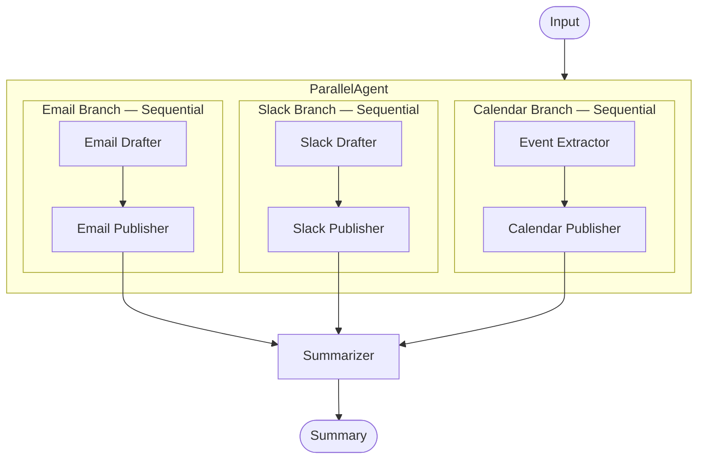

### Example: Parallel Announcement Broadcast

Source: `.READ/adk-samples/python/agents/parallel_task_decomposition_execution/parallel_task_decomposition_agent/agent.py`

```python
from google.adk.agents.sequential_agent import SequentialAgent
from google.adk.agents.parallel_agent import SequentialAgent

email_pipeline = SequentialAgent(
    name="email_pipeline",
    sub_agents=[email_drafter, email_publisher],
)

slack_pipeline = SequentialAgent(
    name="slack_pipeline",
    sub_agents=[slack_drafter, slack_publisher],
)

calendar_pipeline = SequentialAgent(
    name="calendar_pipeline",
    sub_agents=[event_extractor, calendar_publisher],
)

broadcast_agent = ParallelAgent(
    name="broadcast_agent",
    sub_agents=[email_pipeline, slack_pipeline, calendar_pipeline],
)
```

### State flow
- `enhanced_message` is written by the preceding sequential agent
- All three drafter agents read `{enhanced_message}` simultaneously
- Each pipeline writes its own output key (`drafted_email`, `drafted_slack_message`, `event_details`)
- Publishers read their respective draft keys
- A summary agent reads all three publication results

---

## 6. Parallel Inside Sequential

### What it does
A sequential workflow contains a parallel node as one of its steps. The sequential agents before and after the parallel node run in order.

### Architecture

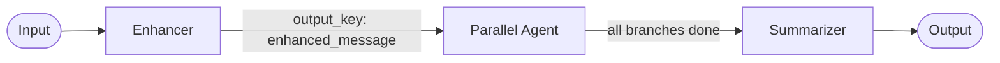

### Example: Broadcast Pipeline

This is the flip side of Pattern 5 — viewed from the sequential perspective:

```python
main_flow = SequentialAgent(
    name="main_flow",
    sub_agents=[
        message_enhancer,     # Sequential: runs first
        broadcast_agent,      # Parallel: runs concurrently
        summary_agent,        # Sequential: runs after parallel completes
    ],
)
```

The key difference from Pattern 5: the outer composition is sequential, not parallel.

---

## 7. Parallel Inside Loop Inside Sequential

### What it does
The deepest nesting pattern. A sequential root contains a loop whose body includes a parallel node.

### Architecture

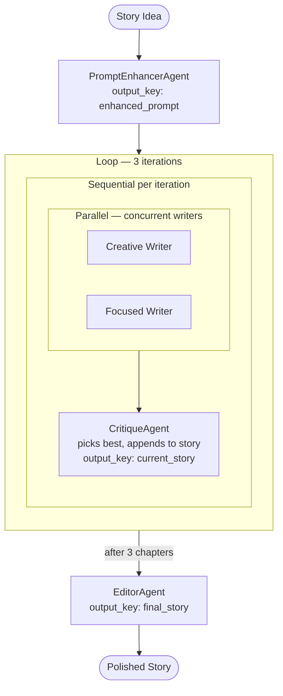

### Example: Story Teller

Source: `.READ/adk-samples/python/agents/story_teller/story_teller_agent/agent.py`

```python
root_agent = SequentialAgent(
    name="story_teller",
    sub_agents=[
        prompt_enhancer,  # Sequential step 1
        LoopAgent(        # Loop as sequential step 2
            name="story_building_loop",
            max_iterations=3,
            sub_agents=[
                SequentialAgent(  # Sequential body inside loop
                    name="chapter_cycle",
                    sub_agents=[
                        ParallelAgent(  # Parallel inside sequential inside loop
                            name="chapter_writers",
                            sub_agents=[creative_writer, focused_writer],
                        ),
                        critique_agent,
                    ],
                ),
            ],
        ),
        editor_agent,  # Sequential step 3
    ],
)
```

### State flow across nesting levels

| Key | Written by | Read by | Nesting depth |
|-----|-----------|---------|---------------|
| `enhanced_prompt` | PromptEnhancerAgent | CreativeWriter, FocusedWriter, CritiqueAgent | Outer → Inner |
| `current_story` | CritiqueAgent (each iteration) | CreativeWriter, FocusedWriter (next iteration) | Accumulates inside loop |
| `creative_chapter_candidate` | CreativeWriter | CritiqueAgent | Same parallel level |
| `final_story` | EditorAgent | — | Outer level |

---

## 8. Sequential Inside Loop

### What it does
A loop agent contains a sequential pipeline as its body. The sequential agents run in order on each iteration.

### Architecture

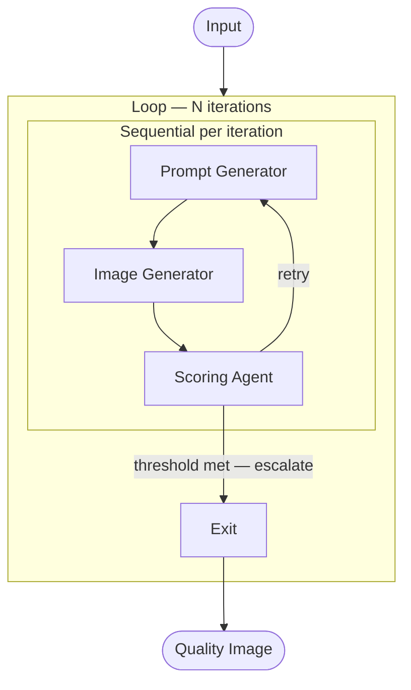

### Example: Image Scoring Pipeline

Source: `.READ/adk-samples/python/agents/image-scoring/image_scoring/agent.py`

```python
image_generation_scoring_agent = SequentialAgent(
    name="image_generation_scoring_agent",
    sub_agents=[
        image_generation_prompt_agent,  # Step 1: Create prompt
        image_generation_agent,          # Step 2: Generate image
        scoring_images_prompt,           # Step 3: Score image
    ],
)

image_scoring = LoopAgent(
    name="image_scoring",
    sub_agents=[
        image_generation_scoring_agent,  # Sequential: generate + score
        checker_agent_instance,           # Check if score meets threshold
    ],
    before_agent_callback=set_session,
)
```

### How the checker exits
```python
# checker_agent checks the score from session state
# If score >= threshold, it calls exit_loop tool:
#   tool_context.actions.escalate = True
```

---

## 9. WorkflowAgent with Function Nodes

### What it does
`WorkflowAgent` uses a graph-based edge definition system. `FunctionNode` wraps arbitrary Python async generators as workflow nodes that can manipulate state, emit data, and route execution.

### Architecture

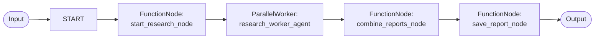

### How it works
`FunctionNode` wraps an async generator function. The function receives `node_input` (the output from the previous node) and can yield:
- `Event(state={...})` — updates session state
- `Event(data={...})` — emits data to the next node
- `Event(route="X")` — sets conditional routing
- Raw data (str, list, dict) — passed as `node_input` to the next node

### Example: Research Workflow

Source: `.READ/adk-samples/python/agents/workflow-concurrent_research_writer/function_nodes/research.py`

```python
from collections.abc import AsyncGenerator
from google.adk.agents.workflow.events.event import Event
from google.adk.agents.workflow.function_node import FunctionNode
from google.genai.types import Content, ModelContent, Part

async def start_research_node(
    node_input: Content,
) -> AsyncGenerator[Event | list[str], None]:
    """Entry node: extracts topic, yields platform list for ParallelWorker."""
    topic = str(node_input.parts[0].text if node_input.parts else "")
    yield Event(state={"topic": topic})
    yield ["X", "LinkedIn", "Reddit", "Medium"]  # Fan-out targets


async def combine_reports_node(
    node_input: Content,
) -> AsyncGenerator[str, None]:
    """Joins text parts from parallel agents into a single string."""
    report_texts = []
    for part in node_input.parts:
        if part.text:
            report_texts.append(part.text)
    yield "\n\n---\n\n".join(report_texts)


async def save_report_node(
    node_input: str,
) -> AsyncGenerator[Event | ModelContent, None]:
    """Saves report to state and yields it for the user."""
    yield Event(state={"research_report": node_input})
    yield ModelContent(parts=[Part.from_text(text=node_input)])


# Wrap as FunctionNodes
start_node = FunctionNode(start_research_node, name="Start Research", rerun_on_resume=True)
combine_reports = FunctionNode(combine_reports_node, name="Combine Reports")
save_node = FunctionNode(save_report_node, name="Save Report", rerun_on_resume=False)
```

### WorkflowAgent definition

```python
from google.adk.agents.workflow.base_node import START
from google.adk.agents.workflow.workflow_agent import WorkflowAgent
from google.adk.agents.workflow.parallel_worker import ParallelWorker

research_workflow = WorkflowAgent(
    name="research_workflow",
    edges=[
        (START, start_node, ParallelWorker(research_worker_agent),
               distill_agent, save_node),
    ],
)
```

---

## 10. WorkflowAgent with Conditional Routing

### What it does
Function nodes yield `Event(route="X")` to set the routing key. Edges are defined as `(from_node, to_node, "route_value")`. Only edges matching the route fire.

### Architecture

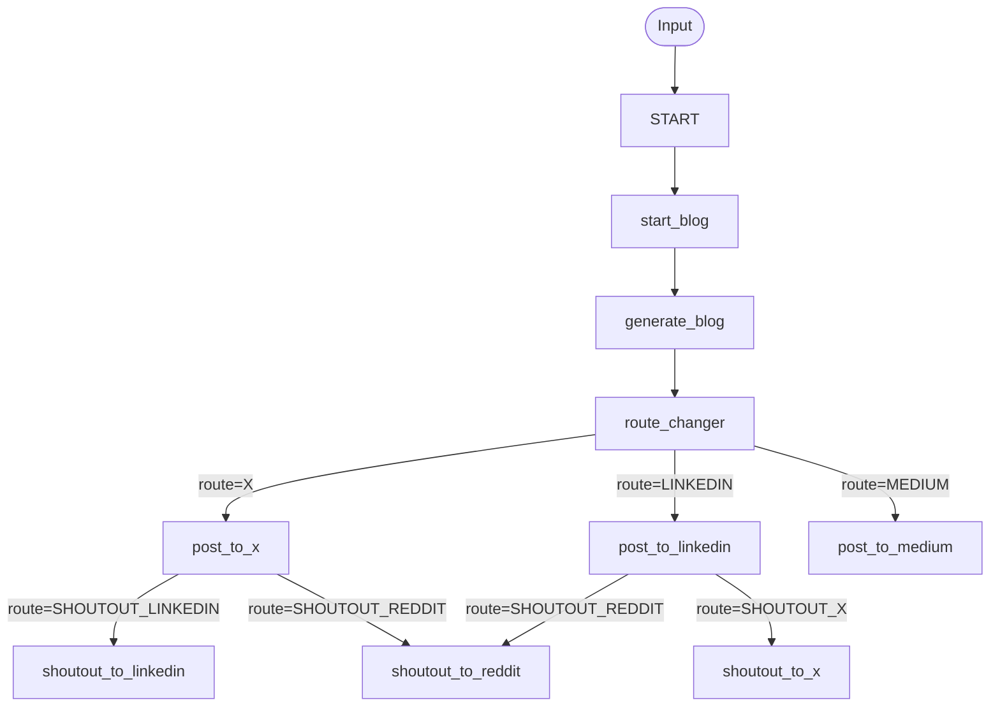

### Example: Blog Publishing Router

Source: `.READ/adk-samples/python/agents/workflow-concurrent_research_writer/function_nodes/publishing.py`

```python
from functools import partial
from collections.abc import AsyncGenerator
from google.adk.agents.workflow.events.event import Event
from google.adk.agents.workflow.function_node import FunctionNode

X_MAX_WORDS = 100
LINKEDIN_MAX_WORDS = 300

async def length_router_node(
    node_input: str,
) -> AsyncGenerator[Event | str, None]:
    """Routes the blog post based on word count."""
    blog_post = node_input
    num_words = len(blog_post.split())
    route = (
        "X" if num_words <= X_MAX_WORDS
        else "LINKEDIN" if num_words <= LINKEDIN_MAX_WORDS
        else "MEDIUM"
    )
    yield blog_post  # Pass content through
    yield Event(route=route)  # Set the route


async def post_node(
    platform: str, node_input: str
) -> AsyncGenerator[Event | str, None]:
    """Posts to a platform, then yields routes for shoutouts."""
    blog_post = node_input
    await post_to_platform(platform, blog_post)

    # Yield routes for downstream edges
    if platform == "X":
        yield Event(route=["SHOUTOUT_LINKEDIN", "SHOUTOUT_REDDIT"])
    elif platform == "LINKEDIN":
        yield Event(route=["SHOUTOUT_X", "SHOUTOUT_REDDIT"])
    elif platform == "MEDIUM":
        yield Event(route=["SHOUTOUT_X", "SHOUTOUT_LINKEDIN"])
    yield blog_post


# Wrap and wire up
route_changer = FunctionNode(length_router_node, name="PathFinder")
post_to_x = FunctionNode(partial(post_node, "X"), name="Post to X")
shoutout_to_linkedin = FunctionNode(
    partial(shoutout_node, "LINKEDIN"), name="Shoutout to LinkedIn"
)

blog_workflow = WorkflowAgent(
    name="blog_workflow",
    edges=[
        (START, start_blog, generate_blog_post_agent, route_changer),
        (route_changer, post_to_x, "X"),
        (route_changer, post_to_linkedin, "LINKEDIN"),
        (route_changer, post_to_medium, "MEDIUM"),
        (post_to_x, shoutout_to_linkedin, "SHOUTOUT_LINKEDIN"),
        (post_to_x, shoutout_to_reddit, "SHOUTOUT_REDDIT"),
    ],
)
```

---

## 11. ParallelWorker (Fan-out Across Inputs)

### What it does
A `ParallelWorker` wraps a single `LlmAgent` and fans it out across multiple inputs. The previous node yields a list of targets (e.g., platform names), and the worker runs once per target. Results are combined by the next node.

### Architecture

```mermaid
flowchart LR
    FN1[start_node yields\n[X, LinkedIn,\nReddit, Medium]] --> PW[ParallelWorker:\nresearch_worker_agent]

    PW -->|runs for X| R1[Research X]
    PW -->|runs for LinkedIn| R2[Research LinkedIn]
    PW -->|runs for Reddit| R3[Research Reddit]
    PW -->|runs for Medium| R4[Research Medium]

    R1 --> FN2[combine_reports_node]
    R2 --> FN2
    R3 --> FN2
    R4 --> FN2
    FN2 --> Out([Combined Report])
```

### Example: Cross-Platform Research

Source: `.READ/adk-samples/python/agents/workflow-concurrent_research_writer/agent.py`

```python
from google.adk.agents.workflow.parallel_worker import ParallelWorker

# A single LlmAgent that researches a platform
research_worker_agent = LlmAgent(
    name="research_worker_agent",
    model="gemini-2.5-flash",
    instruction="Research the topic on platform {platform}. Topic: {topic}",
)

# Wrap it for parallel fan-out
research_workflow = WorkflowAgent(
    name="research_workflow",
    edges=[
        (START, start_node, ParallelWorker(research_worker_agent),
               distill_agent, save_node),
    ],
)
```

The `start_node` yields `["X", "LinkedIn", "Reddit", "Medium"]`, and `ParallelWorker` runs `research_worker_agent` once per platform. Results arrive as a `Content` object with multiple `Part` entries, one per platform.

---

## 12. Human-in-the-Loop (HITL) with RequestInput

### What it does
The workflow pauses and displays a prompt to the user. The user's response is fed back into the workflow. The workflow can loop back for iterative refinement.

### Architecture

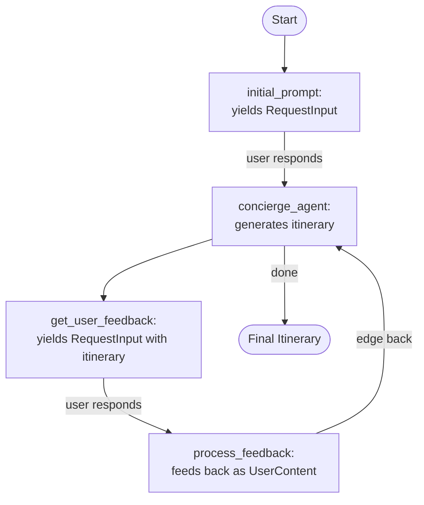

### Example: Interactive Concierge

Source: `.READ/adk-samples/python/agents/workflows-HITL_concierge/agent.py`

```python
from pydantic import BaseModel
from google.adk.agents.llm_agent import LlmAgent
from google.adk.agents.workflow.workflow_agent import WorkflowAgent
from google.adk.agents.workflow.workflow_context import Context
from google.adk.agents.workflow.events.request_input import RequestInput
from google.genai.types import UserContent

class ActivitiesList(BaseModel):
    itinerary: list[dict[str, str]]

concierge_agent = LlmAgent(
    name="concierge_agent",
    model="gemini-2.5-flash",
    instruction="You are a concierge. Create an itinerary based on: {node_input}",
    output_schema=ActivitiesList,
)

async def initial_prompt(ctx: Context):
    yield RequestInput(
        message="Welcome! Tell me your city, age, hobby, and attractions.",
        response_schema={"user response": str},
    )

async def get_user_feedback(node_input: ActivitiesList):
    yield RequestInput(
        message=f"Here is your itinerary:\n{node_input}\n\nWhat would you like to change?",
        payload=node_input,
        response_schema={"user": "response"},
    )

async def process_feedback(node_input: str):
    yield UserContent(f"Feedback: {node_input}.")

root_agent = WorkflowAgent(
    name="root_agent",
    rerun_on_resume=True,
    edges=[
        ("START", initial_prompt, concierge_agent,
                  get_user_feedback, process_feedback),
        (process_feedback, concierge_agent),  # Loop back
    ],
)
```

### Key mechanisms
- `RequestInput` pauses the workflow and shows a UI prompt
- `response_schema` validates the user's input
- `payload` carries data through to the response handler
- Edge `(process_feedback, concierge_agent)` creates the refinement loop
- `rerun_on_resume=True` allows the workflow to resume from the pause point

---

## 13. rerun_on_resume

### What it does
When a workflow is resumable (checkpoint-based persistence), `rerun_on_resume` controls whether function nodes re-execute on resume or are skipped (their previous output is restored from checkpoint).

### Architecture

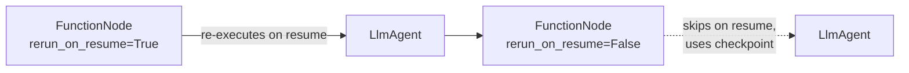

### When to use each

| Setting | Use case |
|---------|----------|
| `rerun_on_resume=True` | Idempotent functions: data extraction, state initialization |
| `rerun_on_resume=False` | Side-effect functions: API calls, posting to platforms, expensive computations |

### Example

Source: `.READ/adk-samples/python/agents/workflow-concurrent_research_writer/function_nodes/research.py`

```python
start_node = FunctionNode(
    start_research_node, name="Start Research", rerun_on_resume=True
)
# Safe to rerun — it just extracts the topic from user input

save_node = FunctionNode(
    save_report_node, name="Save Report", rerun_on_resume=False
)
# Don't rerun — report is already saved, avoid duplicate side effects
```

### How it works
When the app resumes with `is_resumable=True`, the WorkflowAgent checks each function node. If `rerun_on_resume=False` and the node has a checkpoint, the checkpointed output is restored directly without re-executing the function.

---

## 14. Coordinator / Orchestrator (AgentTool)

### What it does
A coordinator LLM agent decides which sub-agents to invoke based on user intent. Sub-agents are wrapped as `AgentTool` instances that the coordinator can call dynamically.

### Architecture

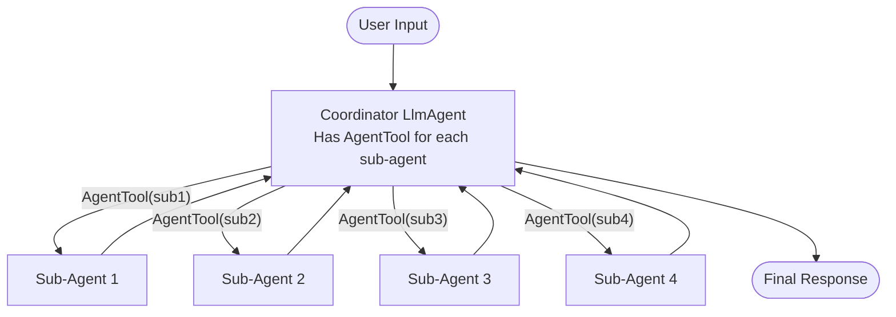

### How it works
`AgentTool` wraps a `BaseAgent` as a callable tool. The coordinator's LLM decides which tool to call based on the conversation. This is **LLM-driven routing**, not hard-coded sequential flow.

### Example: Marketing Agency

Source: `.READ/adk-samples/python/agents/marketing-agency/marketing_agency/agent.py`

```python
from google.adk.agents.llm_agent import LlmAgent
from google.adk.tools.agent_tool import AgentTool

marketing_coordinator = LlmAgent(
    name="marketing_coordinator",
    model="gemini-2.5-flash",
    instruction="""You are a marketing coordinator.
    Use the available tools to: find domains, create websites,
    design marketing campaigns, and generate logos.
    Guide the user through each step sequentially.""",
    tools=[
        AgentTool(domain_create_agent),
        AgentTool(website_create_agent),
        AgentTool(marketing_create_agent),
        AgentTool(logo_create_agent),
    ],
)

root_agent = marketing_coordinator
```

### When to use
- When the workflow needs **flexible, intent-driven routing**
- When different users may need different sub-agents
- When the coordinator should manage multi-step conversations with the user

---

## 15. Validation / Checker Pattern

### What it does
A custom `BaseAgent` inspects session state and signals whether to continue or exit a loop. Used as the last agent in a `LoopAgent` body.

### Architecture

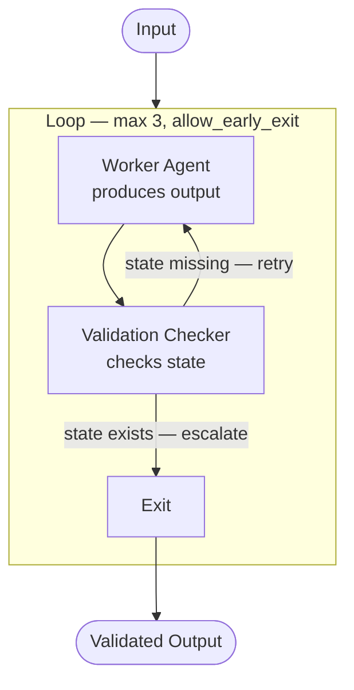

### Example: Blog Outline Validation

Source: `.READ/adk-samples/python/agents/blog-writer/blogger_agent/validation_checkers.py`

```python
from google.adk.agents import BaseAgent
from google.adk.agents.invocation_context import InvocationContext
from google.adk.events import Event, EventActions

class OutlineValidationChecker(BaseAgent):
    """Checks if the blog outline was produced."""

    async def _run_async_impl(self, ctx: InvocationContext):
        if ctx.session.state.get("blog_outline"):
            # Outline exists — exit the loop
            yield Event(
                author=self.name,
                actions=EventActions(escalate=True),
            )
        else:
            # No outline — continue the loop
            yield Event(author=self.name)
```

### Variations

| Variation | Example | Purpose |
|-----------|---------|---------|
| Simple state check | `OutlineValidationChecker` | Check if key exists |
| LLM evaluation | `ResearchEvaluator` | Grade quality with `output_schema=Feedback` |
| Threshold check | `checker_agent` in image-scoring | Compare score against threshold |
| Multi-validator | `invoice_processing` | LLMRules + DataSource + BypassDetector |

---

## 16. EscalationChecker (Custom Loop Exit)

### What it does
A custom `BaseAgent` that inspects state and yields `EventActions(escalate=True)` when conditions are met. This is the **mechanism** behind `allow_early_exit`.

### Architecture

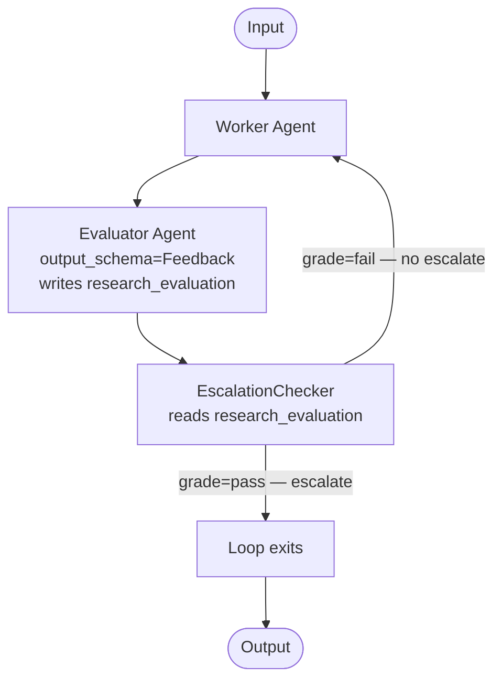

### Example: Deep Research Escalation

Source: `.READ/adk-samples/python/agents/deep-search/app/agent.py`

```python
class EscalationChecker(BaseAgent):
    """Checks research evaluation and escalates to stop the loop if grade is 'pass'."""

    def __init__(self, name: str):
        super().__init__(name=name)

    async def _run_async_impl(self, ctx: InvocationContext):
        evaluation_result = ctx.session.state.get("research_evaluation")
        if evaluation_result and evaluation_result.get("grade") == "pass":
            yield Event(
                author=self.name,
                actions=EventActions(escalate=True),
            )
        else:
            # Continue the loop
            yield Event(author=self.name)


# Usage in the pipeline:
research_pipeline = SequentialAgent(
    name="research_pipeline",
    sub_agents=[
        section_planner,
        section_researcher,
        LoopAgent(
            name="iterative_refinement_loop",
            max_iterations=3,
            sub_agents=[
                research_evaluator,    # Writes research_evaluation
                EscalationChecker(name="escalation_checker"),  # Reads it, escalates if pass
                enhanced_search_executor,  # Runs only if not escalated
            ],
        ),
        report_composer,
    ],
)
```

### Why a separate agent?
The `EscalationChecker` is a lightweight, dedicated agent that has no other responsibility than checking state and signaling exit. This keeps the loop exit logic clean and reusable.

---

## 17. Pipeline Gated Stopping

### What it does
A pipeline stage returns a STOPPED status on violation, preventing all downstream stages from executing. Unlike loop exit, this stops the entire remaining pipeline.

### Architecture

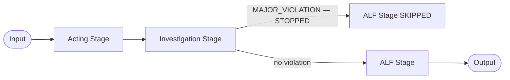

### Example: Invoice Processing

Source: `.READ/adk-samples/python/agents/invoice_processing/invoice_processing/agent.py`

```python
# Multi-stage invoice pipeline:
# 1. Acting stage — initial processing
# 2. Investigation stage — deep analysis, can detect MAJOR_VIOLATION
# 3. ALF stage — Accounts Loss Forecast (only runs if no violation)

# The Investigation stage returns STOPPED status when it detects
# a major violation, which prevents the ALF stage from running.
```

### How it works
When a stage returns with a stopped/escalated status, the framework's SequentialAgent detects this and skips all remaining sub-agents. This is different from loop exit — it's a **pipeline-level abort**.

---

## 18. output_key (Named State Injection)

### What it does
When an `LlmAgent` has `output_key`, its final response text is automatically saved to `session.state[output_key]`. Downstream agents read it via `{variable}` injection.

### Architecture

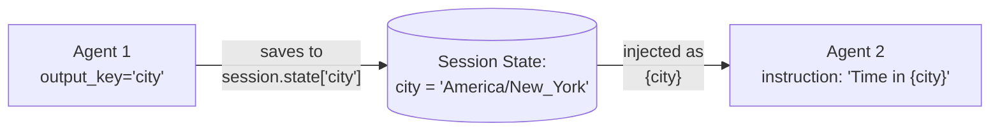

### How it works internally

```python
# LlmAgent saves output after the model responds:
def __maybe_save_output_to_output_key(self, event: Event) -> None:
    if self.output_key and event.data and event.data.content:
        self._invocation_context.session.state[self.output_key] = \
            event.data.content
```

### Example

```python
city_generator = LlmAgent(
    name="city_generator",
    model="gemini-2.5-flash",
    instruction="Return a random city in 'Continent/City' format.",
    output_key="city",  # Saves response to session.state["city"]
)

city_report = LlmAgent(
    name="city_report",
    model="gemini-2.5-flash",
    instruction="It is {time_info} in {city} right now.",  # {city} auto-injected
)
```

### Key rules
- `output_key` saves the **final** response text (after all tool calls complete)
- The saved value is accessible by all **subsequent** agents in the same session
- If the agent is inside a `LoopAgent`, the key is overwritten on each iteration (unless the agent appends/accumulates)

---

## 19. Optional State Injection `{variable?}`

### What it does
Template variable substitution that returns an empty string if the key is absent from session state, instead of raising an error.

### Syntax

| Syntax | Behavior |
|--------|----------|
| `{key}` | Required — errors if key is missing |
| `{key?}` | Optional — substitutes empty string if key is absent |

### Example

```python
storyboard_agent = LlmAgent(
    name="storyboard_agent",
    model="gemini-2.5-flash",
    instruction="""
    Create storyboard panels for this screenplay:
    {screenplay}

    Also reference character descriptions from the story (if available):
    {story?}
    """,
)
```

### When to use
- First iteration of a loop (state may not exist yet)
- Optional context that may or may not be available
- Graceful degradation when upstream agents produce no output

---

## 20. State Accumulation Across Iterations

### What it does
State grows with each loop iteration by reading the previous value and appending to it, rather than overwriting.

### Architecture

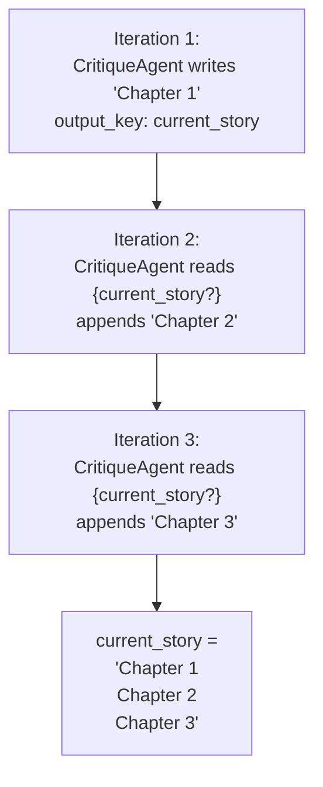

### Example: Story Accumulation

Source: `.READ/adk-samples/python/agents/story_teller/story_teller_agent/agent.py`

```python
critique_agent = LlmAgent(
    name="critique_agent",
    model="gemini-2.5-flash",
    instruction="""
    You have two candidate drafts for the next chapter.
    Select the best one and append it to the running story.

    _CURRENT_STORY_STARTS_
    {current_story?}
    _CURRENT_STORY_ENDS_

    _CHAPTER_OPTION_1_
    {creative_chapter_candidate}
    _CHAPTER_OPTION_1_ENDS_

    _CHAPTER_OPTION_2_
    {focused_chapter_candidate}
    _CHAPTER_OPTION_2_ENDS_

    Task:
    1. Select the best option.
    2. Combine the story so far with the selected chapter.
    3. Add a new chapter header (e.g. "Chapter 2").
    4. Output the complete, updated story.
    """,
    output_key="current_story",
)
```

### Key insight
On iteration 1, `{current_story?}` is empty (or initialised by `prompt_enhancer`). On iteration 2, it contains Chapter 1. On iteration 3, it contains Chapters 1+2. The `output_key` overwrites, but the agent's instruction tells it to **read the old value and include it**.

---

## 21. State Fan-out (One Key Read by Many)

### What it does
A single upstream state key is consumed by multiple downstream agents that are not necessarily adjacent.

### Architecture

```mermaid
flowchart TD
    User([Brand Keywords]) --> COORD[CoordinatorAgent]
    COORD -->|"output_key:\ndomain_create_output"| DC[DomainCreateAgent]
    DC -->|"domain_create_output"| WC[WebsiteCreateAgent\nreads {domain_create_output?}]
    DC -->|"domain_create_output"| MC[MarketingCreateAgent\nreads {domain_create_output?}]
    DC -->|"domain_create_output"| LC[LogoCreateAgent\nreads {domain_create_output?}]
```

### Example: Marketing Agency Domain Key

Source: `.READ/adk-samples/python/agents/marketing-agency/marketing_agency/agent.py`

```python
# DomainCreateAgent writes:
output_key="domain_create_output"

# Three downstream agents all read the same key:
website_creator = LlmAgent(
    instruction="Build a website for: {domain_create_output?}",
    output_key="website_create_output",
)

marketing_creator = LlmAgent(
    instruction="Create marketing strategy for: {domain_create_output?}",
    output_key="marketing_create_output",
)

logo_creator = LlmAgent(
    instruction="Design logo for brand: {domain_create_output?}",
    output_key="logo_create_output",
)
```

---

## 22. Non-Adjacent State Reading

### What it does
A downstream agent reads state from two or more upstream agents that are not its direct predecessors.

### Architecture

```mermaid
flowchart LR
    User([Input]) --> A[Coordinator\noutput_key: seminal_paper]
    A --> B[WebSearch\noutput_key: recent_citing_papers]
    B --> C[NewResearch\nreads {seminal_paper?}\nand {recent_citing_papers?}]
    C --> Out([Output])
```

### Example: Academic Research

Source: `.READ/adk-samples/python/agents/academic-research/academic_research/agent.py`

```python
academic_new_research = LlmAgent(
    name="academic_new_research",
    model="gemini-2.5-flash",
    instruction="""
    Analyse the seminal paper and recent citing papers to suggest future directions.

    Seminal Paper:
    {seminal_paper?}

    Recent Citing Papers:
    {recent_citing_papers?}

    Generate 10+ future research directions.
    """,
)
```

This agent reads from `seminal_paper` (written by `coordinator`, 2 steps back) and `recent_citing_papers` (written by `websearch`, 1 step back).

---

## 23. Implicit State via Conversation History

### What it does
No `output_key` is used. Instead, each agent sees the full conversation history, including all prior agents' responses. This is the simplest state-passing mechanism.

### Architecture

```mermaid
flowchart LR
    User([Question + LLM Answer]) --> A[CriticAgent\nAnalyzes and verifies claims]
    A -->|"findings appended to\nconversation history"| B[ReviserAgent\nSees critic's full analysis\nin conversation context]
    B --> Out([Verified Answer])
```

### Example: LLM Auditor

Source: `.READ/adk-samples/python/agents/llm-auditor`

```python
# No output_key — state passes through conversation history
critic_agent = LlmAgent(
    name="critic_agent",
    model="gemini-2.5-flash",
    instruction="Extract every claim, verify it, assign verdicts.",
    # No output_key — response goes to conversation
)

reviser_agent = LlmAgent(
    name="reviser_agent",
    model="gemini-2.5-flash",
    instruction="Minimally revise based on the reviewer's findings.",
    # Sees critic's full output in conversation history
)

root_agent = SequentialAgent(
    name="llm_auditor",
    sub_agents=[critic_agent, reviser_agent],
)
```

### When to use
- Simple two-agent pipelines where the second agent just needs to see the first's output
- When you don't need named state keys for multiple downstream consumers
- Code review, fact-checking, editing patterns

---

## 24. Output Schema (Structured Output)

### What it does
`output_schema` forces the LLM to return structured data matching a Pydantic model. When set, the agent can only reply (no tool use, no RAG, no agent transfer).

### Architecture

```mermaid
flowchart LR
    User([Research Findings]) --> A["ResearchEvaluator\noutput_schema=Feedback"]
    A -->|"structured JSON:\n{grade, comment, follow_up_queries}"| S[(session.state['research_evaluation'])]
```

### Example: Research Feedback Schema

Source: `.READ/adk-samples/python/agents/deep-search/app/agent.py`

```python
from pydantic import BaseModel, Field
from typing import Literal

class SearchQuery(BaseModel):
    search_query: str = Field(description="A specific search query for web search.")

class Feedback(BaseModel):
    grade: Literal["pass", "fail"] = Field(
        description="'pass' if research is sufficient, 'fail' if needs revision."
    )
    comment: str = Field(description="Detailed explanation of the evaluation.")
    follow_up_queries: list[SearchQuery] | None = Field(
        default=None,
        description="Follow-up queries to fix gaps. Null if grade is 'pass'.",
    )

research_evaluator = LlmAgent(
    model=config.critic_model,
    name="research_evaluator",
    instruction="""Evaluate the research findings.
    Your response must be a single, raw JSON object matching the Feedback schema.""",
    output_schema=Feedback,  # Forces structured JSON output
    disallow_transfer_to_parent=True,
    disallow_transfer_to_peers=True,
    output_key="research_evaluation",
)
```

### Other examples

| Agent | Schema | Source |
|-------|--------|--------|
| HITL Concierge | `ActivitiesList` (list of dicts) | `workflows-HITL_concierge/agent.py` |
| Travel Planning | `types.Itinerary`, `types.RoomsSelection`, `types.HotelsSelection` | `travel-concierge/sub_agents/planning/agent.py` |
| Loan Agent | `UnderwritingReport`, `LoanDecisionResult` | `small-business-loan-agent/sub_agents/` |

---

## 25. Callbacks (before/after agent/model/tool)

### What it does
Lifecycle hooks that run at specific points during agent execution. There are 4 callback types, each with before/after variants.

### Architecture

```mermaid
sequenceDiagram
    participant Caller
    participant Agent
    participant Model
    participant Tool
    participant Callback

    Caller->>Agent: run_async(ctx)
    Agent->>Callback: before_agent_callback
    alt returns Content
        Callback-->>Caller: yield Content (skip agent run)
    else returns None
        Agent->>Callback: before_model_callback
        Callback->>Model: (optional: override LLM call)
        Model->>Callback: before_tool_callback (per tool call)
        Tool->>Callback: after_tool_callback (per tool call)
        Model->>Callback: after_model_callback
        Callback->>Agent: process model output
        Agent->>Callback: after_agent_callback
        Callback-->>Caller: yield Event
    end
```

### Callback Types

| Callback | Signature | When it runs |
|----------|-----------|--------------|
| `before_agent_callback` | `fn(CallbackContext) -> Optional[Content]` | Before any agent runs. If returns Content, agent run is skipped |
| `after_agent_callback` | `fn(CallbackContext) -> Optional[Content]` | After agent completes. Can modify the output |
| `before_model_callback` | `fn(CallbackContext, LlmRequest) -> Optional[LlmResponse]` | Before LLM API call. If returns LlmResponse, model call is skipped |
| `after_model_callback` | `fn(CallbackContext, LlmResponse) -> Optional[Content]` | After LLM responds. Can transform the response |
| `before_tool_callback` | `fn(tool, args, tool_context) -> Optional[dict]` | Before each tool call. Can modify arguments |
| `after_tool_callback` | `fn(tool, args, tool_context, response) -> Optional[dict]` | After each tool call. Can modify the response |
| `on_model_error_callback` | `fn(CallbackContext, error) -> None` | When LLM API fails |
| `on_tool_error_callback` | `fn(tool, args, tool_context, error) -> None` | When tool execution fails |

### Example: Collect Research Sources (after_agent_callback)

Source: `.READ/adk-samples/python/agents/deep-search/app/agent.py`

```python
def collect_research_sources_callback(
    callback_context: CallbackContext,
) -> None:
    """Extracts web sources from grounding metadata and stores in session state."""
    session = callback_context._invocation_context.session
    url_to_short_id = callback_context.state.get("url_to_short_id", {})
    sources = callback_context.state.get("sources", {})
    id_counter = len(url_to_short_id) + 1

    for event in session.events:
        if not (event.grounding_metadata and event.grounding_metadata.grounding_chunks):
            continue
        for chunk in event.grounding_metadata.grounding_chunks:
            if chunk.web:
                url = chunk.web.uri
                if url not in url_to_short_id:
                    short_id = f"src-{id_counter}"
                    url_to_short_id[url] = short_id
                    sources[short_id] = {
                        "short_id": short_id,
                        "title": chunk.web.title,
                        "url": url,
                        "domain": chunk.web.domain,
                        "supported_claims": [],
                    }
                    id_counter += 1

    callback_context.state["url_to_short_id"] = url_to_short_id
    callback_context.state["sources"] = sources


# Attach to agents:
section_researcher = LlmAgent(
    name="section_researcher",
    tools=[google_search],
    after_agent_callback=collect_research_sources_callback,
)
```

### Example: Citation Replacement (after_agent_callback)

```python
def citation_replacement_callback(
    callback_context: CallbackContext,
) -> genai_types.Content:
    """Replaces <cite source="src-N" /> tags with Markdown links."""
    final_report = callback_context.state.get("final_cited_report", "")
    sources = callback_context.state.get("sources", {})

    def tag_replacer(match: re.Match) -> str:
        short_id = match.group(1)
        source_info = sources.get(short_id, {})
        return f" [{source_info['title']}]({source_info['url']})"

    processed_report = re.sub(
        r'<cite\s+source\s*=\s*["\']?\s*(src-\d+)\s*["\']?\s*/>',
        tag_replacer,
        final_report,
    )
    callback_context.state["final_report_with_citations"] = processed_report
    return genai_types.Content(parts=[genai_types.Part(text=processed_report)])


report_composer = LlmAgent(
    name="report_composer",
    after_agent_callback=citation_replacement_callback,
)
```

### Example: before_agent_callback for Session Setup

Source: `.READ/adk-samples/python/agents/image-scoring/image_scoring/agent.py`

```python
import uuid
import datetime
from zoneinfo import ZoneInfo
from google.adk.agents.callback_context import CallbackContext

def set_session(callback_context: CallbackContext):
    """Initialises unique ID and timestamp before the loop starts."""
    callback_context.state["unique_id"] = str(uuid.uuid4())
    callback_context.state["timestamp"] = datetime.datetime.now(
        ZoneInfo("UTC")
    ).isoformat()

image_scoring = LoopAgent(
    name="image_scoring",
    sub_agents=[image_generation_scoring_agent, checker_agent_instance],
    before_agent_callback=set_session,
)
```

---

## 26. Agent Isolation

### What it does
Controls which agents the LLM can transfer to. Prevents the LLM from routing to parent or sibling agents.

### Flags

| Flag | Effect |
|------|--------|
| `disallow_transfer_to_parent=True` | LLM cannot transfer back to parent agent. On next turn, transfers control to parent automatically |
| `disallow_transfer_to_peers=True` | LLM cannot transfer to sibling agents at the same level |

### Example: Isolated Research Evaluator

Source: `.READ/adk-samples/python/agents/deep-search/app/agent.py`

```python
research_evaluator = LlmAgent(
    model=config.critic_model,
    name="research_evaluator",
    instruction="Evaluate the research. Grade pass or fail.",
    output_schema=Feedback,
    disallow_transfer_to_parent=True,   # Cannot escalate to parent
    disallow_transfer_to_peers=True,    # Cannot call sibling agents
    output_key="research_evaluation",
)
```

### When to use
- When an agent should only produce output, not make routing decisions
- Quality assurance / evaluation agents that should not interact with the rest of the system
- Preventing the LLM from "escaping" its intended scope

---

## 27. Context Control (`include_contents="none"`)

### What it does
Controls how much conversation history the LLM receives. Setting to `"none"` gives the agent a blank slate — it sees only its instruction and the current input, no prior conversation.

### Architecture

```mermaid
flowchart LR
    S[(Session State:\nresearch_findings,\nsources, outline)] -->|"injected via\n{variables}"| A["ReportComposer\ninclude_contents='none'"]
    H[(Conversation History)] -.->|"BLOCKED"| A
    A --> Out([Cited Report])
```

### Example: Report Composer Without Context

Source: `.READ/adk-samples/python/agents/deep-search/app/agent.py`

```python
report_composer = LlmAgent(
    model=config.critic_model,
    name="report_composer_with_citations",
    include_contents="none",  # No conversation history
    instruction="""
    Transform the provided data into a polished, cited research report.

    INPUT DATA:
    * Research Plan: {research_plan}
    * Research Findings: {section_research_findings}
    * Citation Sources: {sources}
    * Report Structure: {report_sections}
    """,
    output_key="final_cited_report",
)
```

### Why use this?
- **Cost efficiency**: No need to send long conversation history to the LLM
- **Focus**: Agent works only with explicitly provided data via `{variable}` injection
- **Determinism**: Reduces hallucination from irrelevant conversation context
- **Privacy**: Agent cannot reference or leak earlier conversation content

---

## 28. MCP Tool Integration

### What it does
MCP (Model Context Protocol) allows loading external tool servers over SSE or stdio. Tools from the MCP server become available to agents.

### Architecture

```mermaid
flowchart LR
    Agent[LlmAgent] --> MCP[MCPToolset]
    MCP -->|SSE connection| MCPServer[External MCP Server]
    MCPServer --> Tool1[Tool: sql_query]
    MCPServer --> Tool2[Tool: get_bug_data]
    MCPServer --> Tool3[Tool: get_stack_trace]
    Tool1 --> Agent
    Tool2 --> Agent
    Tool3 --> Agent
```

### Example: Software Bug Assistant (Java)

Source: `.READ/adk-samples/java/agents/software-bug-assistant/SoftwareBugAssistant.java`

```java
// Load MCP tools from a remote server via SSE
var mcpToolParams = McpClientParams.builder()
    .transport(SseClientTransport.builder()
        .uri(URI.create("http://localhost:8080/sse"))
        .build())
    .build();

var mcpToolset = McpToolset.fromServer(mcpToolParams);

var bugAssistant = Agent.builder()
    .name("SoftwareBugAssistant")
    .model("gemini-2.5-flash")
    .instruction("Analyse the bug report and suggest fixes.")
    .tools(List.of(mcpToolset))
    .build();
```

### Example: Policy-as-Code (Python)

Source: `.READ/adk-samples/python/agents/policy-as-code/policy_as_code_agent/mcp.py`

```python
from google.adk.tools.mcp_tool.mcp_toolset import McpToolset

# Connect to Dataplex MCP server
mcp_toolset = McpToolset.from_server(
    server_id="dataplex",
    transport="sse",
    url="http://localhost:8080/sse",
)

policy_agent = LlmAgent(
    name="policy_agent",
    model="gemini-2.5-flash",
    instruction="Check data policies using available tools.",
    tools=[mcp_toolset],
)
```

---

## 29. Multi-Agent Server (Go MultiLoader)

### What it does
Multiple independent agents are loaded into a single REST API server. Each agent is independently addressable via its own endpoint.

### Architecture

```mermaid
flowchart TD
    Client1[Client 1] -->|POST /agents/researcher| API[REST API Server]
    Client2[Client 2] -->|POST /agents/guide| API
    Client3[Client 3] -->|POST /agents/discovery| API

    API --> Loader["agent.NewMultiLoader"]
    Loader --> R1[stopAgent: Researcher]
    Loader --> R2[voyageAgent: Guide]
    Loader --> R3[discoveryAgent: Discovery]
```

### Example: Sail Researcher (Go)

Source: `.READ/adk-samples/go/agents/sail-researcher/main.go`

```go
// Load multiple agents into a single server
loader := agent.NewMultiLoader(
    agent.WithAgent("researcher", stopAgent),
    agent.WithAgent("guide", voyageAgent),
    agent.WithAgent("discovery", discoveryAgent),
)

// Each agent is independently addressable:
// POST /agents/researcher — runs the researcher agent
// POST /agents/guide — runs the guide agent
// POST /agents/discovery — runs the discovery agent
```

### When to use
- Microservice-style agent deployment
- When different agents serve different API endpoints
- When agents should not share conversation state

---

## 30. Timed / Scheduled Trigger

### What it does
A workflow designed to be deployed as an HTTP endpoint and triggered by an external scheduler (e.g., Cloud Scheduler, cron).

### Architecture

```mermaid
flowchart LR
    Scheduler[Cloud Scheduler\n(cron: 0 7 * * *)] -->|HTTP POST| Endpoint[Workflow Endpoint]
    Endpoint --> FN[retrieve_and_list_emails]
    FN --> A[format_news_agent]
    A --> Out([Morning Email Digest])
```

### Example: Morning Email Debrief

Source: `.READ/adk-samples/python/agents/workflow-morning_email_debrief/agent.py`

```python
from google.adk.agents.llm_agent import LlmAgent
from google.adk.agents.workflow.base_node import START
from google.adk.agents.workflow.events.event import Event
from google.adk.agents.workflow.workflow_agent import WorkflowAgent
from googleapiclient.discovery import build

def retrieve_and_list_emails(max_results: int = 5):
    """Fetches recent emails and yields their snippets."""
    service = build("gmail", "v1")
    results = service.users().messages().list(
        userId="me", maxResults=max_results
    ).execute()
    messages = results.get("messages", [])

    summaries = []
    for msg in messages:
        txt = service.users().messages().get(
            userId="me", id=msg["id"]
        ).execute()
        summaries.append(f"Subject: {txt['snippet']}")

    result = "".join(summaries)
    yield Event(data={"emails": result})

format_news_agent = LlmAgent(
    name="format_news_agent",
    model="gemini-2.5-flash",
    instruction="Distill these emails into bullet points: {node_input}",
)

root_agent = WorkflowAgent(
    name="root_agent",
    edges=[("START", retrieve_and_list_emails, format_news_agent)],
)
```

### Deployment pattern
```yaml
# Cloud Scheduler configuration
schedule: "0 7 * * *"  # Every day at 7 AM
httpTarget:
  uri: https://your-service/run/morning-email
  httpMethod: POST
  body: '{"input": "Summarise my morning email"}'
```

---

## Quick Reference: Pattern Selection Guide

| You want to... | Use this pattern |
|----------------|-----------------|
| Run agents in order | [Sequential](#1-sequential-workflow) |
| Run agents concurrently | [Parallel](#2-parallel-execution-fan-out--fan-in) |
| Repeat until N iterations | [Loop](#3-loop-workflow) |
| Repeat until condition met | [Loop with Early Exit](#4-loop-with-early-exit) |
| Build a graph-based workflow | [WorkflowAgent](#9-workflowagent-with-function-nodes) |
| Route based on conditions | [Conditional Routing](#10-workflowagent-with-conditional-routing) |
| Fan-out across inputs | [ParallelWorker](#11-parallelworker-fan-out-across-inputs) |
| Ask user for input mid-workflow | [HITL](#12-human-in-the-loop-hitl-with-requestinput) |
| Resume from checkpoint | [rerun_on_resume](#13-rerun_on_resume) |
| Let LLM decide which agent to call | [Coordinator/AgentTool](#14-coordinator--orchestrator-agenttool) |
| Validate output quality | [Validation/Checker](#15-validation--checker-pattern) |
| Stop remaining pipeline stages | [Gated Stopping](#17-pipeline-gated-stopping) |
| Pass named state between agents | [output_key](#18-output_key-named-state-injection) |
| Handle missing state gracefully | [Optional Injection](#19-optional-state-injection-variable) |
| Accumulate state over iterations | [State Accumulation](#20-state-accumulation-across-iterations) |
| Force structured JSON output | [Output Schema](#24-output-schema-structured-output) |
| Hook into agent lifecycle | [Callbacks](#25-callbacks-beforeafter-agentmodeltool) |
| Prevent LLM routing | [Agent Isolation](#26-agent-isolation) |
| Hide conversation history | [include_contents="none"](#27-context-control-include_contentsnone) |
| Use external tool servers | [MCP](#28-mcp-tool-integration) |
| Deploy multiple agents as REST API | [Multi-Agent Server](#29-multi-agent-server-go-multiloader) |
| Run on a schedule | [Timed Trigger](#30-timed--scheduled-trigger) |
