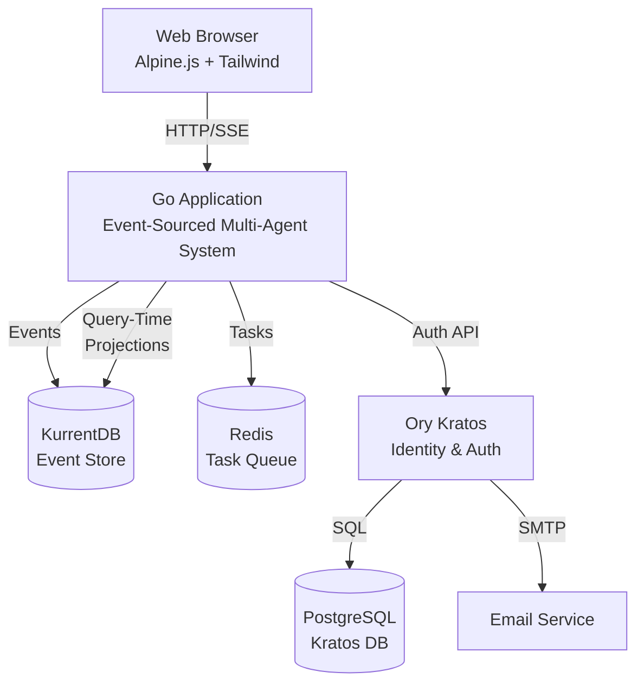

# School with AI

A chat application built with Go, Templ, Tailwind CSS, and Alpine.js, implementing the AG-UI protocol for AI agent interactions.

## Repository Statistics

## System Architecture

### Component Overview

- **Web Browser**: Frontend with Alpine.js for reactivity, Tailwind CSS for styling
- **Go Application**: Event-sourced multi-agent system with query-time projections
- **KurrentDB**: PostgreSQL-backed event store (single source of truth)
- **Redis**: Task queue for async job processing (Asynq)
- **Ory Kratos**: Identity and session management
- **PostgreSQL**: Database for Kratos user data
- **Email Service**: Notification service for authentication emails

### Key Patterns

- **Event Sourcing**: All state changes are stored as events in KurrentDB
- **Query-Time Projections**: State is rebuilt from events on every query (no in-memory cache)
- **CQRS**: Write commands append events, read queries rebuild from events
- **Multi-Agent**: Tool-based agent collaboration with transfer_to_agent and shared whiteboard

## Tech Stack

- **Backend**: Go with Templ templating
- **Frontend**: Alpine.js for reactivity
- **Styling**: Tailwind CSS v4
- **Components**: templui (shadcn/ui equivalent for Go/Templ)
- **Protocol**: AG-UI for server-sent events
- **Linear Algebra**: gosl library (LAPACK/OpenBLAS integration)
