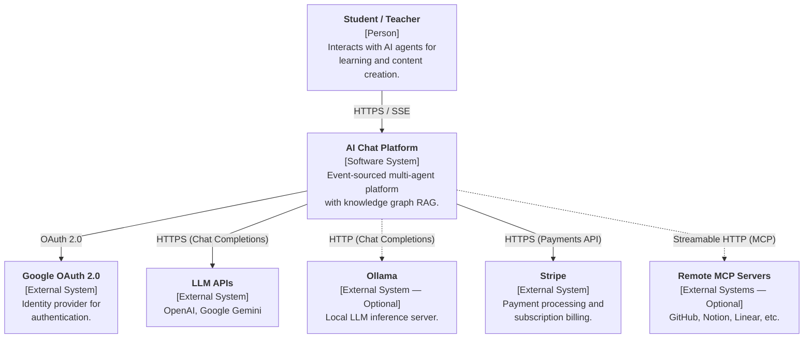
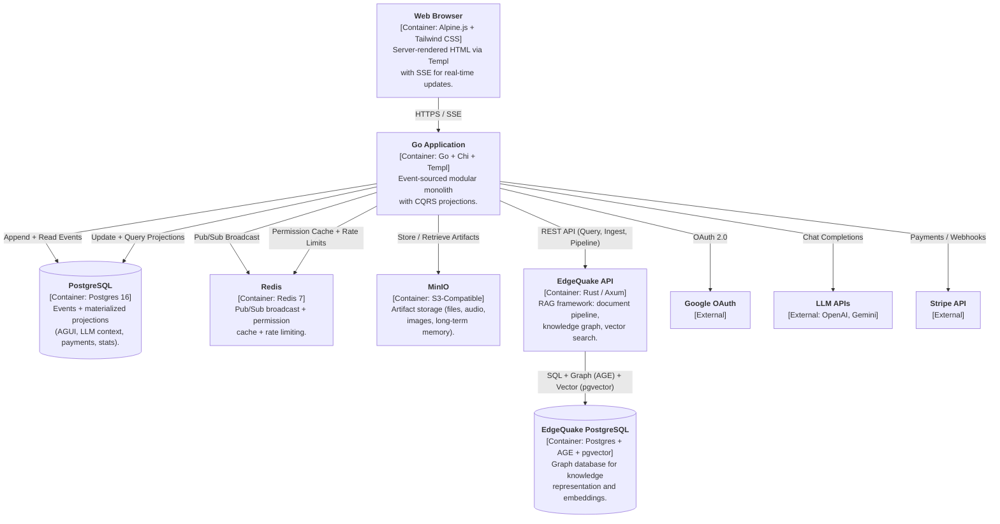
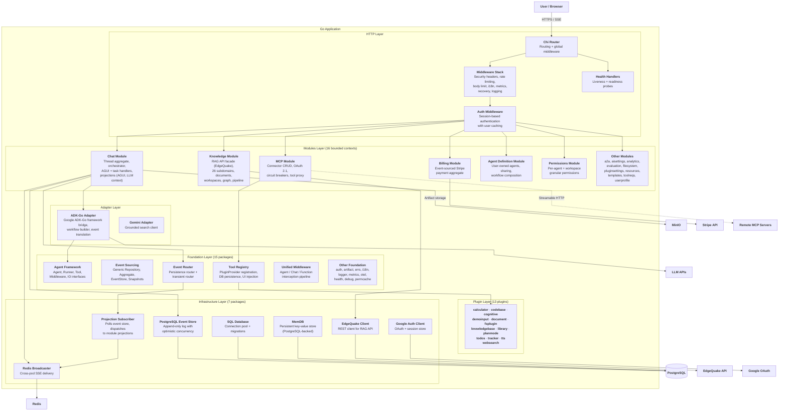

# AI Chat Platform

An event-sourced, multi-agent AI chat platform built with Go, Templ, Tailwind CSS, and Alpine.js. Implements the AG-UI protocol for real-time agent interactions, with a modular plugin system for tools and MCP connector support for remote tool servers.

[Changelog](CHANGELOG.md) · [Developer Onboarding Guide](ONBOARDING.md)

## Repository Statistics

## System Context Diagram (Level 1)

## Containers Diagram (Level 2)

### Containers Overview

| Container | Technology | Description |
| :--- | :--- | :--- |
| **Web Browser** | Alpine.js, Tailwind CSS v4, Templ | Server-rendered HTML with client-side reactivity and SSE streaming. |
| **Go Application** | Go, Chi, Templ | Event-sourced modular monolith. Single binary serving HTTP, background projection workers, and real-time SSE streaming. 16 bounded-context modules, 15 tool plugins, ADK-Go agent framework adapter. |
| **PostgreSQL** | PostgreSQL 16 | Single database for both the append-only event log and all materialized read-model projections. |
| **Redis** | Redis 7 | Triple-duty: cross-pod Pub/Sub for real-time SSE delivery, distributed permission cache (TTL-based), and distributed per-IP rate limiting. |
| **MinIO** | MinIO (S3-compatible) | Private artifact storage for user uploads, audio recordings, images, and long-term memory files. Served via pre-signed URLs. |
| **EdgeQuake API** | Rust, Axum | Advanced RAG framework with document ingestion pipeline, knowledge graph extraction, and hybrid vector + graph search. |
| **EdgeQuake PostgreSQL** | PostgreSQL + Apache AGE + pgvector | Dedicated graph database with vector embeddings for knowledge representation. |
| **Google OAuth** | External | Identity provider — session-based authentication via Google OAuth 2.0. |
| **LLM APIs** | External (OpenAI, Gemini) | Chat completion providers. Per-user model and provider selection stored in the database. |
| **Stripe API** | External | Subscription billing with event-sourced payment aggregate and webhook integration. |

## Components Diagram (Level 3)

The following diagram zooms into the **Go Application** container. The system follows a **modular monolith** architecture (ADR-012, ADR-013) where each module is a self-contained bounded context under `modules/`. Components are grouped by architectural layer.

### Components Overview

| Component | Location | Description |
| :--- | :--- | :--- |
| **Chi Router** | `main.go` | HTTP routing with middleware pipeline (recovery, logging, metrics, security headers, rate limiting, body limit, i18n). |
| **Auth Middleware** | `foundation/auth` | Session-based authentication with 30s user caching (max 10k entries). Implements `RequireAuth()` and `OptionalAuth()` middleware. |
| **Health Handlers** | `foundation/health` | Public `/liveness` and `/readiness` endpoints with pluggable dependency health checks. |
| **Chat Module** | `modules/chat` | Core bounded context. Owns the event-sourced `ThreadAggregate`, `AgentOrchestrator` (event classification: durable vs transient), `ThreadManagement` (lifecycle), AGUI handlers (query side), task management handlers (command side), and two projections (AGUI read model, LLM context). Internal subdomains: `thread/`, `threadmgmt/`, `agentorchestrator/`, `agui/`, `taskmgmt/`, `projection/`, `chatread/`, `chatcontracts/`. |
| **Knowledge Module** | `modules/knowledge` | RAG bounded context wrapping EdgeQuake. 26 RAG subdomains (documents, workspaces, graph, pipeline, entities, chunks, conversations, etc.) plus the `edgequake/` service facade. |
| **MCP Module** | `modules/mcp` | MCP connector lifecycle — CRUD, OAuth 2.1 + PKCE, circuit breakers, bounded concurrency, tool discovery, and request proxy. Bridges remote MCP servers into the tool registry as ephemeral toolsets (ADR-010). |
| **Billing Module** | `modules/billing` | Event-sourced Stripe payment aggregate. Subscription lifecycle, lazy expiration, idempotent webhook processing, payment projection. |
| **Agent Definition Module** | `modules/agentdefinition` | User-owned agent definitions with CRUD, sharing, forking, and multi-agent workflow composition (sequential, parallel, loop via ADR-019). |
| **Permissions Module** | `modules/permissions` | Per-agent and workspace-level granular permissions. Tool requirement configuration and workspace provider abstraction. |
| **Other Modules** | `modules/*` | `a2a` (Agent-to-Agent protocol), `aisettings` (per-user LLM config), `analytics` (usage stats + statistics projection), `evaluation` (hallucination, rubric, safety evals), `filesystem` (S3/GitHub file management), `pluginsettings` (plugin config UI), `resources` (user uploads), `templates` (agent catalog), `toolreqs` (tool requirement specs), `userprofile` (identity + preferences). |
| **ADK-Go Adapter** | `adapters/adkgo` | Bridges the application to Google's ADK-Go agent framework. Builds workflow agents from composition graphs, translates ADK session events to thread domain events, resolves tools, and builds system prompts. 17 files. |
| **Gemini Adapter** | `adapters/gemini` | Implements `websearch.GroundedSearchClient` using the Google Gemini API for grounded web search. |
| **Plugin Layer** | `plugins/*` | 15 self-contained plugins each implementing `PluginProvider` from `foundation/toolregistry`. Each provides backend tool logic + optional Templ UI templates (ADR-008). |
| **Agent Framework** | `foundation/agent` | Framework-agnostic interfaces: `Agent`, `Runner`, `ExecutableTool`, `StreamingExecutableTool`, `AgentProvider`, `Middleware`. Supports hierarchical agent composition and multimodal content (text, images, audio, files, tool calls). Includes `agent/io` sub-package for human-in-the-loop I/O (ADR-001, ADR-006). |
| **Event Sourcing** | `foundation/eventsourcing` | Generic `Repository[T]` with optimistic concurrency, `BaseAggregate` with event queuing/replay, `SnapshotStore` (snapshots every 50 events), and typed `Deserializer` registry. |
| **Event Router** | `foundation/event` | Type-safe dual-router event dispatch — persistence router (feeds projection subscriber) and transient router (feeds Redis broadcaster). |
| **Tool Registry** | `foundation/toolregistry` | Central registry for all tool plugins. Manages `PluginProvider` registration, tool/toolset DB persistence, built-in tool caching, settings schema, and dynamic UI injection (ADR-008). |
| **Unified Middleware** | `foundation/agent` | Middleware pipeline intercepting three operation kinds: Agent runs, Chat (LLM) calls, and Function (tool) calls (ADR-006). |
| **Other Foundation** | `foundation/*` | `auth` (session middleware), `artifact` (S3 storage abstraction), `errs` (error types with HTTP mapping), `i18n` (English + Arabic RTL), `logger` (structured slog), `metrics` (expvar counters), `otel` (OpenTelemetry tracing), `health` (health checks), `debug` (pprof/expvar/statsviz), `permcache` (Redis-backed permission cache), `middleware` (HTTP middleware stack). |
| **PostgreSQL Event Store** | `infra/eventstore/postgres` | Append-only event log with optimistic concurrency and typed event deserialization. |
| **Projection Subscriber** | `infra/projection/subscriber` | Background worker polling the event store and dispatching events to module-owned projections. |
| **Redis Broadcaster** | `infra/projection` | Cross-pod event broadcaster via Redis Pub/Sub. Both durable and ephemeral events are broadcast synchronously for zero-latency SSE delivery (ADR-007). |
| **SQL Database** | `infra/sqldb` | PostgreSQL connection pool management and migration runner. Each module owns its own repository — repos are distributed across 18+ module packages, not centralized. |
| **Google Auth Client** | `infra/googleauth` | Google OAuth 2.0 client with session store. Handles consent flow, token exchange, and user upsert. |
| **EdgeQuake Client** | `infra/edgequake` | REST client for the EdgeQuake RAG API. |

### Key Architectural Patterns

| Pattern | Description | Relevant ADRs |
| :--- | :--- | :--- |
| **Modular Monolith** | 16 bounded-context modules under `modules/`, each owning its full vertical slice (handlers, services, domain, repository). Zero cross-module imports enforced by convention. Cross-module communication via interfaces wired at the composition root (`main.go`, `adapters.go`). | ADR-012, ADR-013 |
| **Event Sourcing** | All state changes persisted as an ordered sequence of events in a PostgreSQL-backed event store. Two aggregates: `ThreadAggregate` (conversations) and `PaymentAccountAggregate` (billing). | — |
| **CQRS** | Strict separation — command side (task handlers -> orchestrator -> event store) and query side (AGUI handlers -> projections). | — |
| **Materialized Projections** | Four PostgreSQL projections (AGUI, LLM context, payment, statistics) updated in real-time by a background projection subscriber. Projections are owned by their respective modules (`modules/chat/projection/`, `modules/billing/`, `modules/analytics/`). | — |
| **Event Classification** | Every event is explicitly classified as **durable** (persisted then broadcast) or **transient** (broadcast-only, never persisted). System recovers from durable events alone. | ADR-003, ADR-007 |
| **Synchronous Broadcast** | Durable events are broadcast to Redis immediately alongside persistence (outbox bypass), eliminating latency gaps between transient and durable event delivery. | ADR-007 |
| **Agent Framework Boundary** | Strict architectural boundary — the application interacts with agent frameworks only through `foundation/agent` interfaces. The `adapters/adkgo` adapter translates ADK-Go session events to thread domain events. | ADR-001, ADR-002, ADR-005 |
| **Multi-Agent Workflows** | Recursive tree composition of agents: sequential, parallel, and loop composites. Mapped directly to ADK-Go's nested agent model via the adapter layer. | ADR-019 |
| **Plugin Architecture** | Every toolset is a self-contained package under `plugins/` implementing `PluginProvider`. Backend logic + optional frontend Templ UI. Dynamic registry replaces hardcoded tool lists. | ADR-008 |
| **MCP Connectors** | User-registered remote MCP servers bridged into the plugin/permissions system as ephemeral toolsets. OAuth 2.1 + PKCE, circuit breakers, SSRF protection. | ADR-010 |
| **Unified Middleware** | Single middleware pipeline intercepting three operation kinds (Agent, Chat, Function) — enables cross-cutting concerns like tracing, rate limiting, and permission checks. | ADR-006 |
| **Pre-Upload Artifacts** | Files uploaded to S3 on attach (before send). Only ~100-byte URL references flow through the event/message pipeline instead of multi-MB base64 blobs. | ADR-011 |
| **Multi-Pod Scalability** | Redis Pub/Sub ensures real-time SSE delivery across all pods. A user connected to Pod A receives events from background tasks running on Pod B. | — |
| **Pointer-Based Domain Events** | All domain events handled as pointers throughout the lifecycle for compile-time type safety and correct type-switch matching. | ADR-004 |
| **Zero Leaf Files** | Domain types are localized into subdirectories within modules, not scattered at the module root. Leaf nodes of the directory tree represent logical components. | ADR-015 |

## Tech Stack

| Layer | Technology |
| :--- | :--- |
| **Backend** | Go with [Templ](https://templ.guide) server-side templating |
| **Frontend** | Alpine.js for reactivity, [templui](https://templui.io) component library |
| **Styling** | Tailwind CSS v4 |
| **Protocol** | [AG-UI](https://github.com/ag-ui-protocol/ag-ui) for server-sent events |
| **Event Store** | PostgreSQL (append-only log with optimistic concurrency) |
| **Agent Framework** | [ADK-Go](https://google.github.io/adk-go/) (Google Agent Development Kit) via adapter layer |
| **RAG** | [EdgeQuake](edgequake/) — Rust framework with Apache AGE graph + pgvector |
| **Object Storage** | MinIO (S3-compatible) for artifacts and long-term memory |
| **Authentication** | Google OAuth 2.0 with cookie sessions |
| **Billing** | Stripe (event-sourced payment aggregate) |
| **LLM Providers** | OpenAI, Google Gemini, Ollama (per-user selection) |
| **Tool Protocol** | [MCP](https://modelcontextprotocol.io/) (Streamable HTTP transport) for remote tool servers |
| **Observability** | OpenTelemetry spans, expvar/pprof debug server, state machine visualization |
| **TLS** | Direct TLS termination (X25519 / P-256 curves) |

## Debugging

The application exposes endpoints to visualize the internal state machines of the Agent Orchestrator. These diagrams are generated in real-time from the running code. 

By default, these are served on the debug server (port `4015` as per `.env`).

| Endpoint | Link | Description |
| :--- | :--- | :--- |
| **Engine State Machine** | [View Graph (SVG)](http://localhost:4015/api/debug/state-machines/engine) \| [View DOT](http://localhost:4015/api/debug/state-machines/engine?format=dot) | Visualizes the high-level Engine state machine. |
| **Tool Lifecycle State Machine** | [View Graph (SVG)](http://localhost:4015/api/debug/state-machines/tool) \| [View DOT](http://localhost:4015/api/debug/state-machines/tool?format=dot) | Visualizes the Tool lifecycle state machine. |

**Query Parameters:**
-   `format=svg` (default): Returns the graph as an SVG image.
-   `format=dot` (or `text`): Returns the raw DOT graph text description.
