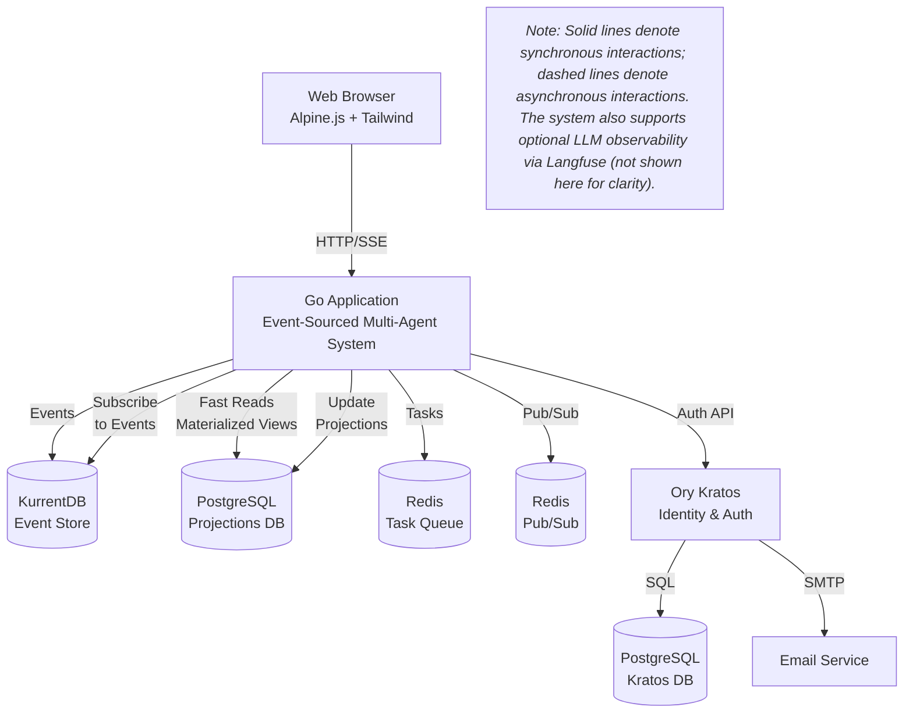
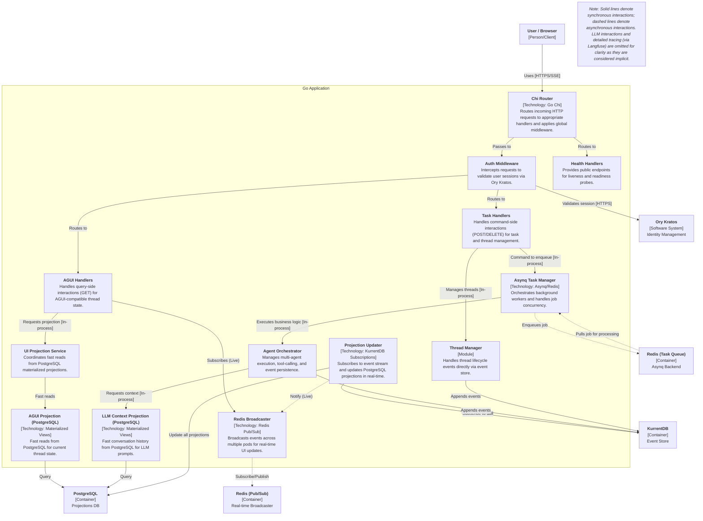

# School with AI

A chat application built with Go, Templ, Tailwind CSS, and Alpine.js, implementing the AG-UI protocol for AI agent interactions.

[Changelog](CHANGELOG.md)

## Repository Statistics

## Containers Diagram

### Containers Overview

- **Web Browser**: Frontend with Alpine.js for reactivity, Tailwind CSS for styling
- **Go Application**: Event-sourced multi-agent system with PostgreSQL materialized projections
- **KurrentDB**: PostgreSQL-backed event store (single source of truth for events)
- **PostgreSQL (App)**: Materialized projection database for fast reads (updated in real-time via event subscription)
- **Redis (Task Queue)**: Distributed task queue (Asynq) for background agent execution
- **Redis (Pub/Sub)**: Real-time event broadcaster for multi-pod scalability
- **Ory Kratos**: Identity and session management
- **PostgreSQL (Kratos)**: Database for Kratos user data
- **Email Service**: Notification service for authentication emails
- **Langfuse**: LLM observability platform for tracing agent executions, handoffs, and responses
- **PostgreSQL (Langfuse)**: Database for Langfuse traces and metadata
- **ClickHouse**: Analytics database for Langfuse metrics and aggregations
- **MinIO**: S3-compatible object storage for Langfuse media and event logs

## Components Diagram (Level 3)

The following diagram zooms into the **Go Application** container to show its internal components, their responsibilities, technologies, and interactions.

### Components Overview

| Name | Technology | Description |
| :--- | :--- | :--- |
| **Chi Router** | Go Chi | High-performance routing with middleware for panic recovery, logging, and metrics. |
| **Auth Middleware** | - | Security layer that enforces session requirements using external Kratos identity service. |
| **Health Handlers** | - | Public system status endpoints used for infrastructure health checks. |
| **Task Handlers** | - | The "Command" side of CQRS, transforming HTTP requests into background tasks. |
| **AGUI Handlers** | - | The "Query" side of CQRS, serving structured JSON/SSE for the AGUI frontend. |
| **Asynq Task Manager** | Asynq/Redis | Reliable task queueing and processing with retry logic and priority management. |
| **Thread Manager** | - | Handles thread lifecycle events (creation, deletion) directly via event store adapter. |
| **UI Projection Service** | - | Domain logic for fast reads from PostgreSQL materialized projections. |
| **Agent Orchestrator** | - | Manages LLM interactions, tool-calling loops, and agent handoffs. (Package: `services/agentorchestrator`) |
| **Projection Updater** | KurrentDB Subscriptions | Subscribes to KurrentDB event stream and updates PostgreSQL projections in real-time. |
| **Redis Broadcaster** | Redis Pub/Sub | Distributed event broadcaster that ensures real-time updates are delivered across all application pods. |
| **LLM Context Projection** | PostgreSQL Materialized Views | Fast conversation history from PostgreSQL for LLM prompts (3-8ms reads). |
| **AGUI Projection** | PostgreSQL Materialized Views | Fast reads from PostgreSQL tables that are kept up-to-date via event subscription (3-8ms vs 50-500ms). |

### Key Patterns

- **Event Sourcing**: All state changes are persisted as a sequence of events in KurrentDB.
- **Materialized Projections**: PostgreSQL tables updated in real-time via event subscription for fast reads (~100x faster than query-time).
- **Event Subscription**: Projection updater subscribes to KurrentDB `$all` stream and incrementally updates both projections (AGUI, LLM Context).
- **CQRS**: Clear separation between command side (Task Handlers writing events) and query side (AGUI Handlers reading projections).
- **Multi-Pod Scalability**: Real-time events are broadcasted via **Redis Pub/Sub**. This ensures that even if a user is connected to Pod A but their background task is running on Pod B, they still receive real-time UI updates seamlessly.
- **Multi-Agent Orchestration**: Collaborative agent execution with explicit handoff protocols.

## Tech Stack

- **Backend**: Go with Templ templating
- **Frontend**: Alpine.js for reactivity
- **Styling**: Tailwind CSS v4
- **Components**: templui (shadcn/ui equivalent for Go/Templ)
- **Protocol**: AG-UI for server-sent events
- **Linear Algebra**: gosl library (LAPACK/OpenBLAS integration)
