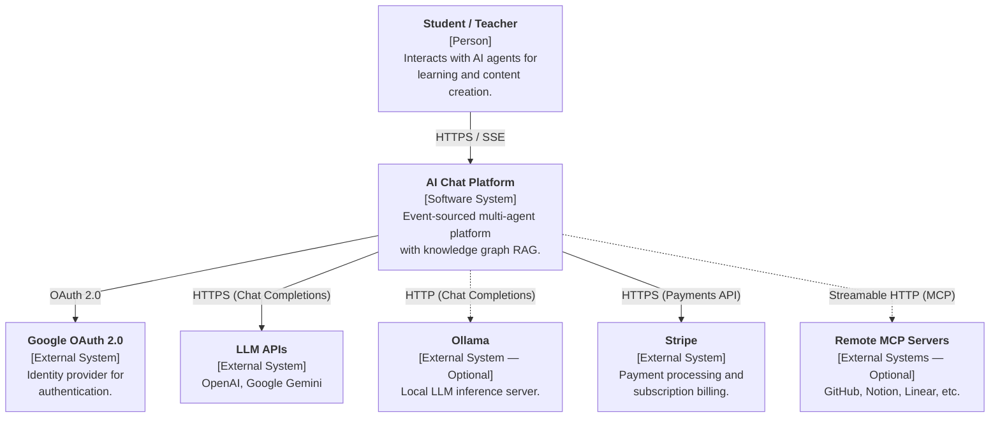
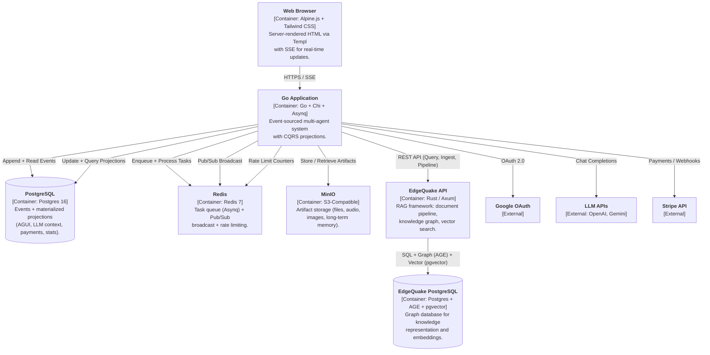

# AI Chat Platform

An event-sourced, multi-agent AI chat platform built with Go, Templ, Tailwind CSS, and Alpine.js. Implements the AG-UI protocol for real-time agent interactions, with a modular plugin system for tools and MCP connector support for remote tool servers.

[Changelog](CHANGELOG.md) · [Developer Onboarding Guide](ONBOARDING.md)

## Repository Statistics

## System Context Diagram (Level 1)

## Containers Diagram (Level 2)

### Containers Overview

| Container | Technology | Description |
| :--- | :--- | :--- |
| **Web Browser** | Alpine.js, Tailwind CSS v4, Templ | Server-rendered HTML with client-side reactivity and SSE streaming. |
| **Go Application** | Go, Chi, Asynq, Templ | Event-sourced multi-agent system. Single binary serving HTTP, background workers, and projections. |
| **PostgreSQL** | PostgreSQL 16 | Single database for both the append-only event log and all materialized read-model projections. |
| **Redis** | Redis 7 | Triple-duty: Asynq distributed task queue, cross-pod Pub/Sub for real-time SSE delivery, and distributed per-IP rate limiting. |
| **MinIO** | MinIO (S3-compatible) | Private artifact storage for user uploads, audio recordings, images, and long-term memory files. Served via pre-signed URLs. |
| **EdgeQuake API** | Rust, Axum | Advanced RAG framework with document ingestion pipeline, knowledge graph extraction, and hybrid vector + graph search. |
| **EdgeQuake PostgreSQL** | PostgreSQL + Apache AGE + pgvector | Dedicated graph database with vector embeddings for knowledge representation. |
| **Google OAuth** | External | Identity provider — session-based authentication via Google OAuth 2.0. |
| **LLM APIs** | External (OpenAI, Gemini) | Chat completion providers. Per-user model and provider selection stored in the database. |
| **Stripe API** | External | Subscription billing with event-sourced payment aggregate and webhook integration. |

## Components Diagram (Level 3)

The following diagram zooms into the **Go Application** container. Components are grouped by architectural layer.

```mermaid
%%{init: {'flowchart': {'curve': 'linear'}}}%%
graph TB
    User["<b>User / Browser</b>"]

    subgraph GoApp["Go Application"]

        subgraph HTTP["HTTP Layer"]
            Router["<b>Chi Router</b><br/>Routing + global middleware"]
            MWStack["<b>Middleware Stack</b><br/>Security headers, rate limiting,<br/>body limit, i18n, metrics,<br/>recovery, logging"]
            AuthMW["<b>Google OAuth Auth</b><br/>Session-based authentication"]
            HealthH["<b>Health Handlers</b><br/>Liveness + readiness probes"]
        end

        subgraph Handlers["Handler Layer (19 modules)"]
            TaskH["<b>Task Management</b><br/>Command side: send message,<br/>agent run, artifacts, memory,<br/>toolsets, plugins"]
            AGUIH["<b>AGUI Handlers</b><br/>Query side: thread state,<br/>messages, SSE streaming"]
            KnowledgeH["<b>Knowledge Handlers</b><br/>KB UI + API: documents,<br/>workspaces, graph, pipeline"]
            MCPH["<b>MCP Handlers</b><br/>Connector CRUD, OAuth,<br/>connect/disconnect, tool proxy"]
            MultiAgentH["<b>Multi-Agent Handlers</b><br/>Workflow orchestration,<br/>catalog forking, execution"]
            BillingH["<b>Billing Handlers</b><br/>Stripe intents, status,<br/>webhooks"]
            OtherH["<b>Other Handlers</b><br/>Agent store, catalog, AI settings,<br/>resources, profile, preferences,<br/>statistics, ratings, co-writer"]
        end

        subgraph Services["Service Layer"]
            Orchestrator["<b>Agent Orchestrator</b><br/>Event classification (durable vs transient),<br/>persistence, broadcast, error handling"]
            TaskMgr["<b>Asynq Task Manager</b><br/>Async job queue with<br/>retry + priority"]
            ThreadMgmt["<b>Thread Management</b><br/>Thread lifecycle via<br/>event store"]
            ToolReg["<b>Tool Registry</b><br/>Plugin registration +<br/>DB persistence"]
            MCPDiscovery["<b>MCP Plugin Discovery</b><br/>Remote connector lifecycle,<br/>OAuth, circuit breaker"]
            BillingS["<b>Billing Service</b><br/>Event-sourced Stripe<br/>payment aggregate"]
            EdgequakeS["<b>EdgeQuake Service</b><br/>REST facade to RAG API"]
            ArtifactS["<b>Artifact Service</b><br/>S3/MinIO storage"]
            MemoryS["<b>Memory Service</b><br/>Long-term memory (S3)"]
            OtherS["<b>Other Services</b><br/>Agent store, AI settings,<br/>permissions, resources,<br/>student profile, title gen"]
        end

        subgraph Plugins["Plugin Layer (15 plugins)"]
            PluginList["<b>agentmemory</b> · <b>artifacts</b> · <b>askuser</b><br/><b>calculator</b> · <b>codebase</b> · <b>cognitive</b><br/><b>document</b> · <b>fsplugin</b> · <b>knowledgebase</b><br/><b>library</b> · <b>planmode</b> · <b>todos</b><br/><b>tracker</b> · <b>tts</b> · <b>websearch</b>"]
        end

        subgraph Foundation["Foundation Layer"]
            AgentSDK["<b>Agent SDK</b><br/>Core abstractions, engine,<br/>LLM adapters (OpenAI,<br/>Gemini, Ollama), I/O"]
            AgentFW["<b>Agent Framework</b><br/>Agent, Runner, Tool,<br/>Middleware interfaces"]
            EventRouter["<b>Event Router</b><br/>Persistence router +<br/>transient router"]
            UnifiedMW["<b>Unified Middleware</b><br/>Agent / Chat / Function<br/>interception pipeline"]
            Metrics["<b>Metrics + OTel</b><br/>Counters, spans, traces"]
        end

        subgraph Infra["Infrastructure Layer"]
            EventStore["<b>PostgreSQL Event Store</b><br/>Append-only log with<br/>optimistic concurrency"]
            Projections["<b>Projection Updater</b><br/>Polls event store, updates<br/>4 projections in real-time"]
            AGUIProj["<b>AGUI Projection</b>"]
            LLMProj["<b>LLM Context Projection</b>"]
            PayProj["<b>Payment Projection</b>"]
            StatsProj["<b>Statistics Projection</b>"]
            RedisB["<b>Redis Broadcaster</b><br/>Cross-pod SSE delivery"]
            DBRepos["<b>SQL Repositories</b><br/>11 repos + migrations"]
            GoogleAuth["<b>Google Auth Client</b><br/>OAuth + session store"]
        end
    end

    AppPostgres[("<b>PostgreSQL</b>")]
    Redis["<b>Redis</b>"]
    MinIO["<b>MinIO</b>"]
    EdgeQuake["<b>EdgeQuake API</b>"]
    GoogleOAuthExt["<b>Google OAuth</b>"]
    LLMAPIs["<b>LLM APIs</b>"]
    StripeAPI["<b>Stripe API</b>"]

    User -->|"HTTPS / SSE"| Router
    Router --> MWStack --> AuthMW
    AuthMW --> TaskH & AGUIH & KnowledgeH & MCPH & BillingH & OtherH
    Router --> HealthH

    TaskH --> TaskMgr --> Orchestrator
    TaskH --> ThreadMgmt
    AGUIH --> AGUIProj
    AGUIH -->|"Live SSE"| RedisB
    KnowledgeH --> EdgequakeS
    MCPH --> MCPDiscovery
    BillingH --> BillingS

    Orchestrator --> AgentSDK
    Orchestrator --> EventStore
    Orchestrator --> EventRouter
    Orchestrator --> RedisB

    AgentSDK --> UnifiedMW
    AgentSDK --> LLMAPIs

    ToolReg --> PluginList
    MCPDiscovery --> ToolReg

    EventRouter --> Projections
    Projections --> AGUIProj & LLMProj & PayProj & StatsProj
    Projections --> RedisB

    EventStore --> AppPostgres
    AGUIProj --> AppPostgres
    LLMProj --> AppPostgres
    PayProj --> AppPostgres
    StatsProj --> AppPostgres
    DBRepos --> AppPostgres
    TaskMgr --> Redis
    RedisB --> Redis
    ArtifactS --> MinIO
    MemoryS --> MinIO
    EdgequakeS --> EdgeQuake
    GoogleAuth --> GoogleOAuthExt
    BillingS --> StripeAPI
    ThreadMgmt --> EventStore
```

### Components Overview

| Component | Technology | Description |
| :--- | :--- | :--- |
| **Chi Router** | Go Chi | HTTP routing with middleware pipeline (recovery, logging, metrics, security headers, rate limiting, body limit, i18n). |
| **Google OAuth Auth** | `infra/googleauth` | Session-based authentication via Google OAuth 2.0 with cookie session store. |
| **Health Handlers** | — | Public `/liveness` and `/readiness` endpoints with dependency health checks. |
| **Task Management** | `handlers/taskmgmt` | Command side of CQRS — message send, agent runs, artifact upload, memory, toolset management, plugin UI. |
| **AGUI Handlers** | `handlers/agui` | Query side of CQRS — thread listing, message history, live SSE streaming via AG-UI protocol. |
| **Knowledge Handlers** | `handlers/knowledge` | Full knowledge base UI and API — document upload, workspace management, graph exploration, pipeline control. |
| **MCP Handlers** | `handlers/mcp` | MCP connector CRUD, OAuth callback, connect/disconnect, tool discovery, request proxy. |
| **Billing Handlers** | `handlers/billing` | Stripe payment intents, subscription status, webhook processing. |
| **Agent Orchestrator** | `services/agentorchestrator` | Core orchestration loop — classifies events as **durable** (persisted to event store) or **transient** (broadcast-only), then persists and/or broadcasts accordingly (ADR-003, ADR-007). |
| **Asynq Task Manager** | `services/taskmanagement` | Distributed background job queue via Asynq/Redis with retry logic and AG-UI event conversion. |
| **Thread Management** | `services/threadmgmt` | Thread lifecycle (create, delete) via event store aggregate. |
| **Tool Registry** | `services/toolregistry` | Central registry for all tool plugins. Manages `PluginProvider` registration, tool/toolset DB persistence, and dynamic UI injection (ADR-008). |
| **MCP Plugin Discovery** | `services/plugindiscovery` | Remote MCP connector lifecycle — OAuth 2.1 + PKCE, circuit breakers, bounded concurrency, ephemeral toolset registration (ADR-010). |
| **Billing Service** | `services/billing` | Event-sourced payment aggregate with Stripe SDK. Subscription lifecycle, lazy expiration, idempotent webhook processing. |
| **EdgeQuake Service** | `services/edgequake` | HTTP facade to the Rust RAG API — documents, query, workspaces, pipeline, graph, entities, relationships. |
| **Artifact Service** | `services/artifact` | S3/MinIO storage for user files, audio, images. Pre-upload pattern with HTTP Range streaming (ADR-011). |
| **Memory Service** | `services/memory` | Long-term memory stored as `MEMORIES.md` in S3. Read/write via memory plugin tool. |
| **Plugin Layer** | `plugins/*` | 9 self-contained plugins each implementing `PluginProvider`: calculator, codebase, cognitive, document, elicitation, knowledgebase, library, memory, tts. Each provides backend logic + Templ UI templates (ADR-008). |
| **Agent SDK** | `foundation/agentsdk` | Framework-isolated agent engine with LLM iteration loop, tool execution, stream processing, and human-in-the-loop I/O. LLM adapters for OpenAI, Gemini, and Ollama (ADR-001, ADR-005). |
| **Agent Framework** | `foundation/agent` | Framework-agnostic interfaces: `Agent`, `Runner`, `ExecutableTool`, `StreamingExecutor`, `AgentProvider`, `Middleware`. Supports workflow composition: sequential, parallel, loop, and conditional routing (ADR-006). |
| **Event Router** | `foundation/event` | Dual-router event dispatch — persistence router (feeds projection updater) and transient router (feeds Redis broadcaster). |
| **Unified Middleware** | `foundation/agent` | Echo-inspired middleware pipeline intercepting three operation kinds: Agent runs, Chat (LLM) calls, and Function (tool) calls (ADR-006). |
| **PostgreSQL Event Store** | `infra/eventstore/postgres` | Append-only event log with optimistic concurrency and typed event deserialization. |
| **Projection Updater** | `infra/projection` | Background worker polling the event store, updating 4 PostgreSQL projections (AGUI, LLM context, payment, statistics) with leader election. |
| **Redis Broadcaster** | `infra/projection` | Cross-pod event broadcaster via Redis Pub/Sub. Both durable and ephemeral events are broadcast synchronously for zero-latency SSE delivery (ADR-007). |
| **SQL Repositories** | `modules/*` | 9 PostgreSQL repositories across modules (agentdefinition, aisettings, filesystem, multiagent, permissions, pluginsettings, resources, toolreqs, userprofile) + migration runner. |

### Key Architectural Patterns

| Pattern | Description | Relevant ADRs |
| :--- | :--- | :--- |
| **Event Sourcing** | All state changes persisted as an ordered sequence of events in a PostgreSQL-backed event store. Two aggregates: `ThreadAggregate` (conversations) and `PaymentAccountAggregate` (billing). | — |
| **CQRS** | Strict separation — command side (Task Handlers → Orchestrator → Event Store) and query side (AGUI Handlers → Projections). | — |
| **Materialized Projections** | Four PostgreSQL projections (AGUI, LLM context, payment, statistics) updated in real-time by a background projection updater. Fast reads (~3-8ms) vs query-time aggregation (~50-500ms). | — |
| **Event Classification** | Every event is explicitly classified as **durable** (persisted then broadcast) or **transient** (broadcast-only, never persisted). System recovers from durable events alone. | ADR-003, ADR-007 |
| **Synchronous Broadcast** | Durable events are broadcast to Redis immediately alongside persistence (outbox bypass), eliminating latency gaps between transient and durable event delivery. | ADR-007 |
| **Agent SDK Boundary** | Strict architectural boundary — the application interacts with agent frameworks only through `foundation/agent` interfaces. Each framework adapter translates `core.Event` → `domain.Event`. | ADR-001, ADR-002, ADR-005 |
| **Plugin Architecture** | Every toolset is a self-contained package under `plugins/` implementing `PluginProvider`. Backend logic + frontend Templ UI. Dynamic registry replaces hardcoded tool lists. | ADR-008 |
| **MCP Connectors** | User-registered remote MCP servers bridged into the plugin/permissions system as ephemeral toolsets. OAuth 2.1 + PKCE, circuit breakers, SSRF protection. | ADR-010 |
| **Unified Middleware** | Single middleware pipeline intercepting three operation kinds (Agent, Chat, Function) — enables cross-cutting concerns like tracing, rate limiting, and permission checks. | ADR-006 |
| **Pre-Upload Artifacts** | Files uploaded to S3 on attach (before send). Only ~100-byte URL references flow through the event/message pipeline instead of multi-MB base64 blobs. | ADR-011 |
| **Multi-Pod Scalability** | Redis Pub/Sub ensures real-time SSE delivery across all pods. A user connected to Pod A receives events from background tasks running on Pod B. | — |
| **Pointer-Based Domain Events** | All domain events handled as pointers throughout the lifecycle for compile-time type safety and correct type-switch matching. | ADR-004 |

## Tech Stack

| Layer | Technology |
| :--- | :--- |
| **Backend** | Go with [Templ](https://templ.guide) server-side templating |
| **Frontend** | Alpine.js for reactivity, [templui](https://templui.io) component library |
| **Styling** | Tailwind CSS v4 |
| **Protocol** | [AG-UI](https://github.com/ag-ui-protocol/ag-ui) for server-sent events |
| **Event Store** | PostgreSQL (append-only log with optimistic concurrency) |
| **Task Queue** | [Asynq](https://github.com/hibiken/asynq) (Redis-backed distributed workers) |
| **RAG** | [EdgeQuake](edgequake/) — Rust framework with Apache AGE graph + pgvector |
| **Object Storage** | MinIO (S3-compatible) for artifacts and long-term memory |
| **Authentication** | Google OAuth 2.0 with cookie sessions |
| **Billing** | Stripe (event-sourced payment aggregate) |
| **LLM Providers** | OpenAI, Google Gemini, Ollama (per-user selection) |
| **Tool Protocol** | [MCP](https://modelcontextprotocol.io/) (Streamable HTTP transport) for remote tool servers |
| **Observability** | OpenTelemetry spans, expvar/pprof debug server, state machine visualization |
| **TLS** | Direct TLS termination (X25519 / P-256 curves) |

## Debugging

The application exposes endpoints to visualize the internal state machines of the Agent Orchestrator. These diagrams are generated in real-time from the running code. 

By default, these are served on the debug server (port `4015` as per `.env`).

| Endpoint | Link | Description |
| :--- | :--- | :--- |
| **Engine State Machine** | [View Graph (SVG)](http://localhost:4015/api/debug/state-machines/engine) \| [View DOT](http://localhost:4015/api/debug/state-machines/engine?format=dot) | Visualizes the high-level Engine state machine. |
| **Tool Lifecycle State Machine** | [View Graph (SVG)](http://localhost:4015/api/debug/state-machines/tool) \| [View DOT](http://localhost:4015/api/debug/state-machines/tool?format=dot) | Visualizes the Tool lifecycle state machine. |

**Query Parameters:**
-   `format=svg` (default): Returns the graph as an SVG image.
-   `format=dot` (or `text`): Returns the raw DOT graph text description.
