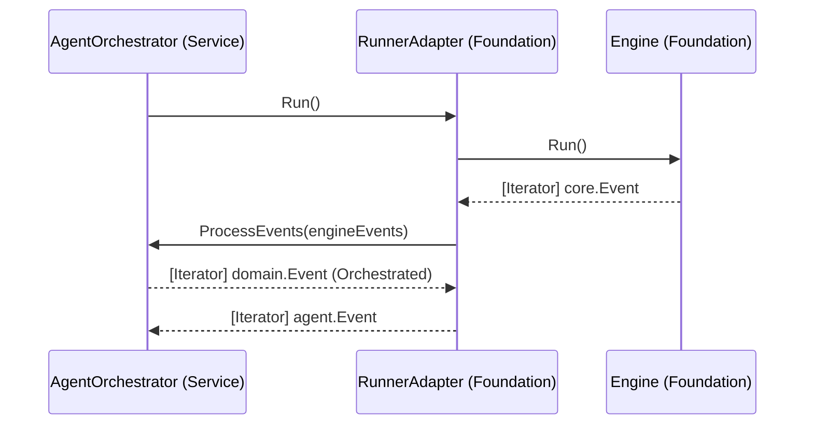
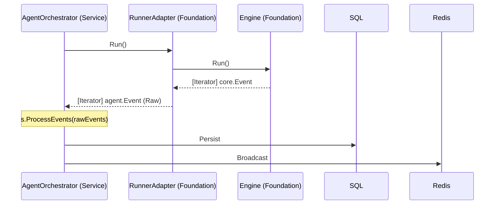

# Analysis & Refactoring Plan: Event Orchestration Decoupling

## 1. Technical Analysis

### Current State & Violation
The project follows a Clean Architecture where the **Foundation Layer** (`foundation/`) should be purely functional and agnostic of infrastructure side-effects (Persistence, SSE Broadcasting). 

However, there is currently an "Orchestration Leak" in the `RunnerAdapter` located at `foundation/agent/adapters/custom/runner.go`. 

**The Violation:**
The `RunnerAdapter` accepts an `EventProcessor` interface and explicitly orchestrates the processing (persistence/broadcasting) of events within its `Run` method. This makes the foundation layer responsible for *deciding* when and how events are handled by the infrastructure.

### Impacts
1.  **Tight Coupling**: The foundation adapter is coupled to the infrastructure lifecycle.
2.  **Ambiguous Responsibility**: The `AgentOrchestrator` service (which should be the true orchestrator) is partially bypassed as its internal logic is called by the foundation layer.
3.  **Redundant Iteration**: Events are iterated over multiple times as they pass through the adapter and then back to the service.

---

## 2. Refactoring Plan

### Goal
Move event orchestration (Persistence/Broadcasting) out of the `foundation/agent/adapters/custom` package and into the `services/agentorchestrator` package.

### Step 1: Clean up Foundation Adapter
**File**: `foundation/agent/adapters/custom/runner.go`
1.  Remove the `EventProcessor` interface and the `eventProcessor` field from `RunnerAdapter`.
2.  Update `NewRunnerAdapter` to remove the `eventProcessor` parameter.
3.  In the `Run` method:
    - **Remove** the call to `r.eventProcessor.ProcessEvents(...)`.
    - Instead, return the `engineDomainEvents` iterator directly to the caller.

### Step 2: Consolidate Orchestration in Service Layer
**File**: `services/agentorchestrator/service.go`
1.  Update the `ExecuteRun` method.
2.  Instead of just yielding events from `s.runner.Run(...)`, capture the iterator and pass it to `s.ProcessEvents(ctx, rawEvents)`.
3.  The `ProcessEvents` method will then handle:
    - **Persistence** (via `isDurable` and `persistDurableEvent`).
    - **Broadcasting** (via `emitter.Dispatch`).

### Step 3: Update Initialization
**File**: `main.go`
1.  Update the call to `custom.NewRunnerAdapter(...)` to match the new signature (remove the `agentOrchestrator` argument).

---

## 3. Implementation Details

### Current Pattern (Violated)

### Proposed Pattern (Corrected)

## 4. Expected Results
- The `foundation/` layer becomes a set of "Pure" components that only transform data.
- The `services/` layer gains full control over the transaction and side-effect lifecycle.
- Clearer audit trail and easier unit testing for both layers.
