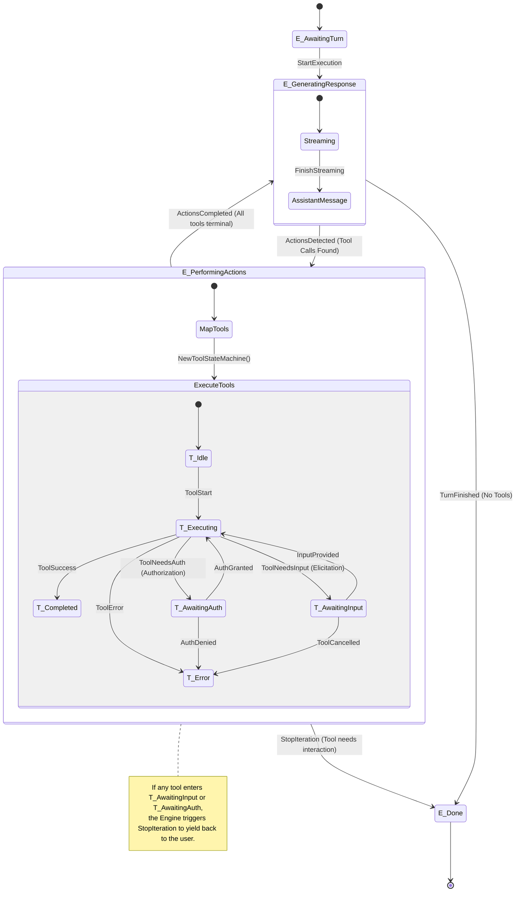
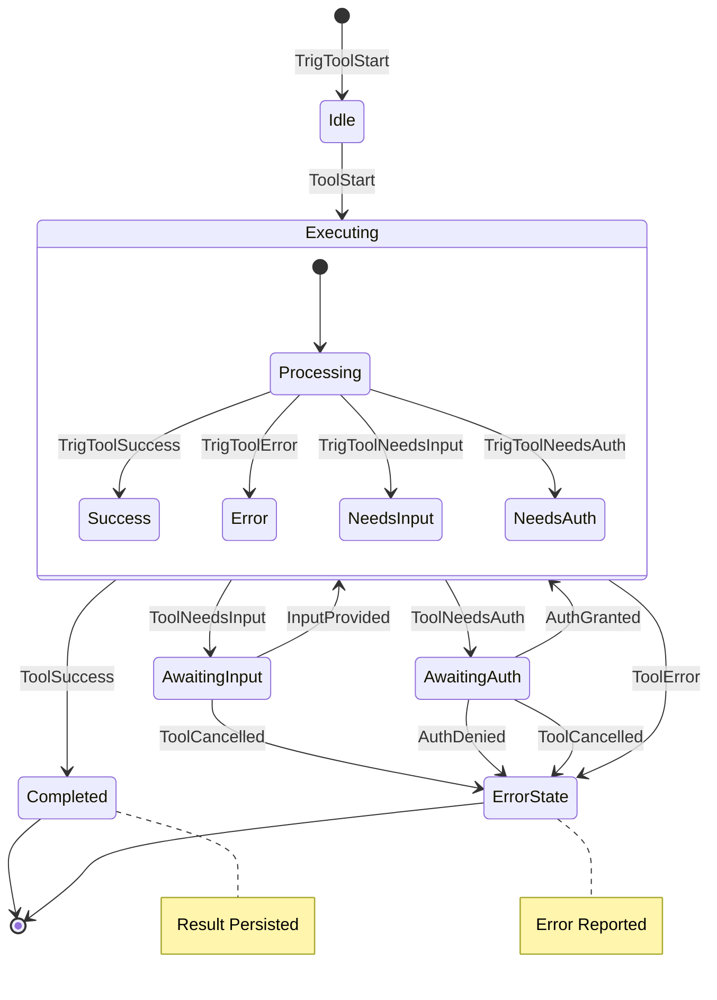

# State Machine Combinations & Visualization

This document describes the state machine models used in the orchestration engine and tool lifecycle.

## Combined State Machine Model

The system uses a layered state machine approach:
1.  **Engine (Outer Layer)**: Manages the iterative LLM loop and high-level execution flow.
2.  **Tool (Inner Layer)**: Manages the lifecycle of individual tool executions, including complex scenarios like user elicitation and authorization.

### State Legend
- **Engine States**: Prefixed with `E_`
- **Tool States**: Prefixed with `T_`

---

## Tool State Machine Diagram

Standalone lifecycle model for an individual tool call:

## Implementation Highlights

- **Stateless Library usage**: Both layers use `github.com/qmuntal/stateless`, allowing for declarative configuration of transitions and actions.
- **Hierarchical Modeling**: While functionally separate types, the `Engine` coordinates the `ToolStateMachines` within its `StatePerformingActions` lifecycle.
- **External State Storage**: The machines allow state resumption by recreating the machine and "firing" it based on persisted conversation history (reconciliation logic in `Engine.inferState`).
- **Concurrency Safety**: The `ToolStateMachine` is thread-safe and can be safely accessed by multiple goroutines:
  - The `stateless.StateMachine` library is internally thread-safe for state transitions
  - Mutable fields (`result`, `elicitation`, `observers`) are protected by a `sync.Mutex`
  - Observer callbacks are invoked without holding locks to prevent deadlocks
  - Read-only fields (`toolCall`, `executor`, `ctx`) are safe to access concurrently without locks

## Architecture & Event Flow

The `Engine` is the authoritative source of truth for both durable state and real-time streaming:

1.  **Centralized Emission**: Consolidated all event handling into a single `Engine.emit` helper.
    - **Durable Events**: State machine events (tool lifecycle, usage) are persisted to the EventStore.
    - **Streaming Events**: Transient events (tokens, delimiters) are dispatched directly to the `EventRouter` for performance.
2.  **Streamlined API**: The `ProcessUserMessage` call chain returns a simple `error`. Emission is handled internally by the engine via the `EventEmitter`.
3.  **Duplication Control**: A hybrid persist-or-dispatch strategy ensures events are delivered exactly once to the UI.
