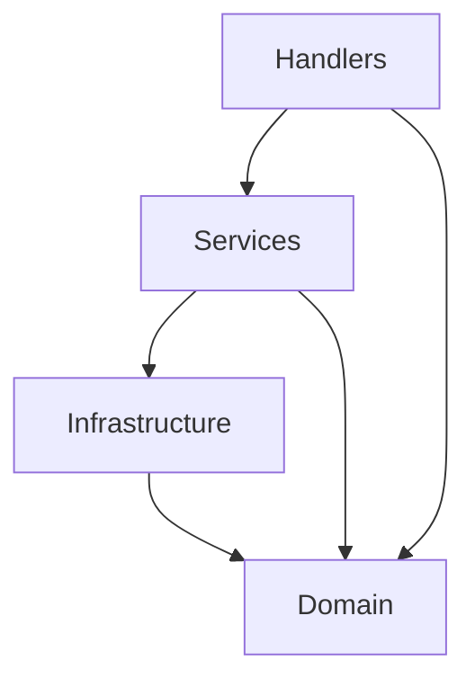

# ADR-001: Clean Architecture Layer Boundaries

**Status:** Accepted

**Date:** 2026-01-06

## Context

We need strict layer separation to maintain code quality as the application grows. Without enforced boundaries, handlers were directly accessing infrastructure, making testing difficult and creating tight coupling.

## Decision

Implement Clean Architecture with four layers and strict dependency rules:

**Dependency Rule:** Dependencies point inward only. Outer layers depend on inner layers, never reverse.

## Consequences

**Positive:**
- Testable: Mock service interfaces in handler tests
- Maintainable: Clear responsibilities per layer
- Flexible: Swap implementations without changing handlers

**Negative:**
- More files: Services wrap infrastructure
- Learning curve: Team must understand layer boundaries

## Enforcement

Pull requests violating these rules will be rejected. Use the grep command above to verify compliance before committing.
