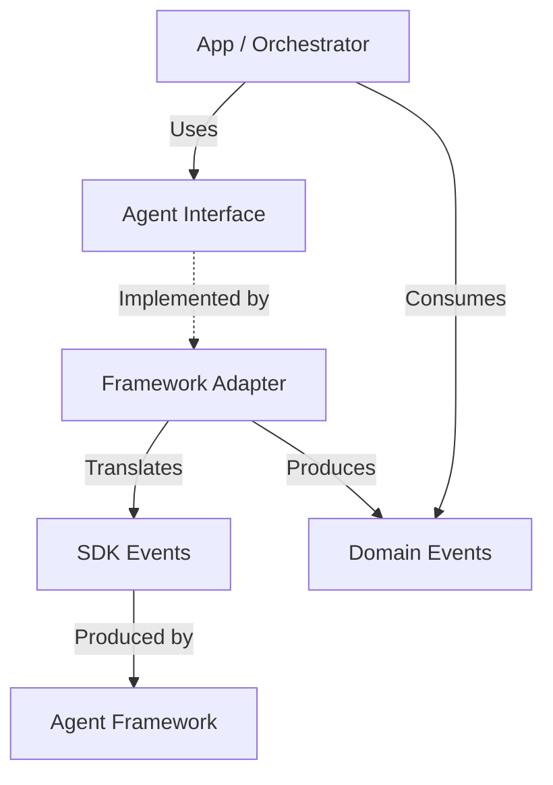

# ADR 001: Agent Framework Architectural Boundary and Event Translation

## Status
Proposed

## Context
Our Go web application currently has tight coupling with the internal `agentsdk` framework. The orchestration service directly calls the sdk engine and handles sdk-specific events (`core.Event`). This makes it difficult to support multiple agent frameworks (e.g., ADK-Go, Blades) and hides implementation details from the domain layer.

## Decision
We will enforce a strict architectural boundary between the application and agent frameworks:

1.  **Agent Interface as Sole Access Point**: The `foundation/agent` interface will be the only way the application interacts with any agent framework.
2.  **SDK-Specific Events**: Each agent framework will define its own internal event types (e.g., `agentsdk` uses `core.Event`).
3.  **Adapter Responsibility**: For each framework, a custom adapter will implement the `agent.Agent` interface.
4.  **Event Translation**: The adapter will be responsible for translating framework-specific events into `domain.Event` types.
5.  **Application Decoupling**: The application (including the orchestration service) will only depend on the `agent.Agent` interface and `domain.Event`. It will have no knowledge of `core.Event` or other framework-specific types.

## Architecture Diagram

## Consequences
- **Decoupling**: The domain layer is protected from framework implementation details.
- **Extensibility**: Adding a new agent framework only requires creating a new adapter and event translation logic.
- **Maintainability**: Event translation is centralized within the adapter layer.
- **Complexity**: An additional translation layer is introduced, but it's justified by the architectural benefits.
