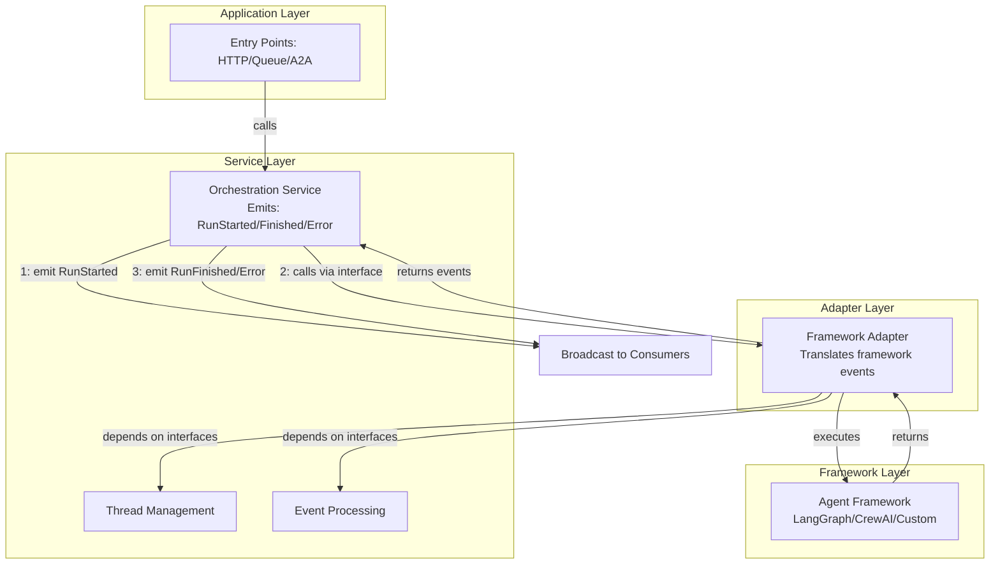

# ADR 002: Run Lifecycle Events and Service Layer Orchestration

## Status
Accepted

## Context
Agent execution requires clear lifecycle boundaries (RunStarted, RunFinished, RunError) for observability and coordination. Initially, these events were emitted by framework adapters, creating misplaced responsibilities, circular dependencies, and inverted dependency flow between layers.

## Decision

### 1. Layer Assignment

Run lifecycle management is a **service layer concern**. Service layer orchestrates execution and emits lifecycle boundaries. Adapter layer translates framework events, remains stateless.

**Constraint**: Only orchestration service may emit RunStarted, RunFinished, RunError.

### 2. Dependency Direction

Services depend on adapter abstractions (Runner interface). Adapters depend on service abstractions (ThreadManager, EventProcessor interfaces). No concrete cross-layer dependencies.

**Flow:**
```
Task Management → Orchestration Service → Adapter (via Runner interface)
Adapter → Thread/Event Services (via interfaces)
```

**Constraint**: Follow Dependency Inversion Principle - both layers depend on abstractions.

### 3. Event Classification

Run lifecycle events are **ephemeral** per ADR 003. They signal execution boundaries for real-time coordination, not domain state. Emitted before domain entities exist.

**Constraint**: MUST NOT persist to event store. Broadcast-only.

### 4. Event Semantics

Events follow domain semantics, not implementation details:
- `RunID` (execution context), not `MessageID` (domain entity)
- `ParentRunID` for lineage/branching
- `Input`/`Result` for execution I/O

**Constraint**: Schemas align with domain language, not internal models.

### 5. Orchestration Path

All entry points (HTTP, queue, A2A) route through orchestration service.

**Required:** `Entry Point → Orchestration → Adapter → Framework`
**Prohibited:** `Entry Point → Adapter` (bypasses orchestration)

## Architecture Diagram



## Consequences

**Positive:**
- Clear layer separation and framework independence
- Consistent lifecycle events across all execution paths
- Interface-based design enables testing and framework swapping
- Temporal decoupling from domain entity creation

**Negative:**
- Additional orchestration layer increases call stack depth
- Circular dependency requires post-construction wiring
- Multiple layers must coordinate on interface contracts

**Trade-off:** Architectural clarity over minimal latency

## Constraints

1. **Layer Responsibility**: Lifecycle emission is exclusively a service layer responsibility
2. **Dependency Direction**: Must follow Dependency Inversion Principle - depend on abstractions
3. **Event Persistence**: Ephemeral events must never be persisted to event store
4. **Event Schemas**: Must align with domain language, not internal models
5. **Orchestration Path**: All execution must route through orchestration service

## Related ADRs
- ADR 001: Agent Framework Architectural Boundary and Event Translation
- ADR 003: Event Classification - Ephemeral vs. Persistent
