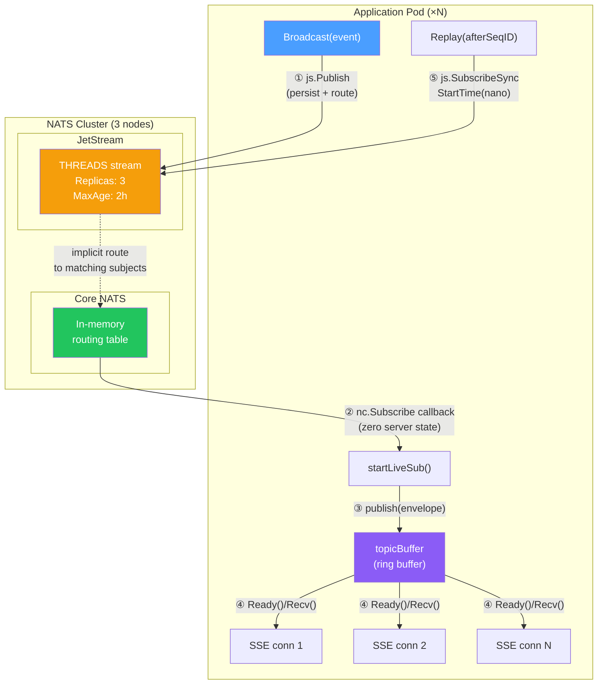
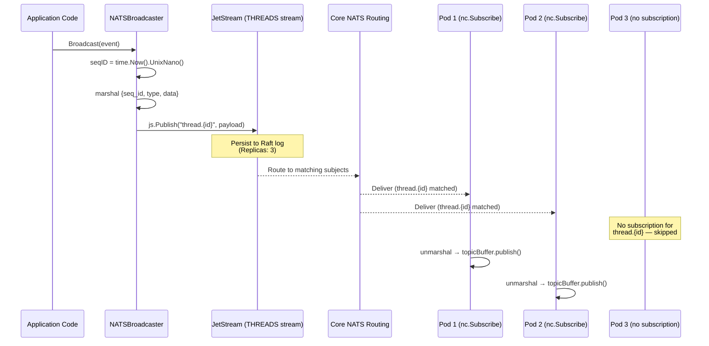
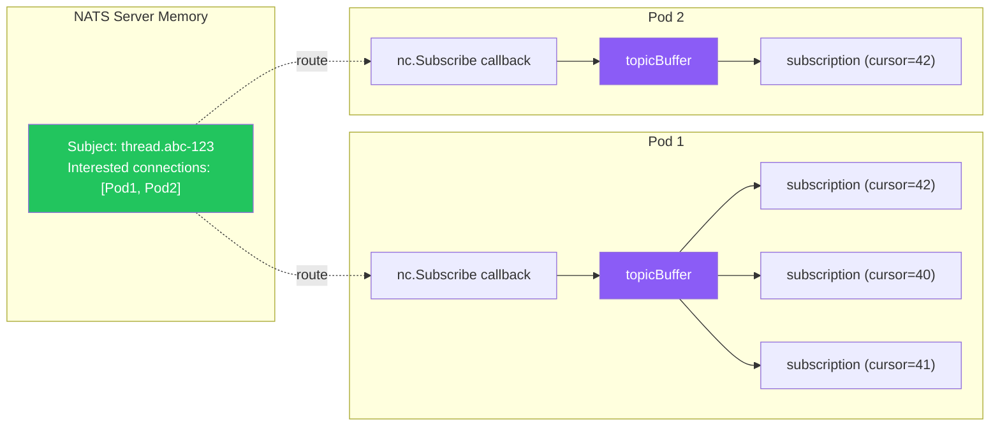
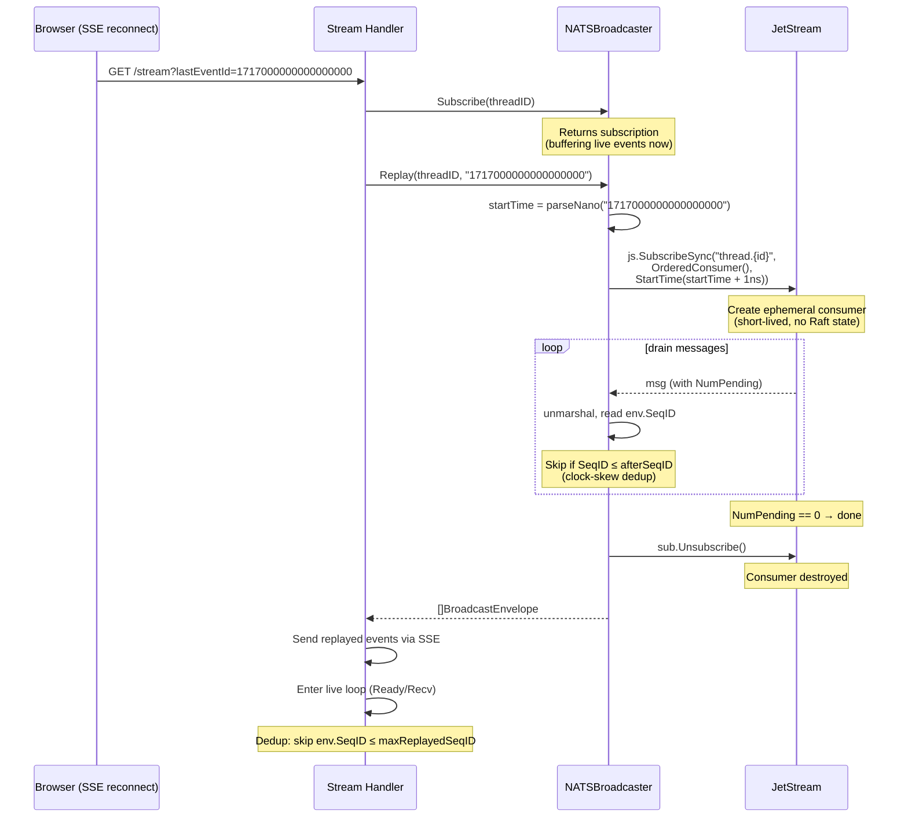
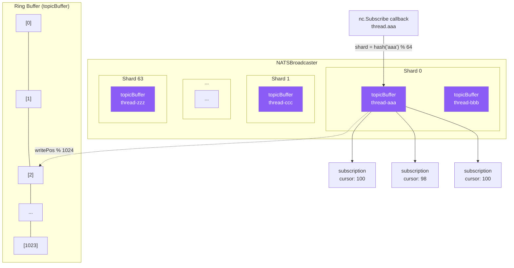
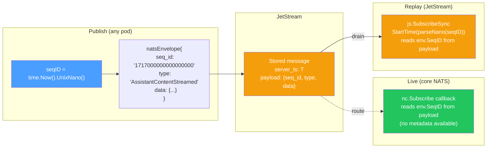
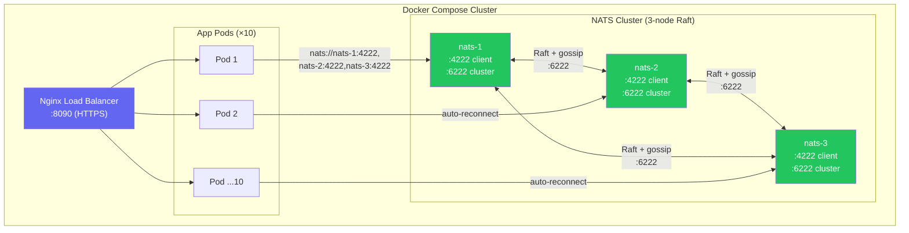
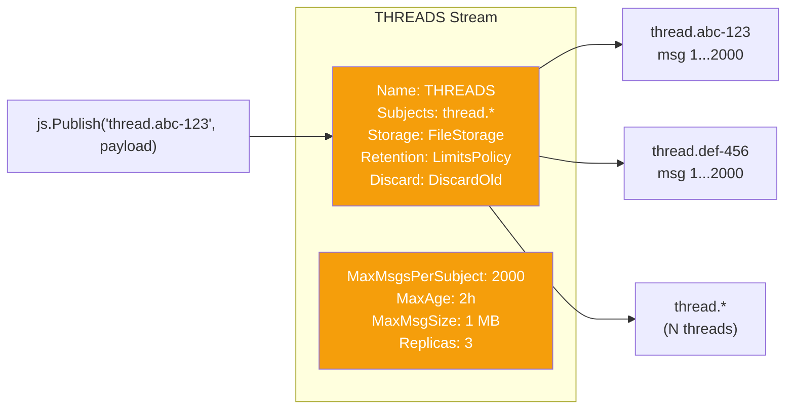
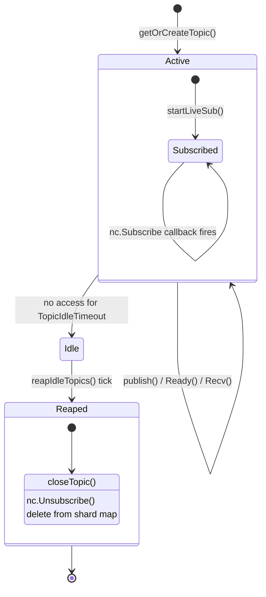

# ADR 018: Role of NATS in Real-Time Event Delivery

## Status

Accepted — supersedes ADR 017 (Redis Streams) for the event fan-out and replay transport.

## Context

ADR 017 introduced Redis Streams as the cross-pod replay buffer and Redis Pub/Sub for live delivery. As the system matured towards a 10-pod cluster deployment (and beyond to 1,000+ pods), two problems emerged:

1. **Redis is a single-writer bottleneck.** Every `XADD` + `PUBLISH` funnels through one Redis master. At 100 tokens/s × 10,000 streams = 2M Redis ops/s, the master becomes the throughput ceiling.

2. **No built-in clustering for Pub/Sub.** Redis Sentinel provides failover but not horizontal fan-out. All Pub/Sub messages flow through the master; read replicas do not participate in Pub/Sub routing.

NATS was selected as a replacement because it provides both concerns — **live fan-out** and **durable replay** — in a single clustered system with no single-writer bottleneck.

### Why NATS over Kafka, Pulsar, or Redis Streams?

| Criterion | NATS | Kafka | Pulsar | Redis Streams |
|---|---|---|---|---|
| Operational complexity | Single binary, zero dependencies | ZooKeeper/KRaft, topic partitioning | ZooKeeper, BookKeeper, brokers | Already in stack but single-writer |
| Latency (p99 fan-out) | < 1 ms | 2–5 ms (batch-oriented) | 2–5 ms | < 1 ms (single node) |
| Subject-level routing | Native — server filters at wire level | Partition-based, no subject filtering | Topic + subscription filtering | Channel-based, no wildcards |
| Embedded clustering | Built-in Raft for JetStream | Built-in (KRaft) | BookKeeper + ZK | Sentinel (failover only) |
| Memory per live subscriber | Zero (routing table entry) | Consumer group state | Cursor state | Channel subscriber list |

NATS is the only option that provides sub-millisecond fan-out with zero server-side state per live subscriber and built-in Raft-based durability — all in a single 20 MB binary.

## Decision

### Architecture Overview

NATS serves two distinct roles in the system, using two different protocol layers:



### 1. Dual-Protocol Design — Core NATS for Live, JetStream for Replay

The key insight is that live delivery and historical replay have fundamentally different requirements:

| Concern | Live delivery | Replay |
|---|---|---|
| Latency | < 1 ms critical | Seconds acceptable |
| Durability | Not needed — ring buffer absorbs gaps | Required — must survive pod restarts |
| Server state per subscriber | Must be zero at scale | Ephemeral consumer, short-lived |
| Delivery guarantee | At-most-once is fine | At-least-once required |

Using JetStream push consumers for live delivery (as a naive implementation would) creates a server-side consumer object for every active thread on every pod. At scale this is catastrophic:

```
10,000 SSE connections/pod × 1,000 pods = 10,000,000 JetStream consumers
```

Each consumer tracks delivery state, ACK windows, and Raft log entries. Millions of them overwhelm the NATS cluster.

**The fix:** live delivery uses `nc.Subscribe` (core NATS), which has zero server-side state — the server maintains only an in-memory routing table entry. Replay uses `js.SubscribeSync` (JetStream), which creates a short-lived ephemeral ordered consumer that is destroyed after draining.

### 2. Publish Path — Single Write, Dual Delivery



A single `js.Publish` call does two things atomically:
1. **Persists** the message in the JetStream THREADS stream (for replay)
2. **Routes** the message to all core NATS subscribers on matching subjects (for live delivery)

There is no double-write. The `seq_id` (UnixNano timestamp) is generated before publish and embedded in the JSON payload so that core NATS callbacks — which carry no JetStream metadata — can read a monotonic sequence ID.

### 3. Live Delivery Path — Zero Server-Side State



The NATS server stores one routing table entry per subject with active interest. This is a hash-map lookup — O(1), fixed memory, no Raft overhead. When a pod calls `nc.Subscribe("thread.abc-123", callback)`:

- The server adds the connection to the interest list for that subject
- On `nc.Unsubscribe` or connection close, the entry is removed
- **No consumer objects, no ACK tracking, no delivery state**

Within each pod, the `topicBuffer` ring buffer provides local fan-out. 5,000 SSE connections on the same thread share a single `topicBuffer` — each connection holds only a cursor (uint64). The signal-channel wake mechanism is O(1) regardless of subscriber count.

### 4. Replay Path — Ephemeral Ordered Consumer with StartTime



Replay uses `nats.StartTime` rather than `nats.StartSequence` because the SeqID is a UnixNano timestamp, not a JetStream sequence number. This decouples the replay position from JetStream-internal sequence numbering and allows the same SeqID to work for both live delivery (core NATS) and replay (JetStream).

The `OrderedConsumer()` option creates a lightweight, ephemeral consumer with no ACK tracking — it delivers messages in order and is destroyed on unsubscribe. It exists only for the duration of the synchronous drain loop (~milliseconds to seconds), not for the lifetime of the SSE connection.

### 5. In-Process Fan-Out — Sharded Topic Map



The 64-shard topic map ensures that operations on different threads never contend on the same mutex. Within a shard, each `topicBuffer` uses:

- A fixed-size ring buffer (default 1,024 entries) — no allocations on the hot path
- An `atomic.Pointer[signal]` for wake-up — closing the signal channel wakes all local subscribers in O(1)
- A cursor-based `subscription` struct that the broadcaster never tracks — when the HTTP handler stops calling `Ready()`/`Recv()`, the subscription is GC'd with no cleanup

### 6. Sequence ID Design — UnixNano in Payload



The SeqID is embedded in the payload rather than read from JetStream metadata because core NATS messages carry no metadata. This creates a clock-skew concern:

- **Publisher pod clock** generates the SeqID (UnixNano)
- **NATS server clock** assigns the message timestamp used by `StartTime`

With NTP, the skew is typically <1 ms. Replay subtracts a 100 ms safety margin from the start time to over-deliver, then filters `env.SeqID <= afterSeqID` in application code. Over-delivery is harmless; under-delivery (missed events) is prevented.

### 7. NATS Cluster Topology



The NATS cluster runs 3 nodes with full-mesh routing. JetStream streams are replicated to all 3 nodes (`Replicas: 3`) via Raft consensus. Each app pod connects to all 3 NATS nodes (`nats://nats-1:4222,nats://nats-2:4222,nats://nats-3:4222`) with auto-reconnect — if one node goes down, the client transparently fails over.

Configuration is shared across all nodes via a single `nats.conf`:

```
jetstream {
  store_dir: /data
  max_mem_store: 256mb
  max_file_store: 4gb
}
```

Node-specific settings (`--name`, `--cluster`, `--routes`) are passed via CLI arguments, keeping the config file identical for all three containers.

### 8. Stream Configuration



A single stream `THREADS` captures all thread events using the wildcard subject `thread.*`. Per-subject limits (`MaxMsgsPerSubject: 2000`) cap the replay buffer per thread. `DiscardOld` evicts the oldest messages when the cap is reached. `MaxAge: 2h` garbage-collects stale threads automatically.

The stream is created idempotently on startup (`ensureStream`) — if it already exists, its config is updated to match the desired state.

### 9. Lifecycle Management — Reaper



Topics are created lazily when the first SSE connection arrives for a thread. The reaper scans all 64 shards every `ReaperInterval` (default: 60s) and removes topics whose `lastAccess` timestamp exceeds `TopicIdleTimeout` (default: 10 min). On removal:

1. `closeTopic()` wakes all local subscribers with a closed signal
2. `nc.Unsubscribe()` removes the core NATS interest for the subject
3. The topic is deleted from the shard map

This ensures that abandoned threads do not accumulate core NATS subscriptions or in-process memory indefinitely.

## Consequences

### Positive

- **Zero server-side state for live delivery.** Core NATS `nc.Subscribe` creates no consumer objects. 10M concurrent subscriptions are just routing table entries — a hash-map lookup per message.
- **Single write per event.** `js.Publish` atomically persists (JetStream) and routes (core NATS). No double-write, no coordination.
- **HA with no single point of failure.** 3-node NATS cluster with Raft replication. Any node can go down without data loss or service interruption.
- **Eliminates Redis as a bottleneck.** Redis is retained for caching and session storage but is no longer in the real-time event delivery path.
- **Sub-millisecond fan-out.** Core NATS subject routing is pure in-memory — no disk I/O on the live path.
- **Bounded, self-cleaning resources.** Ring buffers are fixed-size; the reaper garbage-collects idle topics; `MaxAge` and `MaxMsgsPerSubject` cap the JetStream stream.

### Negative

- **New infrastructure dependency.** NATS must be deployed and monitored alongside the existing stack. Mitigated by NATS's single-binary simplicity and the existing Docker Compose cluster configuration.
- **Clock-skew sensitivity on replay.** The embedded UnixNano SeqID uses the publisher's clock; `nats.StartTime` uses the server's clock. A 100 ms safety margin + application-level dedup handles this, but NTP must be running on all nodes.
- **Core NATS is at-most-once.** If a pod's NATS connection drops mid-delivery, the live message is lost for that pod. The ring buffer + replay mechanism makes this recoverable — the client reconnects with `?lastEventId=` and replays from JetStream.
- **Single stream for all threads.** The `THREADS` stream holds events for all threads. At extreme scale (millions of active threads), the per-subject index may become large. JetStream's internal indexing is designed for this, but monitoring stream metadata size is advisable.

## Alternatives Rejected

| Alternative | Reason rejected |
|---|---|
| JetStream push consumers for live delivery | Creates a server-side consumer per thread per pod — millions of consumers at scale overwhelm Raft consensus |
| Redis Streams + Pub/Sub (ADR 017) | Single-writer Redis master becomes throughput bottleneck; no built-in horizontal fan-out for Pub/Sub |
| Kafka / Pulsar | Higher operational complexity (ZooKeeper, partitioning); higher latency (batch-oriented); overkill for subject-level routing |
| gRPC streaming between pods | Requires service mesh or manual connection management; N² connections for full fan-out; no built-in persistence |
| Embedded in-process only (no external bus) | Single-pod — reconnecting to a different pod loses all state; no replay across pods |

## Files Changed

| File | Change |
|---|---|
| `infra/projection/subscriber/redis_broadcaster.go` | `NATSBroadcaster` replaces `RedisBroadcaster`; `nc.Subscribe` for live, `js.Publish` for write, `js.SubscribeSync` + `StartTime` for replay; embedded UnixNano `seq_id` in `natsEnvelope`; 64-shard topic map with ring buffers; reaper for idle topics |
| `foundation/eventsourcing/event.go` | `BroadcastEnvelope.SeqID` changed from Redis Stream entry ID to UnixNano timestamp |
| `modules/chat/projection/agui/agui_projection.go` | `Replay` doc updated to reflect UnixNano SeqID format |
| `infra/cluster/nats.conf` | JetStream configuration: 256 MB memory store, 4 GB file store, 2 MB max payload |
| `docker-compose.cluster.yml` | 3-node NATS cluster (`nats-1`, `nats-2`, `nats-3`) with full-mesh routing; app pods connect to all 3 nodes with `SCHOOL_NATS_REPLICAS=3` |
