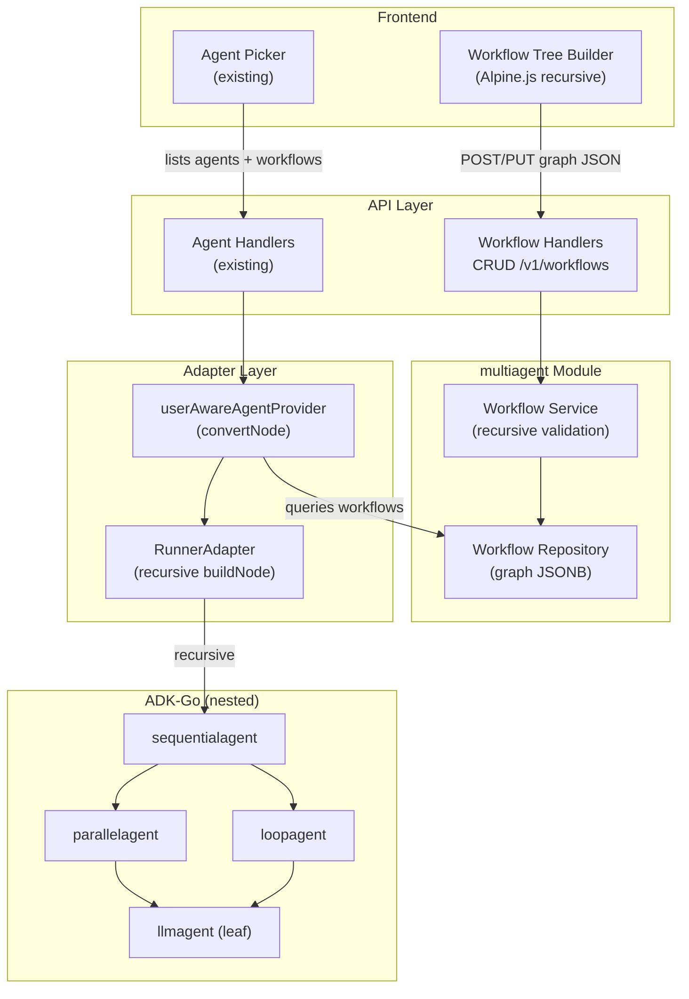

# ADR 019: Multi-Agent Workflow Composition

## Status

Accepted (Revised)

## Context

Users can create and configure individual agents (ADR 012, `agentstore` module). Each agent has a name, system prompt, and associated tools/knowledge bases. However, agents are **flat** — a user selects a single agent per conversation and that agent handles everything alone.

Real-world tasks often benefit from **multi-agent workflows**: a pipeline where several specialists collaborate. Examples:

| Workflow | Pattern | Description |
|---|---|---|
| Research & Verify | Sequential | Researcher → Fact Checker → Editor |
| Multi-Perspective Analysis | Parallel | Economic, Social, Political analysts run concurrently |
| Iterative Refinement | Loop | Drafter → Critic → Reviser, repeat until quality threshold |
| Complex Pipeline | Nested | Sequential → [Researcher, Parallel → [Writer, Reviewer], Loop → [Editor, QA]] |

ADK-Go provides first-class workflow agent types (`sequentialagent`, `parallelagent`, `loopagent`) that handle orchestration. Crucially, ADK-Go's composition model is **recursive**: any agent can be a child of any other via the `SubAgents []Agent` field. This enables arbitrary nesting — a sequential agent can contain a parallel agent which contains a loop agent, etc.

The platform needs a domain model that lets users **compose arbitrary agent trees from the UI** and a runtime that recursively maps those trees to ADK-Go workflow agents.

### Design Constraints

1. **Arbitrary composition** — users can nest any combination of sequential, parallel, loop, and agent nodes to any depth.
2. **Reuse existing agents** — leaf nodes reference `AgentDefinition` IDs, not duplicate system prompts.
3. **Per-user scoping** — workflows are owned by users, just like agent definitions.
4. **Selectable as agents** — a workflow must be selectable in the agent picker just like a regular agent.
5. **ADK-Go mapping** — the adapter layer must recursively translate the tree into nested ADK-Go workflow agents.
6. **Safety limits** — max tree depth (5) and max total nodes (50) prevent runaway compositions.

## Decision

### 1. Domain Model — Recursive Composition Tree

Instead of a flat list of steps, compositions are modeled as a recursive tree of `WorkflowNode` objects:

```go
type NodeType string

const (
    NodeAgent      NodeType = "agent"      // leaf: references an AgentDefinition
    NodeSequential NodeType = "sequential" // composite: runs children in order
    NodeParallel   NodeType = "parallel"   // composite: runs children concurrently
    NodeLoop       NodeType = "loop"       // composite: repeats children
)

// WorkflowNode is the recursive building block.
type WorkflowNode struct {
    ID            string         `json:"id"`
    Type          NodeType       `json:"type"`
    Label         string         `json:"label,omitempty"`
    AgentID       string         `json:"agent_id,omitempty"`       // leaf only
    OutputKey     string         `json:"output_key,omitempty"`     // leaf only
    Children      []WorkflowNode `json:"children,omitempty"`       // composite only
    MaxIterations int            `json:"max_iterations,omitempty"` // loop only
}

type WorkflowDefinition struct {
    ID          string       `json:"id"`
    UserID      string       `json:"user_id"`
    Name        string       `json:"name"`
    Description string       `json:"description"`
    Icon        string       `json:"icon"`
    Graph       WorkflowNode `json:"graph"`    // the composition tree root
    CreatedAt   time.Time    `json:"created_at"`
    UpdatedAt   time.Time    `json:"updated_at"`
}
```

Example tree (stored as JSON):

```json
{
  "id": "node-1", "type": "sequential", "children": [
    { "id": "node-2", "type": "agent", "agent_id": "researcher", "output_key": "research" },
    { "id": "node-3", "type": "parallel", "children": [
      { "id": "node-4", "type": "agent", "agent_id": "writer" },
      { "id": "node-5", "type": "agent", "agent_id": "fact-checker" }
    ]},
    { "id": "node-6", "type": "loop", "max_iterations": 3, "children": [
      { "id": "node-7", "type": "agent", "agent_id": "reviewer" },
      { "id": "node-8", "type": "agent", "agent_id": "editor" }
    ]}
  ]
}
```

### 2. Database Schema

Single table with JSONB for the entire composition tree:

```sql
CREATE TABLE workflow_definitions (
    id          VARCHAR(255) PRIMARY KEY,
    user_id     VARCHAR(255) NOT NULL,
    name        VARCHAR(255) NOT NULL,
    description TEXT    NOT NULL DEFAULT '',
    icon        TEXT    NOT NULL DEFAULT '',
    graph       JSONB   NOT NULL DEFAULT '{}',
    created_at  TIMESTAMP NOT NULL DEFAULT NOW(),
    updated_at  TIMESTAMP NOT NULL DEFAULT NOW()
);
```

### 3. Module Structure

`modules/multiagent/` follows the modular-monolith pattern (ADR 012):

```
modules/multiagent/
├── types.go          — WorkflowNode, WorkflowDefinition, NodeType, repository interface
├── repo.go           — PostgreSQL repository (marshal/unmarshal graph JSONB)
├── service.go        — Recursive tree validation (depth, node count, agent ownership)
├── handlers.go       — HTTP CRUD handlers (accept/return graph JSON)
└── multiagent.go     — Module facade (New, RegisterRoutes, WorkflowRepo)
```

REST endpoints:

| Method | Path | Description |
|---|---|---|
| `GET` | `/v1/workflows` | List user's workflows |
| `POST` | `/v1/workflows` | Create workflow |
| `GET` | `/v1/workflows/{id}` | Get workflow by ID |
| `PUT` | `/v1/workflows/{id}` | Update workflow |
| `DELETE` | `/v1/workflows/{id}` | Delete workflow |

### 4. Agent Interface Extension

The `foundation/agent` package gains a `WorkflowAgent` interface with a recursive node graph:

```go
type WorkflowAgent interface {
    Agent
    WorkflowGraph() WorkflowNodeInfo
}

type WorkflowNodeInfo struct {
    ID            string
    Type          string // "agent", "sequential", "parallel", "loop"
    Label         string
    AgentID       string
    OutputKey     string
    MaxIterations int
    Children      []WorkflowNodeInfo
}
```

The `userAwareAgentProvider` in `adapters.go` converts `multiagent.WorkflowNode` → `agent.WorkflowNodeInfo` via a recursive `convertNode()` function.

### 5. ADK-Go Adapter — Recursive Tree Builder

When the `RunnerAdapter` encounters a `WorkflowAgent`, it recursively walks the `WorkflowNodeInfo` tree via `buildNode()`:

```
buildNode(node)
  ├─ case "agent"      → buildLeafAgent()  → llmagent.New(...)
  ├─ case "sequential" → buildSequentialNode() → sequentialagent.New(SubAgents: children.map(buildNode))
  ├─ case "parallel"   → buildParallelNode()   → parallelagent.New(SubAgents: children.map(buildNode))
  └─ case "loop"       → buildLoopNode()       → loopagent.New(MaxIterations: n, SubAgents: children.map(buildNode))
```

Key behaviors:
- **Leaf agents** get the full tool/prompt pipeline: requirements, resolveTools, buildSystemPrompt.
- **Loop nodes** automatically add `exitlooptool` to the last child agent.
- **Names are unique** across the tree — ADK-Go enforces this via `parentmap.New()`.
- **No depth limit in ADK-Go** — our service enforces max depth 5 and max 50 nodes.

### 6. Frontend — Visual Tree Builder

The workflow editor uses a recursive Alpine.js component (`workflowTreeBuilder`) that renders nodes as nested cards:

- Each node shows its type badge and a type selector dropdown
- Composite nodes show their children indented with connecting lines
- Four "Add" buttons per composite: +Agent, +Sequential, +Parallel, +Loop
- Agent nodes have an agent selector dropdown and optional output key
- Loop nodes have a max-iterations input
- Remove button on all non-root nodes
- Tree stats bar shows total nodes, depth, and agent count

### 7. Architecture Diagram



## Consequences

### Positive

- **Arbitrary composition** — users can build any combination of sequential, parallel, loop, and agent nodes.
- **1:1 ADK-Go mapping** — the recursive tree maps directly to ADK-Go's `SubAgents []Agent` model.
- **Reuse existing agents** — leaf nodes reference agent definitions, changes propagate automatically.
- **Minimal new infrastructure** — one module, one table, one JSONB column for the entire tree.
- **Visual tree builder** — users see the composition structure as nested cards.
- **Safety limits** — max depth 5, max 50 nodes, validated server-side.
- **Extensible** — new node types (conditional, router) can be added by extending `NodeType`.

### Negative

- **All leaf agents use the same LLM** — per-node model override is deferred to a future iteration.
- **JSONB graph** — not individually queryable. Acceptable since workflows are always loaded whole.
- **Complex UI** — recursive tree editing is more complex than a flat step list. Mitigated by the visual builder.

## Alternatives Rejected

| Alternative | Reason |
|---|---|
| Flat step list | Cannot express nested composition (Sequential → Parallel → Loop). |
| YAML-only configuration | No UI affordance. Users can't build workflows without writing YAML. |
| Separate orchestration engine | ADK-Go already provides recursive workflow agents. Building a custom engine duplicates effort. |
| DAG model (non-tree) | ADK-Go enforces single-parent trees. A DAG would require custom execution logic. |

## Files Changed

| File | Change |
|---|---|
| `arch/adr/019-multi-agent-workflow-composition.md` | This document |
| `modules/multiagent/types.go` | `WorkflowNode` (recursive), `WorkflowDefinition` (graph JSONB) |
| `modules/multiagent/repo.go` | Marshal/unmarshal graph JSONB |
| `modules/multiagent/service.go` | Recursive tree validation |
| `modules/multiagent/handlers.go` | Accept/return graph JSON payloads |
| `modules/multiagent/multiagent.go` | Module facade |
| `foundation/agent/agent.go` | `WorkflowAgent` interface with `WorkflowGraph() WorkflowNodeInfo` |
| `adapters.go` | `workflowAgentAdapter`, recursive `convertNode()` |
| `adapters/adkgo/workflow.go` | Recursive `buildNode()` → ADK-Go agents |
| `adapters/adkgo/runner.go` | Workflow detection in `Run()` |
| `infra/sqldb/migrate/sql/migrate.sql` | Migration 1.58 — `graph JSONB` column |
| `main.go` | Wire `multiagent.Module` |
| `components/agents/agents.templ` | Workflows tab + tree builder template |
| `assets/js/components/agents-dialog.js` | Tree state management + CRUD |
| `assets/js/components/workflow-tree-builder.js` | Recursive node renderer (Alpine.js) |
| `assets/js/app-plugins.js` | Register `workflowTreeBuilder` component |
