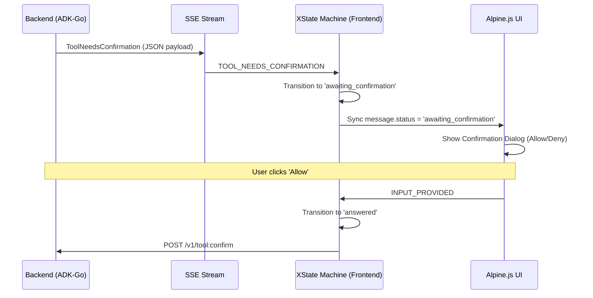

# ADR 022: Frontend-Backend Tool State Mirroring

## Status
Accepted

## Context
Tool execution in the agent system is an interactive process that can go through various phases: execution, completion, failure, and elicitation (requesting human input or confirmation). 

Previously, the frontend and backend had misaligned terminology for these elicitation states (e.g., `awaiting_custom_input` vs `awaiting_input`). Furthermore, the frontend relied on heuristics—such as checking for the presence of a JSON schema—to distinguish between a binary "Allow/Deny" confirmation and a structured "Text Input" request. This led to brittle UI logic and race conditions during streaming and hydration.

## Decision
We will implement a strict mirroring between the backend tool statuses and the frontend XState machine states:

1.  **Specialized Elicitation States**: We differentiate between `AWAITING_INPUT` (for structured, schema-driven data) and `AWAITING_CONFIRMATION` (for binary tool approval) at both the domain event and frontend machine levels.
2.  **Protocol Mapping**: Backend events `ToolNeedsInput` and `ToolNeedsConfirmation` map directly to `TOOL_NEEDS_INPUT` and `TOOL_NEEDS_CONFIRMATION` events in the frontend state machine.
3.  **Elimination of Heuristics**: The UI rendering logic (Alpine.js templates) now depends exclusively on the message `status` string, which is synchronized from the XState machine's current state. We no longer check for the presence of a schema to determine the UI mode.
4.  **Universal Sync Logic**: The `stateMap` in the `chat-tool-registry.js` acts as the single point of translation for mapping backend status strings (persisted in the database and projected to the UI) into XState state values.

## Architecture Diagram

## Consequences
- **Robustness**: State transitions are predictable and follow a defined state machine on both ends.
- **Maintainability**: New elicitation types can be added by introducing a new state/event pair without breaking existing heuristics.
- **Improved UX**: The UI accurately reflects the tool's lifecycle stage, preventing accidental double-submissions or missing interaction prompts.
- **Technical Debt Reduction**: Removed legacy and confusing terms like `custom_input` and `awaiting_custom_input`.
