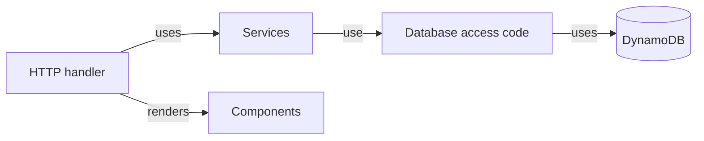

# Project structure

The application is divided up into multiple packages, each with its own purpose.

* `cdk` - Infrastructure setup for deploying the application.
* `components` - templ components.
* `infra`.
* `handlers` - HTTP handlers.
* `services` - Services used by the handlers.
* `main.go` - Used to run the application locally.

## Application architecture

The architecture follows a typical "onion model" where each layer doesn't know about the layer above it, and each layer is responsible for a specific thing.

