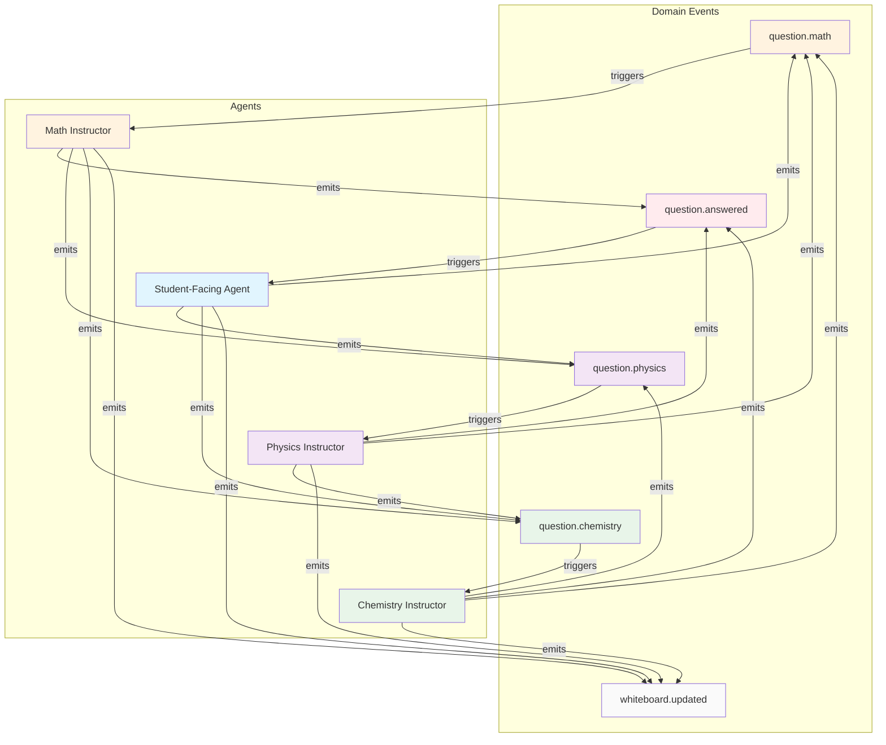
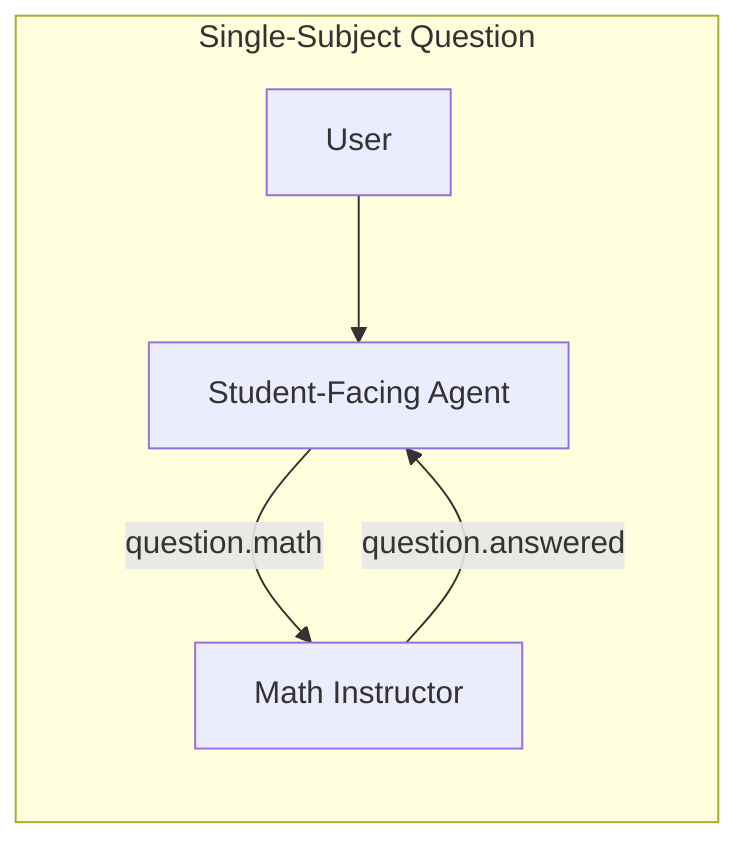
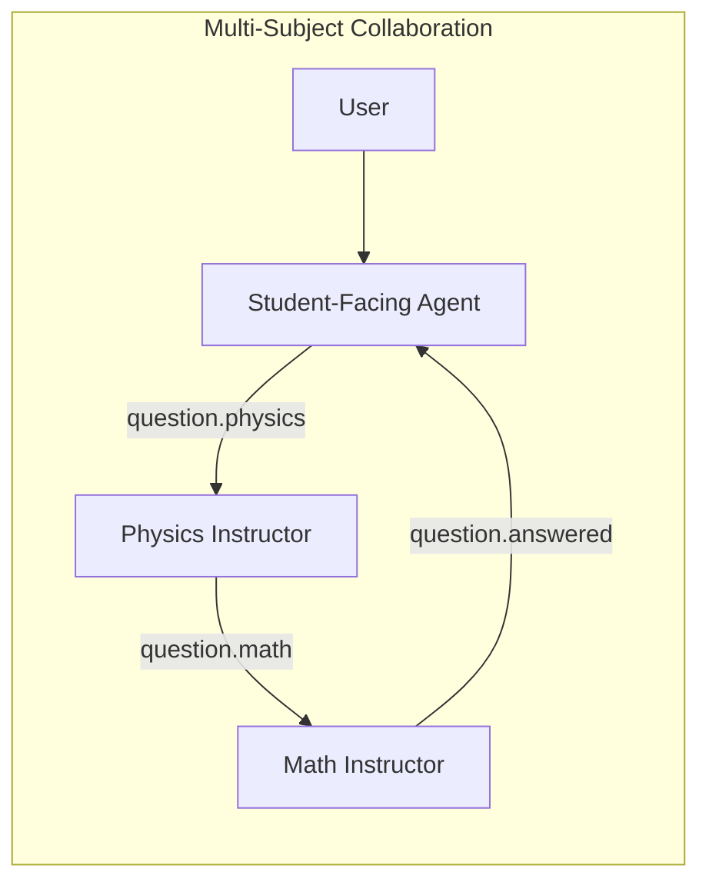
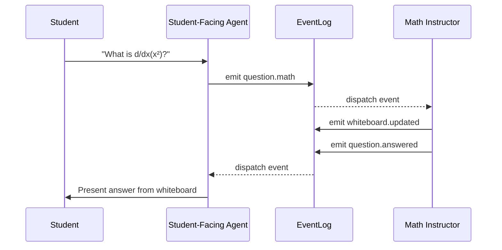

# Event Architecture

## Overview

The system uses a **unified event-driven architecture** where all agent communication and system state changes are represented as domain events in an append-only event log.

## Unified Event Structure

All events follow a single, consistent structure:

```go
type DomainEvent struct {
    // Core event metadata
    ID        string                 `json:"id"`
    Type      EventType              `json:"type"`
    Timestamp time.Time              `json:"timestamp"`
    ThreadID  string                 `json:"thread_id"`
    Version   int                    `json:"version"` // For schema evolution
    
    // Event payload - flexible structure
    Data map[string]interface{} `json:"data"`
    
    // Additional metadata
    Metadata map[string]string `json:"metadata,omitempty"`
    
    // Event correlation
    CorrelationID string `json:"correlation_id,omitempty"`
    CausationID   string `json:"causation_id,omitempty"`
}
```

### Benefits of Unified Events

1. **Schema Evolution**: Version field allows backward-compatible changes
2. **Flexible Payload**: Data map accommodates any event-specific fields
3. **Event Sourcing**: All state changes are captured in immutable events
4. **Debugging**: Correlation/causation IDs enable tracing event chains
5. **Serialization**: Consistent structure simplifies storage/transmission
6. **Type Safety**: EventType enum ensures valid event types

## Event Types

```go
const (
    EventTypeWhiteboardUpdated         = "whiteboard.updated"
    EventTypeInstructorThought         = "instructor.thought"
    EventTypeInstructorStrategyChanged = "instructor.strategy_changed"
    EventTypeMathQuestion              = "question.math"
    EventTypePhysicsQuestion           = "question.physics"
    EventTypeChemistryQuestion         = "question.chemistry"
    EventTypeQuestionAnswered          = "question.answered"
)
```

### Pure Event-Driven Communication

Agents **only** communicate through domain events - there is no direct agent-to-agent calling:

- **Question Events**: Activate specialist instructors (`question.math`, `question.physics`, `question.chemistry`)
- **Answer Events**: Signal completion and activate coordinator (`question.answered`)
- **Whiteboard Events**: Track content changes (`whiteboard.updated`)
- **Internal Events**: Private thoughts and strategy changes (not visible to other agents)

## Event Data Schemas

### Question Events (Math/Physics/Chemistry)
```json
{
  "type": "question.math",
  "data": {
    "question": "What is the derivative of x^2?",
    "emitted_by": "student-facing-agent",
    "context": "calculus",
    "whiteboard_state": "# QUESTION\n..."
  }
}
```

### Question Answered Event
```json
{
  "type": "question.answered",
  "data": {
    "subject": "math",
    "answer": "2x",
    "answered_by": "math-instructor",
    "is_complete": true,
    "whiteboard_state": "# QUESTION\n## MATH\n..."
  }
}
```

### Whiteboard Updated Event
```json
{
  "type": "whiteboard.updated",
  "data": {
    "agent_name": "math-instructor",
    "content": "## MATH\nThe derivative is 2x",
    "action": "append"
  }
}
```

### Instructor Thought Event
```json
{
  "type": "instructor.thought",
  "data": {
    "instructor_name": "math-instructor",
    "thought": "This requires chain rule",
    "is_private": true
  }
}
```

## Agent Communication Matrix

The following diagram shows which events each agent can emit and respond to:



### Agent Event Contracts

| Agent | Responds To (Triggers) | Emits |
|-------|------------------------|-------|
| **student-facing-agent** | User messages, `question.answered` | `question.math`, `question.physics`, `question.chemistry`, `whiteboard.updated` |
| **math-instructor** | `question.math` | `question.answered`, `question.physics`, `question.chemistry`, `whiteboard.updated` |
| **physics-instructor** | `question.physics` | `question.answered`, `question.math`, `question.chemistry`, `whiteboard.updated` |
| **chemistry-instructor** | `question.chemistry` | `question.answered`, `question.math`, `question.physics`, `whiteboard.updated` |

### Communication Patterns





## Event Flow Example



## Worker Pool Event Dispatching

The worker pool listens to the event log and activates agents based on event type:

```go
switch event.Type {
case EventTypeMathQuestion:
    activateAgent("math-instructor", event)
case EventTypePhysicsQuestion:
    activateAgent("physics-instructor", event)
case EventTypeChemistryQuestion:
    activateAgent("chemistry-instructor", event)
case EventTypeQuestionAnswered:
    activateAgent("student-facing-agent", event)
}
```

## Event Metadata Usage

### Correlation ID
Tracks related events in a conversation thread:
```go
event.CorrelationID = threadID
```

### Causation ID
Links cause-effect relationships:
```go
newEvent.CausationID = triggeringEvent.ID
```

### Custom Metadata
Additional context:
```go
event.Metadata = map[string]string{
    "session_id": "abc123",
    "user_id": "user456",
}
```

## Legacy Compatibility

~~Old event structures are maintained for backward compatibility~~

**As of January 2026**, the system is **purely event-driven**:
- ❌ No `agent.called` events (removed)
- ❌ No `call_agent` tool (removed)
- ✅ Only domain-specific question events (`question.math`, `question.physics`, `question.chemistry`, `question.answered`)
- ✅ Agents subscribe to specific event types
- ✅ Worker pool dispatches agents based on emitted events

## Best Practices

1. **Always use constructors**: `NewMathQuestionEvent()` instead of manual struct creation
2. **Include context**: Provide rich data in event payload
3. **Use correlation IDs**: Link related events
4. **Version events**: Increment version when changing data schema
5. **Immutable events**: Never modify events after creation
6. **Typed accessors**: Use `GetString()`, `GetBool()` helpers for type safety

## Event Sourcing Benefits

1. **Complete Audit Trail**: Every state change is recorded
2. **Time Travel**: Replay events to reconstruct any past state
3. **Debugging**: Trace exact sequence of events leading to any state
4. **Analytics**: Mine event log for insights
5. **Compliance**: Immutable log satisfies regulatory requirements
