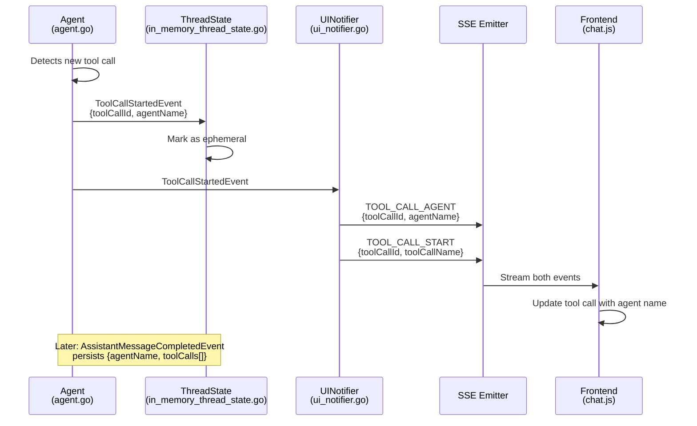
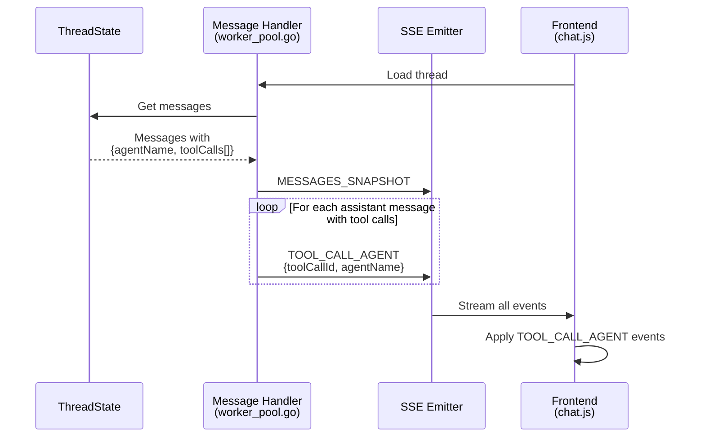

# Event Flow Documentation

This document describes how events flow through the system architecture.

## 1. Tool Call Agent Persistence

**Purpose**: Track which agent executed each tool call and persist this information across page reloads.

### Real-Time Flow

### Snapshot/Reload Flow

### Key Points

- **Consistent Event Flow**: Both streaming and snapshots emit `TOOL_CALL_AGENT` events
- **Real-Time**: 1 domain event (`ToolCallStartedEvent`) → 2 AGUI events (`TOOL_CALL_AGENT` + `TOOL_CALL_START`)
- **Snapshots**: Iterate assistant messages and emit `TOOL_CALL_AGENT` for each tool call (same events as streaming)
- **Persistence**: Agent name stored in `AssistantMessageCompletedEvent.agentName`
- **UI Processing**: Same handler processes `TOOL_CALL_AGENT` events regardless of source
