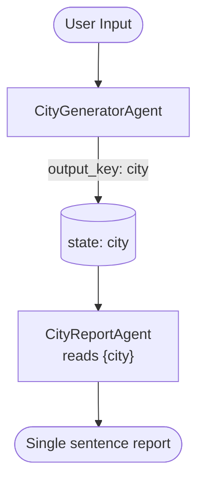
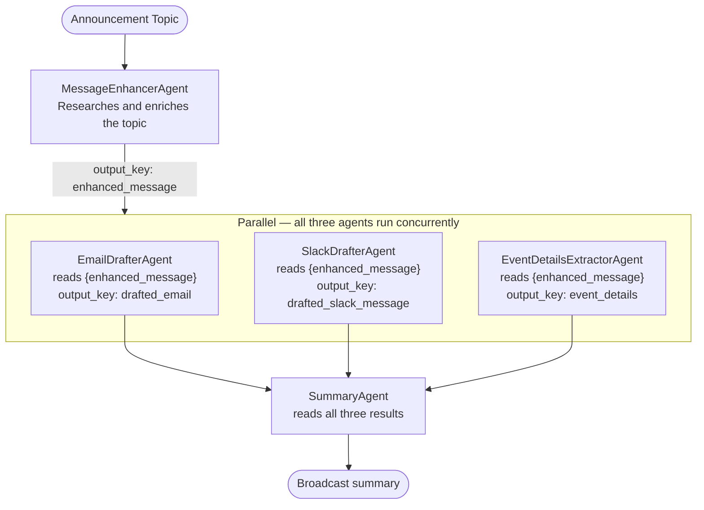
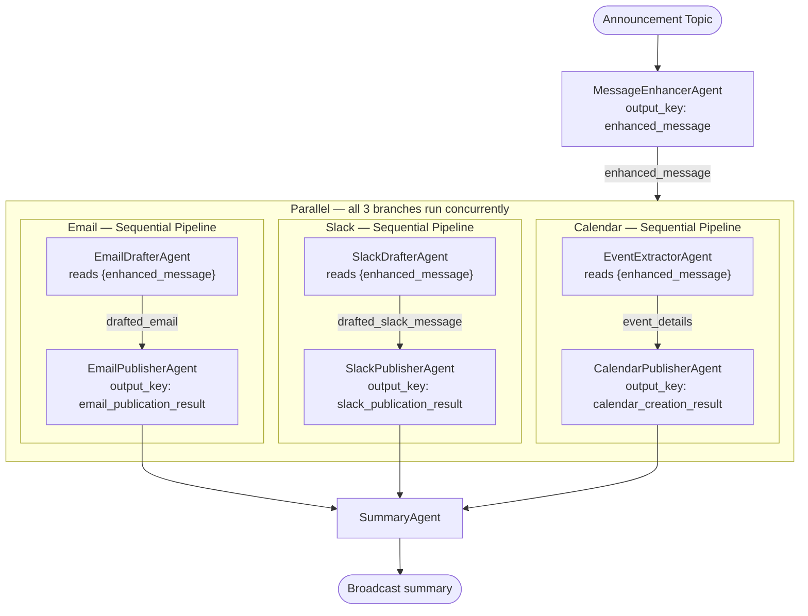
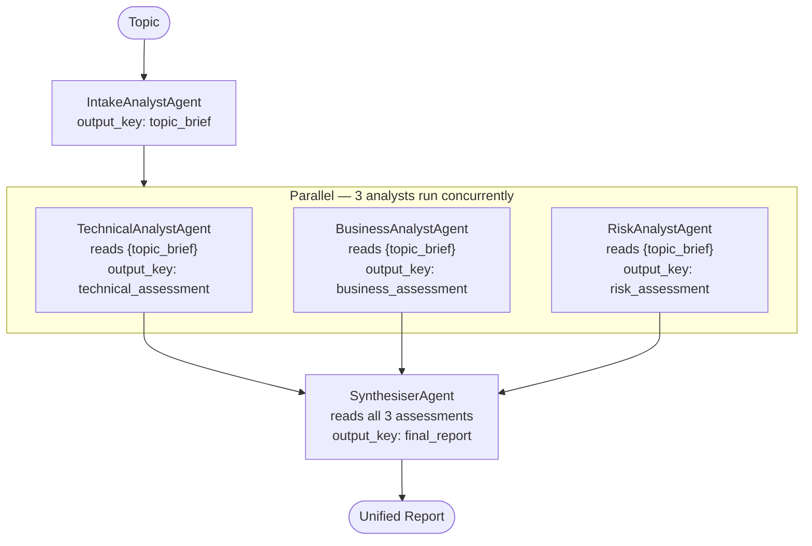
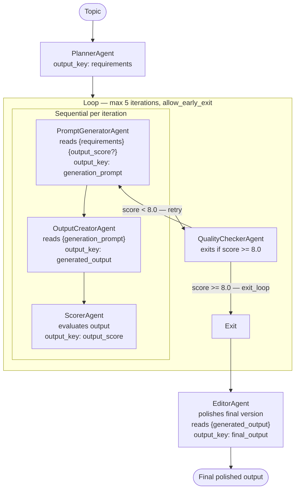
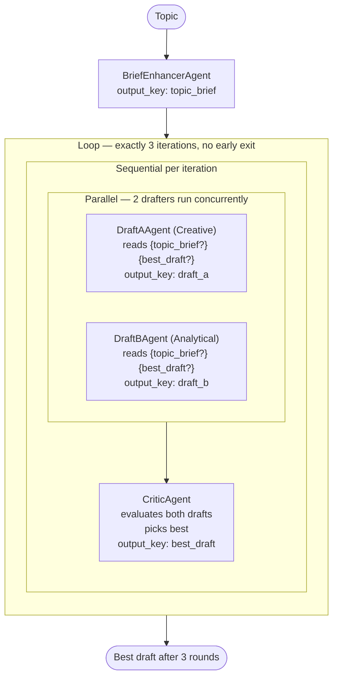
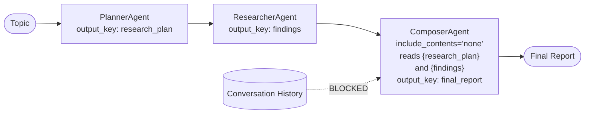
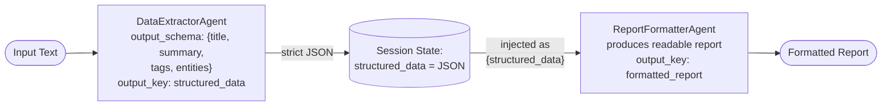
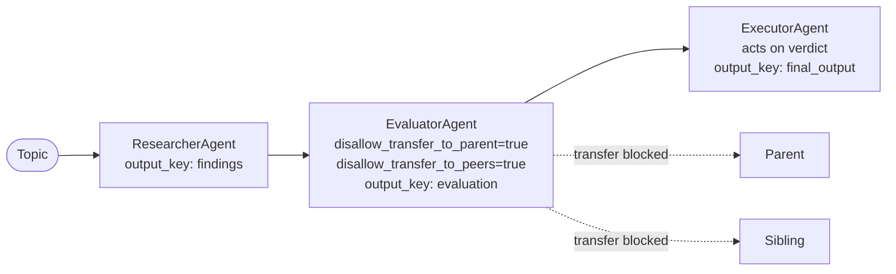
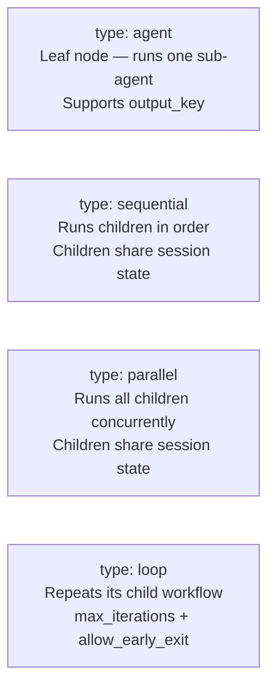

# Catalog Agent Architecture Reference

Each entry in the catalog demonstrates a specific set of ADK-Go workflow features. This document describes the architecture of every example and maps it to the system capabilities it exercises.

---

## Feature Matrix

| Agent | Sequential | Parallel | Loop | allow\_early\_exit | State Injection | Nested Workflows |
|---|:---:|:---:|:---:|:---:|:---:|:---:|
| Sequential Workflow | ✓ | | | | ✓ | |
| Implicit State | ✓ | | | | | |
| Parallel Workflow | ✓ | ✓ | | | ✓ | |
| Sequential Inside Parallel | ✓ | ✓ | | | ✓ | ✓ |
| Parallel Inside Sequential | ✓ | ✓ | | | ✓ | |
| Loop Workflow | | | ✓ | | ✓ | |
| Loop with Exit | | | ✓ | ✓ | ✓ | |
| Sequential Inside Loop | | ✓ | ✓ | ✓ | ✓ | |
| Parallel Inside Loop Inside Sequential | ✓ | ✓ | ✓ | | ✓ | ✓ |
| Context Control | | | | | ✓ | |
| Output Schema | | | | | ✓ | |
| Agent Isolation | | | | | | |

---

## 1. Sequential Workflow

**Source:** ADK Python — `workflows-sequential`

**What it demonstrates:** The simplest possible sequential workflow. One agent writes a value to a named state key (`output_key`), and the next agent reads it back via `{variable}` injection in its system prompt.



**Key state variables**

| Key | Written by | Read by |
|---|---|---|
| `city` | CityGeneratorAgent | CityReportAgent |

**ADK features used**
- `type: sequential` workflow node
- `output_key` on an agent node — stores the agent's final response text into session state
- `{variable}` injection — substitutes the state value into the next agent's system prompt at runtime

---

## 2. Implicit State

**Source:** ADK Python + Go — `llm-auditor`

**What it demonstrates:** A two-agent sequential pipeline where the second agent reads the first agent's output purely from **conversation history** (no explicit `output_key`). The critic's response — including all verdicts — is automatically part of the context the reviser receives.


**ADK features used**
- `type: sequential` workflow node
- Implicit state passing via **conversation history** — no `output_key` needed; each agent sees the full prior exchange
- Sequential agents share one continuous message thread

---

## 3. Parallel Workflow

**Source:** ADK Python — `parallel_task_decomposition_execution`

**What it demonstrates:** A sequential root wrapping a `type: parallel` node whose three child agents run concurrently — each independently drafting content for Email, Slack, and Calendar from the same upstream state — and a summary agent collects the results. This is the purest fan-out/fan-in pattern with no nested sequential branches.



**Key state variables**

| Key | Written by | Read by |
|---|---|---|
| `enhanced_message` | MessageEnhancerAgent | All three parallel drafter/extractor agents |
| `drafted_email` | EmailDrafterAgent | SummaryAgent |
| `drafted_slack_message` | SlackDrafterAgent | SummaryAgent |
| `event_details` | EventDetailsExtractorAgent | SummaryAgent |

**ADK features used**
- `type: parallel` node — all child agents start simultaneously and share the same session state
- Each parallel child is a single `type: agent` node (no nesting)
- `{variable?}` optional injection in SummaryAgent — results may not exist if a branch fails

---

## 4. Sequential Inside Parallel

**Source:** ADK Python — `parallel_task_decomposition_execution`

**What it demonstrates:** Three parallel branches where **each branch is itself a sequential pipeline** (drafter → publisher). The email branch drafts then publishes; the Slack branch drafts then publishes; the Calendar branch extracts events then publishes. All three branches run concurrently.



**Key state variables**

| Key | Written by | Read by |
|---|---|---|
| `enhanced_message` | MessageEnhancerAgent | All three drafter/extractor agents |
| `drafted_email` | EmailDrafterAgent | EmailPublisherAgent (same branch) |
| `drafted_slack_message` | SlackDrafterAgent | SlackPublisherAgent (same branch) |
| `event_details` | EventExtractorAgent | CalendarPublisherAgent (same branch) |
| `email_publication_result` | EmailPublisherAgent | SummaryAgent |
| `slack_publication_result` | SlackPublisherAgent | SummaryAgent |
| `calendar_creation_result` | CalendarPublisherAgent | SummaryAgent |

**ADK features used**
- `type: parallel` node — all child branches start simultaneously
- `type: sequential` inside each parallel branch — drafter → publisher pipeline
- State isolation within branches — each branch has its own state keys
- `{variable?}` optional injection in SummaryAgent — results may not exist if a branch fails

---

## 5. Parallel Inside Sequential

**Source:** ADK samples — `claim-adjudication-agent`, `nexshift-agent` (simplified)

**What it demonstrates:** A sequential root where **one step is a parallel node**. An intake analyst processes input first, then three specialist analysts (technical, business, risk) evaluate the topic concurrently, then a synthesiser combines all findings into a final report. The outer composition is sequential; the middle step is parallel.



**Key state variables**

| Key | Written by | Read by |
|---|---|---|
| `topic_brief` | IntakeAnalystAgent | All three parallel analysts |
| `technical_assessment` | TechnicalAnalystAgent | SynthesiserAgent |
| `business_assessment` | BusinessAnalystAgent | SynthesiserAgent |
| `risk_assessment` | RiskAnalystAgent | SynthesiserAgent |
| `final_report` | SynthesiserAgent | — |

**ADK features used**
- `type: sequential` as the root composition — agents run in order
- `type: parallel` as one step in the sequence — analysts run concurrently
- Multiple `output_key` declarations — each analyst publishes a named result
- Downstream agent (Synthesiser) reads **all three** parallel outputs simultaneously
- `{variable?}` optional injection — handles case where a branch may not produce output

---

## 6. Loop Workflow

**Source:** ADK samples — `story_teller` (simplified)

**What it demonstrates:** A fixed-iteration loop where a single agent runs exactly `max_iterations` times with no early exit. Each iteration reads the previous output via `{refined_concept?}` and improves it. Shows the simplest loop pattern.


**Key state variables**

| Key | Written by | Read by |
|---|---|---|
| `refined_concept` | RefinementAgent (each iteration) | RefinementAgent (next iteration via `{refined_concept?}`) |

**ADK features used**
- `type: loop` with `max_iterations: 3` and `allow_early_exit: false`
- `{variable?}` optional injection — first iteration has no prior version
- State **overwrite** across iterations — each refinement replaces the previous one

---

## 7. Loop with Exit

**Source:** ADK samples — `blog-writer`, `iterative-deep-research` (simplified)

**What it demonstrates:** A loop with `allow_early_exit: true` where a writer agent produces a draft and a checker agent validates quality. The checker calls the `exit_loop` tool when the draft meets standards, skipping remaining iterations. Shows the "retry-until-good" pattern.


**Key state variables**

| Key | Written by | Read by |
|---|---|---|
| `draft` | DraftWriterAgent | QualityCheckerAgent |

**ADK features used**
- `type: loop` with `allow_early_exit: true` — the last agent in the loop body receives the `exit_loop` tool
- Validation agent pattern — a lightweight agent that inspects state and calls `exit_loop` when ready
- LLM-driven loop termination — exit is based on quality judgment, not a fixed counter

---

## 8. Sequential Inside Loop

**Source:** ADK Python — `image-scoring`, `on-brand-genmedia` (simplified)

**What it demonstrates:** An outer sequential pipeline wraps a loop: a planner first produces structured requirements, then a loop runs a sequential generate-score-check pipeline that iterates until quality is met, and finally an editor polishes the approved output into its final form.



**Key state variables**

| Key | Written by | Read by |
|---|---|---|
| `requirements` | PlannerAgent | PromptGeneratorAgent (all iterations) |
| `generation_prompt` | PromptGeneratorAgent (each iteration) | OutputCreatorAgent, ScorerAgent |
| `generated_output` | OutputCreatorAgent (each iteration) | ScorerAgent, EditorAgent |
| `output_score` | ScorerAgent (each iteration) | QualityCheckerAgent, PromptGeneratorAgent (next iteration) |
| `final_output` | EditorAgent | — |

**ADK features used**
- `type: sequential` as the root composition — planner → loop → editor
- `type: loop` with `max_iterations: 5` and `allow_early_exit: true`
- `type: sequential` as the loop body — three agents run in order each iteration
- `{variable?}` optional injection — first iteration has no prior score or prompt
- State **overwrite** across iterations — each refinement replaces the previous prompt and output
- `allow_early_exit: true` — QualityCheckerAgent (last in loop body) receives the `exit_loop` tool
- **Feedback loop** — PromptGeneratorAgent reads the previous score to refine its prompt
- **Outer sequential** — PlannerAgent sets up requirements before the loop, EditorAgent polishes after

---

## 9. Parallel Inside Loop Inside Sequential

**Source:** ADK Python — `story_teller` (simplified)

**What it demonstrates:** The most deeply nested composition in the catalog. A sequential root contains a loop whose body is itself a sequential containing a parallel. Two drafters run concurrently, a critic selects the best, and the loop repeats exactly 3 times — each iteration building on the previous best draft.



**Key state variables**

| Key | Written by | Read by |
|---|---|---|
| `topic_brief` | BriefEnhancerAgent | DraftA, DraftB, Critic (all iterations) |
| `draft_a` | DraftAAgent (each iteration) | CriticAgent (same iteration) |
| `draft_b` | DraftBAgent (each iteration) | CriticAgent (same iteration) |
| `best_draft` | CriticAgent (each iteration) | DraftA, DraftB (next iteration via `{best_draft?}`) |

**ADK features used**
- `type: loop` with `max_iterations: 3` and `allow_early_exit: false`
- `type: parallel` nested inside `type: sequential` nested inside `type: loop`
- `{variable?}` optional injection — first iteration has no prior `{best_draft}`
- State **overwrite** across iterations — `best_draft` is replaced each round with the selected version
- State **fan-out** — `topic_brief` is read by all agents at every depth

---

## 10. Context Control

**Source:** ADK Python — `deep-search` (report_composer)

**What it demonstrates:** An agent with `include_contents="none"` receives no conversation history — it operates only on explicitly injected state via `{variable}` placeholders. This isolates the agent from irrelevant prior context, reduces token cost, prevents hallucination from stale conversation history, and forces deterministic behaviour based solely on provided data.



**Key state variables**

| Key | Written by | Read by |
|---|---|---|
| `research_plan` | PlannerAgent | ResearcherAgent, ComposerAgent |
| `findings` | ResearcherAgent | ComposerAgent |
| `final_report` | ComposerAgent | — |

**ADK features used**
- `include_contents: none` — ComposerAgent receives NO conversation history
- `{variable}` injection — all context is explicitly provided via state keys
- **Cost efficiency** — no need to send long conversation history to the LLM
- **Focus** — agent works only with explicitly provided data
- **Determinism** — reduces hallucination from irrelevant conversation context

---

## 11. Output Schema

**Source:** ADK Python — `deep-search` (research_evaluator with Feedback schema), `travel-concierge` (planning with Itinerary/HotelsSelection schemas)

**What it demonstrates:** An agent with `output_schema` set to a JSON Schema forces the LLM to return strictly typed structured data instead of free-form text. When set, the agent can only reply with matching JSON — no tool use, no RAG, no agent transfer. This enables reliable downstream processing of agent output.



**Key state variables**

| Key | Written by | Read by |
|---|---|---|
| `structured_data` | DataExtractorAgent (strict JSON) | ReportFormatterAgent |
| `formatted_report` | ReportFormatterAgent | — |

**ADK features used**
- `output_schema` — forces the LLM to return JSON matching the schema
- When `output_schema` is set, the agent **cannot** use tools, RAG, or transfer to other agents
- Enables reliable downstream processing — the formatter knows the exact structure
- Reduces parsing errors — the model is constrained by the schema
- Common schema types: `object` with required properties, `array` of typed items, `enum` fields

**Example output_schema:**
```json
{
  "type": "object",
  "required": ["title", "summary", "tags", "entities"],
  "properties": {
    "title": {"type": "string"},
    "summary": {"type": "string"},
    "tags": {"type": "array", "items": {"type": "string"}},
    "entities": {
      "type": "array",
      "items": {
        "type": "object",
        "required": ["name", "type"],
        "properties": {
          "name": {"type": "string"},
          "type": {"type": "string", "enum": ["person", "organization", "location"]}
        }
      }
    }
  }
}
```

---

## 12. Agent Isolation

**Source:** ADK Python — `deep-search` (research_evaluator)

**What it demonstrates:** An agent with `disallow_transfer_to_parent` and `disallow_transfer_to_peers` set to `true` is constrained from making routing decisions. It can only produce its output — it cannot delegate back to the parent agent or transfer to sibling agents. This is critical for quality assurance, evaluation, and compliance agents that should not interact with the rest of the system.



**Key state variables**

| Key | Written by | Read by |
|---|---|---|
| `findings` | ResearcherAgent | EvaluatorAgent, ExecutorAgent |
| `evaluation` | EvaluatorAgent | ExecutorAgent |
| `final_output` | ExecutorAgent | — |

**ADK features used**
- `disallow_transfer_to_parent: true` — EvaluatorAgent cannot delegate back to parent
- `disallow_transfer_to_peers: true` — EvaluatorAgent cannot transfer to sibling agents
- **Prevents hallucination** — isolated agent cannot accidentally route to unrelated agents
- **Enforces role boundaries** — evaluator can only evaluate, not fix or re-research
- **Security** — prevents LLM from escaping its intended scope

---

## Workflow Type Reference



### State injection syntax

| Syntax | Behaviour |
|---|---|
| `{key}` | Required — errors if key is absent from session state |
| `{key?}` | Optional — substitutes empty string if key is absent |

### Loop exit modes

| Setting | Behaviour |
|---|---|
| `allow_early_exit: false` | Loop always runs exactly `max_iterations` times |
| `allow_early_exit: true` | Last agent in the loop body receives the `exit_loop` tool; calling it stops the loop before `max_iterations` is reached |
