# Catalog Agent Architecture Reference

Each entry in the catalog demonstrates a specific set of ADK-Go workflow features. This document describes the architecture of every example and maps it to the system capabilities it exercises.

---

## Feature Matrix

| Agent | Sequential | Parallel | Loop | allow\_early\_exit | State Injection | Nested Workflows |
|---|:---:|:---:|:---:|:---:|:---:|:---:|
| Sequential Workflow | ✓ | | | | ✓ | |
| LLM Auditor | ✓ | | | | | |
| Podcast Transcript | ✓ | | | | ✓ | |
| Parallel Workflow | ✓ | ✓ | | | ✓ | |
| Sequential Inside Parallel | ✓ | ✓ | | | ✓ | ✓ |
| Parallel Inside Sequential | ✓ | ✓ | | | ✓ | |
| Loop Workflow | | | ✓ | | ✓ | |
| Loop with Exit | | | ✓ | ✓ | ✓ | |
| Sequential Inside Loop | | ✓ | ✓ | ✓ | ✓ | |
| Parallel Inside Loop Inside Sequential | ✓ | ✓ | ✓ | | ✓ | ✓ |
| Story Teller | ✓ | ✓ | ✓ | | ✓ | ✓ |
| Blog Writer | ✓ | | ✓ | ✓ | ✓ | |
| Iterative Deep Research | ✓ | | ✓ | ✓ | ✓ | |
| Academic Research | ✓ | | | | ✓ | |
| Marketing Agency | ✓ | | | | ✓ | |
| Short Movie Agent | ✓ | | | | ✓ | |
| Context Control | | | | | ✓ | |
| Customer Support Triage | ✓ | | | | | |

---

## 1. Sequential Workflow

**Source:** ADK Python — `workflows-sequential`

**What it demonstrates:** The simplest possible sequential workflow. One agent writes a value to a named state key (`output_key`), and the next agent reads it back via `{variable}` injection in its system prompt.

**Key state variables**

| Key | Written by | Read by |
|---|---|---|
| `city` | CityGeneratorAgent | CityReportAgent |

**ADK features used**
- `type: sequential` workflow node
- `output_key` on an agent node — stores the agent's final response text into session state
- `{variable}` injection — substitutes the state value into the next agent's system prompt at runtime

---

## 2. LLM Auditor

**Source:** ADK Python + Go — `llm-auditor`

**What it demonstrates:** A two-agent sequential pipeline where the second agent reads the first agent's output purely from **conversation history** (no explicit `output_key`). The critic's response — including all verdicts — is automatically part of the context the reviser receives.

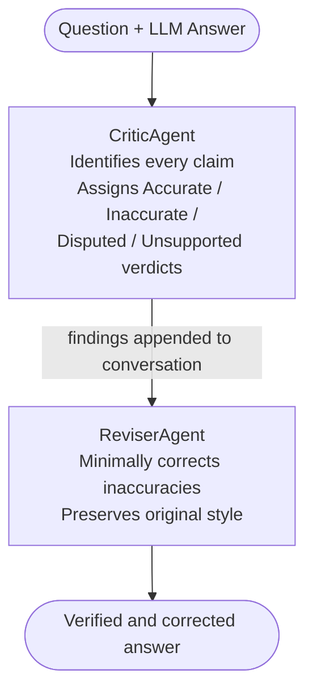

**ADK features used**
- `type: sequential` workflow node
- Implicit state passing via **conversation history** — no `output_key` needed; each agent sees the full prior exchange
- Sequential agents share one continuous message thread

---

## 3. Podcast Transcript Generator

**Source:** ADK Python — `podcast_transcript_agent`

**What it demonstrates:** A three-stage sequential pipeline with explicit `output_key` handoffs. Each agent reads the previous agent's output via named state injection, building up structured data across three steps.

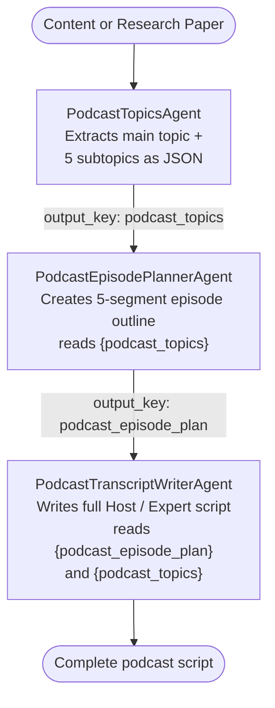

**Key state variables**

| Key | Written by | Read by |
|---|---|---|
| `podcast_topics` | PodcastTopicsAgent | PodcastEpisodePlannerAgent, PodcastTranscriptWriterAgent |
| `podcast_episode_plan` | PodcastEpisodePlannerAgent | PodcastTranscriptWriterAgent |

**ADK features used**
- `type: sequential` workflow node
- Multiple `output_key` declarations — each agent publishes a named result
- `{variable}` injection referencing keys from **earlier, non-adjacent** agents (transcript reads both `podcast_topics` and `podcast_episode_plan`)

---

## 4. Parallel Workflow

**Source:** ADK Python — `parallel_task_decomposition_execution`

**What it demonstrates:** A sequential root wrapping a `type: parallel` node whose three child agents run concurrently — each independently drafting content for Email, Slack, and Calendar from the same upstream state — and a summary agent collects the results. This is the purest fan-out/fan-in pattern with no nested sequential branches.

**Key state variables**

| Key | Written by | Read by |
|---|---|---|
| `enhanced_message` | MessageEnhancerAgent | All three parallel drafter/extractor agents |
| `drafted_email` | EmailDrafterAgent | SummaryAgent |
| `drafted_slack_message` | SlackDrafterAgent | SummaryAgent |
| `event_details` | EventDetailsExtractorAgent | SummaryAgent |

**ADK features used**
- `type: parallel` node — all child agents start simultaneously and share the same session state
- Each parallel child is a single `type: agent` node (no nesting)
- `{variable?}` optional injection in SummaryAgent — results may not exist if a branch fails

---

## 5. Sequential Inside Parallel

**Source:** ADK Python — `parallel_task_decomposition_execution`

**What it demonstrates:** Three parallel branches where **each branch is itself a sequential pipeline** (drafter → publisher). The email branch drafts then publishes; the Slack branch drafts then publishes; the Calendar branch extracts events then publishes. All three branches run concurrently.

**Key state variables**

| Key | Written by | Read by |
|---|---|---|
| `enhanced_message` | MessageEnhancerAgent | All three drafter/extractor agents |
| `drafted_email` | EmailDrafterAgent | EmailPublisherAgent (same branch) |
| `drafted_slack_message` | SlackDrafterAgent | SlackPublisherAgent (same branch) |
| `event_details` | EventExtractorAgent | CalendarPublisherAgent (same branch) |
| `email_publication_result` | EmailPublisherAgent | SummaryAgent |
| `slack_publication_result` | SlackPublisherAgent | SummaryAgent |
| `calendar_creation_result` | CalendarPublisherAgent | SummaryAgent |

**ADK features used**
- `type: parallel` node — all child branches start simultaneously
- `type: sequential` inside each parallel branch — drafter → publisher pipeline
- State isolation within branches — each branch has its own state keys
- `{variable?}` optional injection in SummaryAgent — results may not exist if a branch fails

---

## 6. Parallel Inside Sequential

**Source:** ADK samples — `claim-adjudication-agent`, `nexshift-agent` (simplified)

**What it demonstrates:** A sequential root where **one step is a parallel node**. An intake analyst processes input first, then three specialist analysts (technical, business, risk) evaluate the topic concurrently, then a synthesiser combines all findings into a final report. The outer composition is sequential; the middle step is parallel.

**Key state variables**

| Key | Written by | Read by |
|---|---|---|
| `topic_brief` | IntakeAnalystAgent | All three parallel analysts |
| `technical_assessment` | TechnicalAnalystAgent | SynthesiserAgent |
| `business_assessment` | BusinessAnalystAgent | SynthesiserAgent |
| `risk_assessment` | RiskAnalystAgent | SynthesiserAgent |
| `final_report` | SynthesiserAgent | — |

**ADK features used**
- `type: sequential` as the root composition — agents run in order
- `type: parallel` as one step in the sequence — analysts run concurrently
- Multiple `output_key` declarations — each analyst publishes a named result
- Downstream agent (Synthesiser) reads **all three** parallel outputs simultaneously
- `{variable?}` optional injection — handles case where a branch may not produce output

---

## 7. Loop Workflow

**Source:** ADK samples — `story_teller` (simplified)

**What it demonstrates:** A fixed-iteration loop where a single agent runs exactly `max_iterations` times with no early exit. Each iteration reads the previous output via `{refined_concept?}` and improves it. Shows the simplest loop pattern.

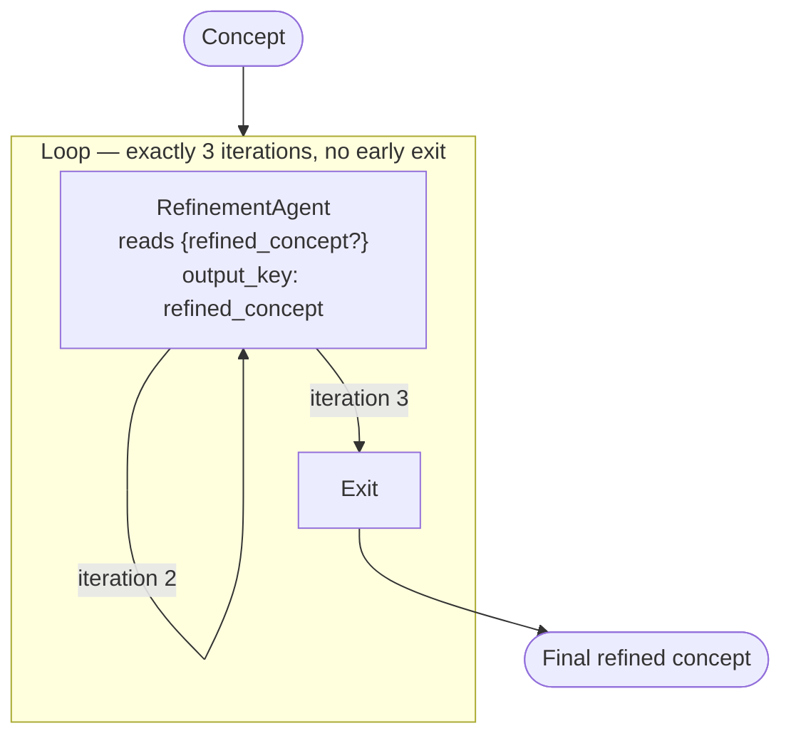

**Key state variables**

| Key | Written by | Read by |
|---|---|---|
| `refined_concept` | RefinementAgent (each iteration) | RefinementAgent (next iteration via `{refined_concept?}`) |

**ADK features used**
- `type: loop` with `max_iterations: 3` and `allow_early_exit: false`
- `{variable?}` optional injection — first iteration has no prior version
- State **overwrite** across iterations — each refinement replaces the previous one

---

## 8. Loop with Exit

**Source:** ADK samples — `blog-writer`, `iterative-deep-research` (simplified)

**What it demonstrates:** A loop with `allow_early_exit: true` where a writer agent produces a draft and a checker agent validates quality. The checker calls the `exit_loop` tool when the draft meets standards, skipping remaining iterations. Shows the "retry-until-good" pattern.

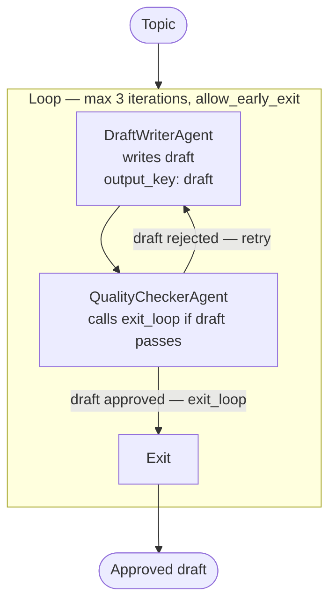

**Key state variables**

| Key | Written by | Read by |
|---|---|---|
| `draft` | DraftWriterAgent | QualityCheckerAgent |

**ADK features used**
- `type: loop` with `allow_early_exit: true` — the last agent in the loop body receives the `exit_loop` tool
- Validation agent pattern — a lightweight agent that inspects state and calls `exit_loop` when ready
- LLM-driven loop termination — exit is based on quality judgment, not a fixed counter

---

## 9. Sequential Inside Loop

**Source:** ADK Python — `image-scoring`, `on-brand-genmedia` (simplified)

**What it demonstrates:** An outer sequential pipeline wraps a loop: a planner first produces structured requirements, then a loop runs a sequential generate-score-check pipeline that iterates until quality is met, and finally an editor polishes the approved output into its final form.

**Key state variables**

| Key | Written by | Read by |
|---|---|---|
| `requirements` | PlannerAgent | PromptGeneratorAgent (all iterations) |
| `generation_prompt` | PromptGeneratorAgent (each iteration) | OutputCreatorAgent, ScorerAgent |
| `generated_output` | OutputCreatorAgent (each iteration) | ScorerAgent, EditorAgent |
| `output_score` | ScorerAgent (each iteration) | QualityCheckerAgent, PromptGeneratorAgent (next iteration) |
| `final_output` | EditorAgent | — |

**ADK features used**
- `type: sequential` as the root composition — planner → loop → editor
- `type: loop` with `max_iterations: 5` and `allow_early_exit: true`
- `type: sequential` as the loop body — three agents run in order each iteration
- `{variable?}` optional injection — first iteration has no prior score or prompt
- State **overwrite** across iterations — each refinement replaces the previous prompt and output
- `allow_early_exit: true` — QualityCheckerAgent (last in loop body) receives the `exit_loop` tool
- **Feedback loop** — PromptGeneratorAgent reads the previous score to refine its prompt
- **Outer sequential** — PlannerAgent sets up requirements before the loop, EditorAgent polishes after

---

## 10. Parallel Inside Loop Inside Sequential

**Source:** ADK Python — `story_teller` (simplified)

**What it demonstrates:** The most deeply nested composition in the catalog. A sequential root contains a loop whose body is itself a sequential containing a parallel. Two drafters run concurrently, a critic selects the best, and the loop repeats exactly 3 times — each iteration building on the previous best draft.

**Key state variables**

| Key | Written by | Read by |
|---|---|---|
| `topic_brief` | BriefEnhancerAgent | DraftA, DraftB, Critic (all iterations) |
| `draft_a` | DraftAAgent (each iteration) | CriticAgent (same iteration) |
| `draft_b` | DraftBAgent (each iteration) | CriticAgent (same iteration) |
| `best_draft` | CriticAgent (each iteration) | DraftA, DraftB (next iteration via `{best_draft?}`) |

**ADK features used**
- `type: loop` with `max_iterations: 3` and `allow_early_exit: false`
- `type: parallel` nested inside `type: sequential` nested inside `type: loop`
- `{variable?}` optional injection — first iteration has no prior `{best_draft}`
- State **overwrite** across iterations — `best_draft` is replaced each round with the selected version
- State **fan-out** — `topic_brief` is read by all agents at every depth

---

## 11. Story Teller

**Source:** ADK Python — `story_teller`

**What it demonstrates:** The most deeply nested workflow in the catalog. A sequential root contains a loop whose body is itself a sequential containing a parallel. Shows how state written by the outermost agents (`enhanced_prompt`) is readable deep inside a nested loop-parallel structure, and how `{variable?}` handles the first-iteration case before state is initialised.

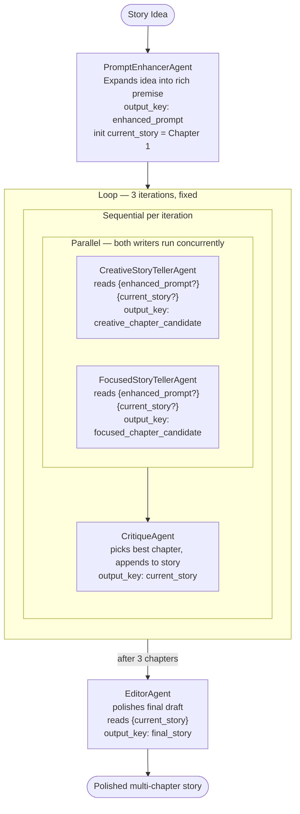

**Key state variables**

| Key | Written by | Read by |
|---|---|---|
| `enhanced_prompt` | PromptEnhancerAgent | CreativeWriter, FocusedWriter, CritiqueAgent |
| `current_story` | PromptEnhancerAgent (init) then CritiqueAgent (each iteration) | CreativeWriter, FocusedWriter, CritiqueAgent, EditorAgent |
| `creative_chapter_candidate` | CreativeStoryTellerAgent | CritiqueAgent |
| `focused_chapter_candidate` | FocusedStoryTellerAgent | CritiqueAgent |
| `final_story` | EditorAgent | — |

**ADK features used**
- `type: loop` with fixed `max_iterations: 3` and `allow_early_exit: false`
- `type: parallel` nested inside `type: sequential` nested inside `type: loop`
- `{variable?}` optional injection — iteration 1 runs before `current_story` is populated by `CritiqueAgent`; the `?` suffix returns an empty string instead of erroring
- State **accumulation** across loop iterations — `current_story` grows with each chapter

---

## 12. Blog Writer

**Source:** ADK Python — `blog-writer`

**What it demonstrates:** Two back-to-back `allow_early_exit` loops, each containing a worker agent followed by a validation agent. The validator checks whether the expected state key was populated and calls `exit_loop` if it was, skipping remaining iterations. Shows the "retry-until-success" pattern without hard-coding a fixed iteration count.

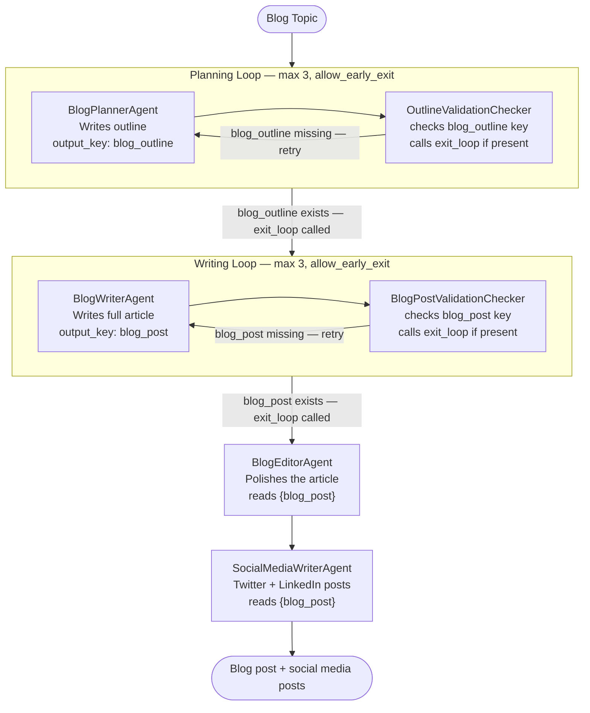

**Key state variables**

| Key | Written by | Read by |
|---|---|---|
| `blog_outline` | BlogPlannerAgent | BlogWriterAgent, OutlineValidationChecker |
| `blog_post` | BlogWriterAgent | BlogEditorAgent, SocialMediaWriterAgent, BlogPostValidationChecker |
| `social_media_posts` | SocialMediaWriterAgent | — |

**ADK features used**
- `allow_early_exit: true` — the last agent in the loop body receives the `exit_loop` tool
- Validation agent pattern — a lightweight agent that inspects state and calls `exit_loop` when ready
- Two independent loops in the same sequential workflow

---

## 13. Iterative Deep Research

**Source:** ADK samples — `iterative-deep-research`

**What it demonstrates:** A single `allow_early_exit` loop where the last agent in the loop body grades research quality. If it passes, it calls `exit_loop` and the workflow advances to the report composer. If it fails, it provides gap-filling feedback and the loop re-runs. Shows iterative refinement driven by LLM judgement rather than a fixed counter.

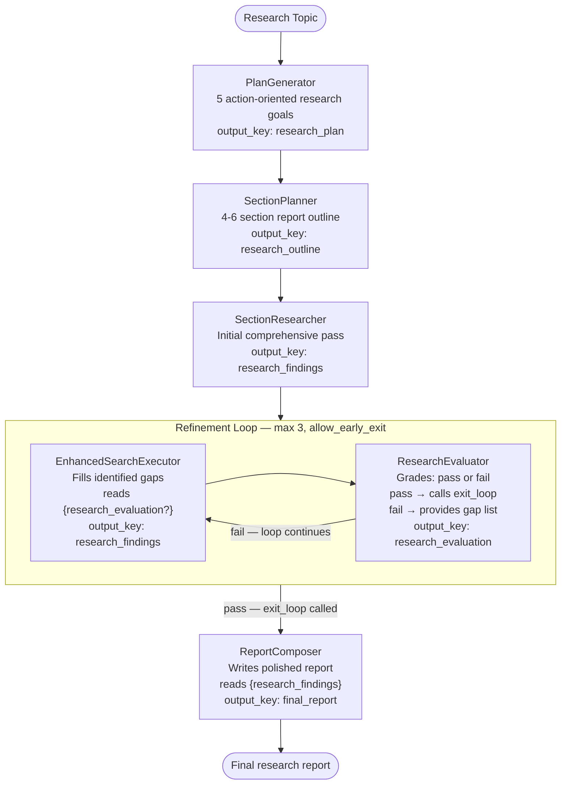

**Key state variables**

| Key | Written by | Read by |
|---|---|---|
| `research_plan` | PlanGenerator | SectionPlanner, SectionResearcher |
| `research_outline` | SectionPlanner | SectionResearcher |
| `research_findings` | SectionResearcher, EnhancedSearchExecutor | EnhancedSearchExecutor, ResearchEvaluator, ReportComposer |
| `research_evaluation` | ResearchEvaluator | EnhancedSearchExecutor |
| `final_report` | ReportComposer | — |

**ADK features used**
- `allow_early_exit: true` — `ResearchEvaluator` (last agent in loop body) receives the `exit_loop` tool
- **LLM-driven loop termination** — the exit decision is based on qualitative assessment, not a fixed counter
- State **overwrite** across iterations — `research_findings` is replaced each iteration with the improved version
- `{research_evaluation?}` — optional on the first iteration (no prior evaluation exists yet)

---

## 14. Academic Research Assistant

**Source:** ADK Python — `academic-research`

**What it demonstrates:** A coordinator-style sequential pipeline where each agent adds a new layer of analysis on top of the previous agent's output. The final agent reads two upstream state keys (`seminal_paper` and `recent_citing_papers`) that were produced by non-adjacent agents.

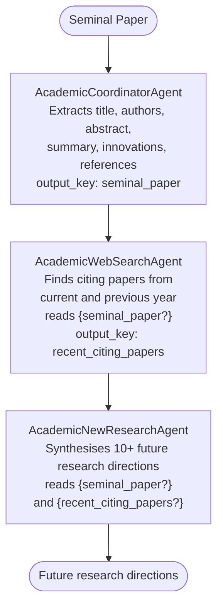

**Key state variables**

| Key | Written by | Read by |
|---|---|---|
| `seminal_paper` | AcademicCoordinatorAgent | AcademicWebSearchAgent, AcademicNewResearchAgent |
| `recent_citing_papers` | AcademicWebSearchAgent | AcademicNewResearchAgent |

**ADK features used**
- `type: sequential` with three agents
- A downstream agent reading state from **two prior agents** simultaneously
- `{variable?}` optional injection — coordinator output may be partial if the user has not yet provided the paper

---

## 15. Marketing Agency

**Source:** ADK Python — `marketing-agency`

**What it demonstrates:** A five-agent sequential pipeline where each specialist builds on the brand identity established in the first step. The `domain_create_output` key acts as the shared brand anchor read by all downstream agents. Shows how a single upstream state key can be consumed by multiple non-adjacent agents in a long chain.

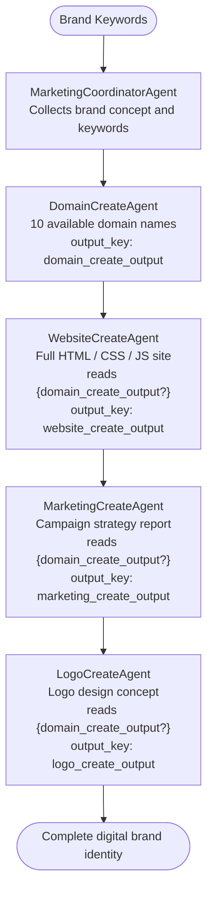

**Key state variables**

| Key | Written by | Read by |
|---|---|---|
| `domain_create_output` | DomainCreateAgent | WebsiteCreateAgent, MarketingCreateAgent, LogoCreateAgent |
| `website_create_output` | WebsiteCreateAgent | — |
| `marketing_create_output` | MarketingCreateAgent | — |
| `logo_create_output` | LogoCreateAgent | — |

**ADK features used**
- `type: sequential` with five agents
- **Fan-out state reading** — one state key (`domain_create_output`) is read by three separate downstream agents
- `{variable?}` optional injection — graceful handling if domain step produced no output

---

## 16. Short Movie Agent

**Source:** ADK Python — `short-movie-agents`

**What it demonstrates:** A linear five-agent creative pipeline where each agent transforms the previous output into a new representation — from concept to story to screenplay to storyboard to video production notes. Each transformation step reads the accumulated creative assets from state.

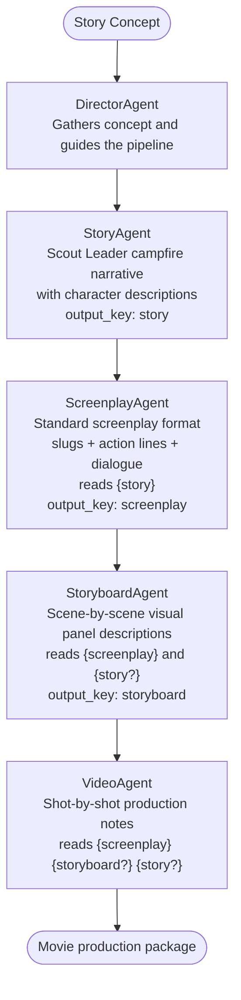

**Key state variables**

| Key | Written by | Read by |
|---|---|---|
| `story` | StoryAgent | ScreenplayAgent, StoryboardAgent, VideoAgent |
| `screenplay` | ScreenplayAgent | StoryboardAgent, VideoAgent |
| `storyboard` | StoryboardAgent | VideoAgent |

**ADK features used**
- `type: sequential` with five agents
- **Accumulating context** — VideoAgent reads three separate upstream state keys simultaneously
- `{variable?}` optional injection — later agents degrade gracefully if an earlier step produced no output
- Sequential creative transformation — each agent produces a distinct artifact format from the same underlying narrative

---

## 17. Context Control

**Source:** ADK Python — `deep-search` (report_composer)

**What it demonstrates:** An agent with `include_contents="none"` receives no conversation history — it operates only on explicitly injected state via `{variable}` placeholders. This isolates the agent from irrelevant prior context, reduces token cost, prevents hallucination from stale conversation history, and forces deterministic behaviour based solely on provided data.

**Key state variables**

| Key | Written by | Read by |
|---|---|---|
| `research_plan` | PlannerAgent | ResearcherAgent, ComposerAgent |
| `findings` | ResearcherAgent | ComposerAgent |
| `final_report` | ComposerAgent | — |

**ADK features used**
- `include_contents: none` — ComposerAgent receives NO conversation history
- `{variable}` injection — all context is explicitly provided via state keys
- **Cost efficiency** — no need to send long conversation history to the LLM
- **Focus** — agent works only with explicitly provided data
- **Determinism** — reduces hallucination from irrelevant conversation context

---

## 18. Customer Support Triage

**Source:** ADK samples — `workflow-concurrent_research_writer` (conditional routing simplified)

**What it demonstrates:** An evaluator classifies incoming messages and routes to the matching specialist branch. Only one branch executes per request. A wildcard (`*`) fallback catches any unclassified messages.

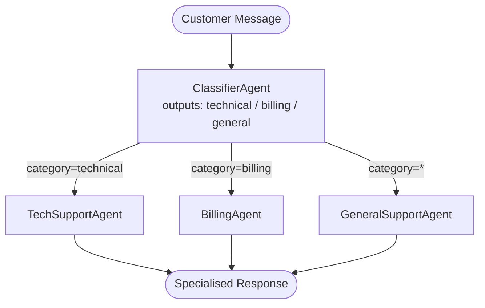

**Key state variables**

| Key | Written by | Read by |
|---|---|---|
| `category` | ClassifierAgent | Conditional routing node |

**ADK features used**
- `type: conditional` workflow node
- `condition` on branch agents — only matching branch executes
- Wildcard (`*`) fallback for unclassified messages

---

## Workflow Type Reference

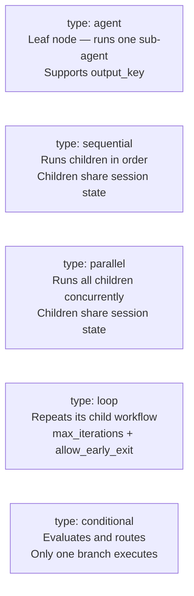

### State injection syntax

| Syntax | Behaviour |
|---|---|
| `{key}` | Required — errors if key is absent from session state |
| `{key?}` | Optional — substitutes empty string if key is absent |

### Loop exit modes

| Setting | Behaviour |
|---|---|
| `allow_early_exit: false` | Loop always runs exactly `max_iterations` times |
| `allow_early_exit: true` | Last agent in the loop body receives the `exit_loop` tool; calling it stops the loop before `max_iterations` is reached |
