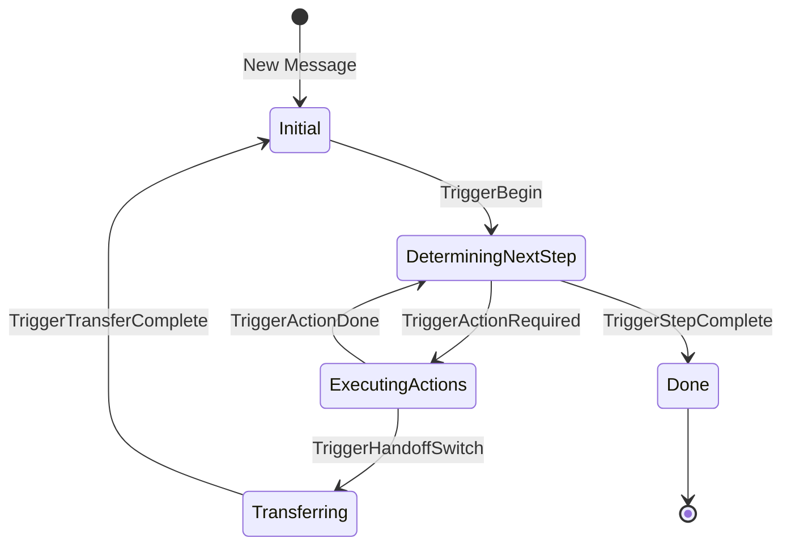
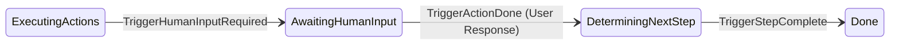

# Engine State Machine

The Engine follows a cyclical state machine designed for multi-agent collaboration and human-in-the-loop interaction.

## 1. Core Execution Cycle
Represents the standard autonomous loop and agent-to-agent transfers.

## 2. Human-in-the-Loop Lifecycle (Factor 7)
Shows how the "Wait" state is treated as just another tool execution.

> [!NOTE]
> When a user provides input, the Engine is re-started. `inferState` identifies the pending request and puts the engine into `AwaitingHumanInput`, which then immediately consumes the user's message as a tool result via `TriggerActionDone`.
