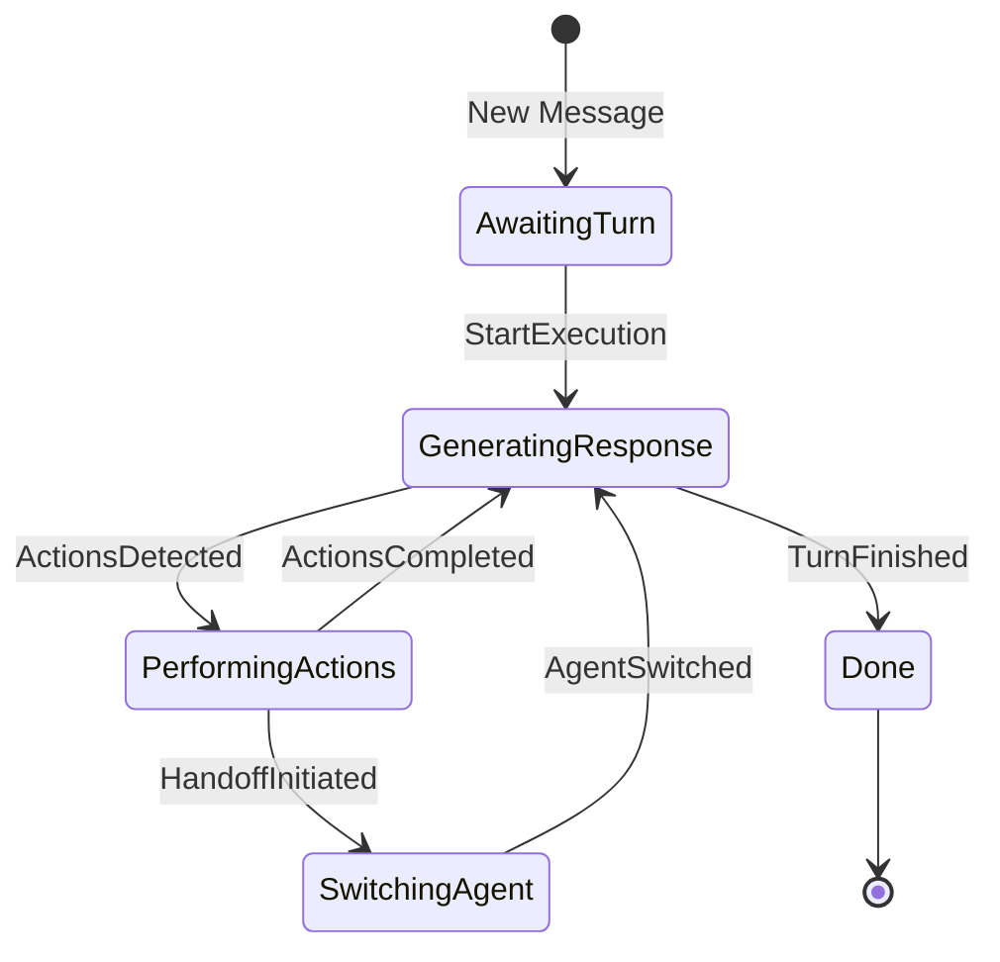
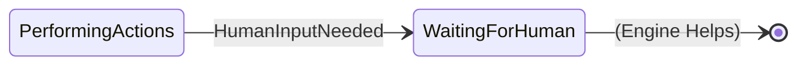

# Engine State Machine

The Engine follows a cyclical state machine designed for multi-agent collaboration and human-in-the-loop interaction.

## 1. Core Execution Cycle
Represents the standard autonomous loop and agent-to-agent transfers.

## 2. Human-in-the-Loop Lifecycle
Shows how the "Wait" state is used to persist an elicitation request.

> [!NOTE]
> When a user provides input, the Engine is re-started with the new message history. `inferState` identifies that the previous elicitation has been answered, and the engine resumes (typically determining the next step based on the provided input).
